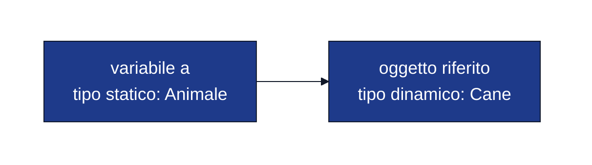
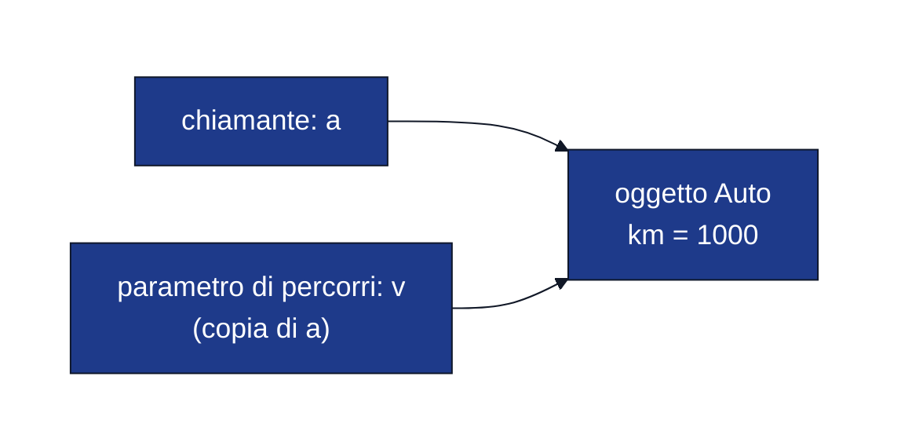
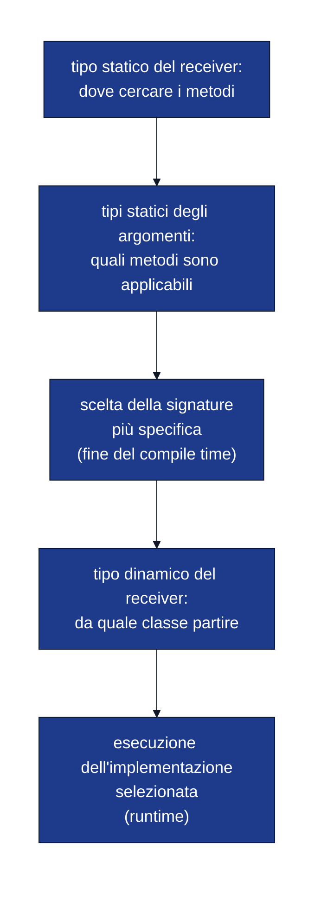
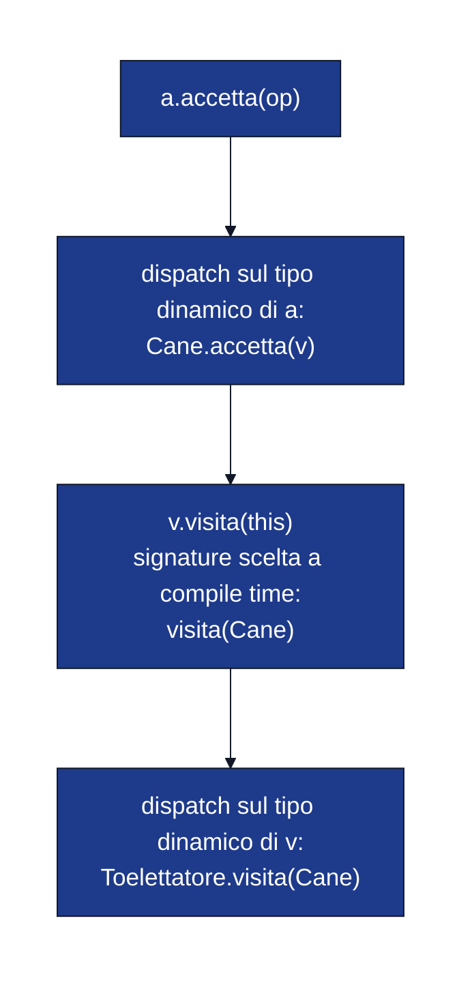

# Java: ereditarietà, polimorfismo e passaggio dei parametri

Argomenti:

- Tipo statico e tipo dinamico  
- Passaggio dei parametri  
- Overriding  
- Overloading  
- Combinazione di overloading e overriding  
- Quando un metodo di una subclass fa overloading e quando fa overriding  
- `toString()`  
- Operatore `==`  
- `equals()` e `hashCode()`  

Ogni esempio numerato è un file `Main.java` completo, da salvare in una directory separata ed eseguire con `javac Main.java` seguito da `java Main`. Gli esempi usano Java 21.

## Tipo statico e tipo dinamico

Tutto il comportamento descritto in seguito dipende dalla distinzione tra due tipi.

- **Tipo statico**: il tipo di un'espressione ricavato dal codice sorgente, per esempio dalla dichiarazione di una variabile. È noto al compiler e non cambia durante l'esecuzione.  
- **Tipo dinamico**: la classe dell'oggetto effettivamente riferito durante l'esecuzione. Un oggetto non cambia mai classe, ma la stessa variabile può riferire in momenti diversi oggetti di classi diverse.  

Si scrive $S <: T$ per indicare che $S$ è un subtype di $T$. La relazione tra tipi reference è riflessiva ($T <: T$) e transitiva:

$$S <: T \;\land\; T <: U \implies S <: U$$

Detti $\mathrm{st}(v)$ il tipo statico di una variabile reference $v$ e $\mathrm{dyn}(v)$ la classe dell'oggetto riferito, in un programma compilato in modo coerente, per ogni $v \neq \texttt{null}$ vale:

$$\mathrm{dyn}(v) <: \mathrm{st}(v)$$

Diagramma: tipo statico e tipo dinamico in `Animale a = new Cane();`



Il tipo statico stabilisce **che cosa si può chiedere** a un'espressione, cioè quali metodi e campi sono utilizzabili. Il tipo dinamico stabilisce **quale implementazione risponde** quando si invoca un instance method soggetto a overriding.

### Esempio 1: i due tipi

```java
class Animale {
    String verso() { return "..."; }
}
class Cane extends Animale {
    @Override
    String verso() { return "Bau"; }
    String scodinzola() { return "scodinzolo"; }
}

public class Main {
    public static void main(String[] args) {
        Animale a = new Cane();     // tipo statico: Animale; tipo dinamico: Cane
        System.out.println(a.verso());
        System.out.println(a.getClass().getSimpleName());

        // a.scodinzola();          // non compila: Animale non ha scodinzola()
        if (a instanceof Cane c) {  // controllo a runtime e nuova variabile di tipo Cane
            System.out.println(c.scodinzola());
        }
    }
}
```

Output:

```text
Bau
Cane
scodinzolo
```

Il cast di una reference non trasforma l'oggetto: cambia soltanto il tipo statico dell'espressione. L'upcast (da `Cane` ad `Animale`) è sempre valido; il downcast (da `Animale` a `Cane`) è controllato a runtime e, se l'oggetto non è compatibile, genera `ClassCastException`.

## Passaggio dei parametri

In Java il passaggio dei parametri è sempre **pass by value** ([JLS §8.4.1, Formal Parameters: https://docs.oracle.com/javase/specs/jls/se21/html/jls-8.html#jls-8.4.1](https://docs.oracle.com/javase/specs/jls/se21/html/jls-8.html#jls-8.4.1)): ogni parametro è una nuova variabile locale, inizializzata con una copia del valore dell'argomento.

- Con un tipo primitivo viene copiato il valore, per esempio il numero `5`.  
- Con un tipo reference viene copiata la reference. L'oggetto non viene copiato: chiamante e metodo chiamato dispongono di due variabili distinte che riferiscono lo stesso oggetto.  

Ne derivano due comportamenti diversi:

- **modificare l'oggetto** tramite il parametro produce un effetto visibile al chiamante;  
- **riassegnare il parametro** cambia solo la variabile locale.  

Diagramma: stato all'ingresso di `percorri(a)`



### Esempio 2: modifica e riassegnazione

```java
class Veicolo {
    int km;
    Veicolo(int km) { this.km = km; }
}
class Auto extends Veicolo {
    Auto(int km) { super(km); }
}

public class Main {
    static void incrementa(int n)      { n++; }
    static void percorri(Veicolo v)    { v.km += 100; }           // modifica l'oggetto
    static void sostituisci(Veicolo v) { v = new Veicolo(0); }    // riassegna la copia
    static void scambia(Veicolo x, Veicolo y) {
        Veicolo t = x; x = y; y = t;                              // scambia le copie
    }

    public static void main(String[] args) {
        int n = 5;
        incrementa(n);
        System.out.println("n = " + n);

        Auto a = new Auto(1000);
        Auto b = new Auto(2000);

        percorri(a);
        System.out.println("dopo percorri:    a.km = " + a.km);

        sostituisci(a);
        System.out.println("dopo sostituisci: a.km = " + a.km);

        scambia(a, b);
        System.out.println("dopo scambia:     a.km = " + a.km + ", b.km = " + b.km);
    }
}
```

Output:

```text
n = 5
dopo percorri:    a.km = 1100
dopo sostituisci: a.km = 1100
dopo scambia:     a.km = 1100, b.km = 2000
```

Il metodo `scambia` non può scambiare le variabili del chiamante: scambia soltanto le proprie copie. Il fatto che siano copiate delle reference non rende il meccanismo un pass by reference.

### Esempio 3: passaggio di un oggetto di una subclass

Dove è richiesto un parametro di tipo `Veicolo` si può passare un'espressione di tipo `Auto` o `Moto`, perché $\texttt{Auto} <: \texttt{Veicolo}$ e $\texttt{Moto} <: \texttt{Veicolo}$. L'upcast è implicito.

```java
class Veicolo {
    String descrivi() { return "veicolo"; }
}
class Auto extends Veicolo {
    @Override String descrivi() { return "auto"; }
    int porte() { return 5; }
}
class Moto extends Veicolo {
    @Override String descrivi() { return "moto"; }
}

public class Main {
    // un solo metodo, valido per Veicolo e per ogni sua sottoclasse
    static void stampa(Veicolo v) {
        System.out.println(v.descrivi() + " (classe " + v.getClass().getSimpleName() + ")");
        // v.porte();   // non compila: il tipo statico di v e' Veicolo
    }

    public static void main(String[] args) {
        stampa(new Veicolo());
        stampa(new Auto());
        stampa(new Moto());
    }
}
```

Output:

```text
veicolo (classe Veicolo)
auto (classe Auto)
moto (classe Moto)
```

All'interno di `stampa`:

- il tipo statico di `v` è `Veicolo`, quindi sono utilizzabili solo i membri disponibili in `Veicolo`;  
- il tipo dinamico resta quello dell'oggetto passato, perché il passaggio copia la reference e non converte l'oggetto;  
- `v.descrivi()` esegue l'implementazione determinata dal tipo dinamico.  

Questo è il **polimorfismo per subtyping**: lo stesso codice opera su oggetti di classi diverse e ciascuno risponde con il proprio comportamento.

## Overriding

Un instance method dichiarato in una classe $D$ fa **overriding** di un metodo di una superclass $B$ ([JLS §8.4.8, Inheritance, Overriding, and Hiding: https://docs.oracle.com/javase/specs/jls/se21/html/jls-8.html#jls-8.4.8](https://docs.oracle.com/javase/specs/jls/se21/html/jls-8.html#jls-8.4.8)) quando valgono tutte le condizioni seguenti:

- $D <: B$ e $D \neq B$;  
- i due metodi hanno lo stesso nome;  
- hanno lo stesso numero di parametri e, posizione per posizione, gli stessi tipi, dopo l'eventuale sostituzione dei type parameter della superclass (è ammesso anche il caso in cui il metodo di $D$ usa la erasure della signature di $B$);  
- il metodo di $B$ è accessibile ai fini dell'overriding: non è `private` e, se è package-private, $D$ appartiene allo stesso package;  
- nessuno dei due è `static`.  

La **signature** di un metodo comprende nome, eventuali type parameter e lista ordinata dei tipi dei parametri ([JLS §8.4.2, Method Signature: https://docs.oracle.com/javase/specs/jls/se21/html/jls-8.html#jls-8.4.2](https://docs.oracle.com/javase/specs/jls/se21/html/jls-8.html#jls-8.4.2)). Non comprende il tipo di ritorno, i nomi dei parametri, i modificatori e la clausola `throws`.

Soddisfatte le condizioni precedenti, la dichiarazione deve rispettare anche questi vincoli, altrimenti la compilazione fallisce:

- il metodo ereditato non deve essere `final`;  
- il tipo di ritorno deve essere compatibile: identico per i primitivi e `void`; per i tipi reference può essere un subtype (**covariant return type**);  
- l'accesso non può essere più restrittivo;  
- non si possono aggiungere checked exception più ampie di quelle dichiarate dal metodo ereditato.  

L'annotazione `@Override` non crea l'overriding: chiede al compiler di verificare che la dichiarazione implementi o ridefinisca un metodo di un supertype. In caso contrario si ottiene un errore. Va usata sempre.

### Esempio 4: overriding, covariant return e `super`

```java
import java.io.FileNotFoundException;
import java.io.IOException;

class Animale {
    protected Animale genera() throws IOException { return new Animale(); }
    String mangia(String cibo) { return "Animale mangia " + cibo; }
}
class Gatto extends Animale {
    @Override   // accesso piu' ampio, ritorno covariante, eccezione piu' specifica
    public Gatto genera() throws FileNotFoundException { return new Gatto(); }

    @Override   // il nome del parametro e' irrilevante
    String mangia(String pietanza) {
        return "Gatto mangia " + pietanza + " | super: " + super.mangia(pietanza);
    }
}

public class Main {
    public static void main(String[] args) throws IOException {
        Animale a = new Gatto();
        System.out.println(a.genera().getClass().getSimpleName());
        System.out.println(a.mangia("pesce"));
    }
}
```

Output:

```text
Gatto
Gatto mangia pesce | super: Animale mangia pesce
```

L'invocazione `super.mangia(pietanza)` richiama l'implementazione della superclass senza dynamic dispatch.

## Overloading

Si ha **overloading** quando in una classe sono disponibili, perché dichiarati o ereditati, più metodi con lo stesso nome e signature che non si sostituiscono a vicenda: cambiano il numero, il tipo o l'ordine dei parametri ([JLS §8.4.9, Overloading: https://docs.oracle.com/javase/specs/jls/se21/html/jls-8.html#jls-8.4.9](https://docs.oracle.com/javase/specs/jls/se21/html/jls-8.html#jls-8.4.9)).

La scelta della signature da invocare avviene **a compile time**, in base al **tipo statico** degli argomenti. Il tipo dinamico degli argomenti non partecipa alla scelta.

### Esempio 5: il tipo statico decide l'overload

```java
class Animale { }
class Cane extends Animale { }
class Gatto extends Animale { }

class Veterinario {
    String visita(Animale a) { return "visita generica"; }
    String visita(Cane c)    { return "visita per cani"; }
    String visita(Gatto g)   { return "visita per gatti"; }
}

public class Main {
    public static void main(String[] args) {
        Veterinario vet = new Veterinario();

        Cane c = new Cane();
        Animale a = new Cane();   // stesso tipo dinamico di c

        System.out.println(vet.visita(c));
        System.out.println(vet.visita(a));
        System.out.println(vet.visita((Cane) a));        // il cast cambia il tipo statico
        System.out.println(vet.visita((Animale) c));

        Animale[] pazienti = { new Cane(), new Gatto() };
        for (Animale p : pazienti) {
            System.out.println(p.getClass().getSimpleName() + ": " + vet.visita(p));
        }
    }
}
```

Output:

```text
visita per cani
visita generica
visita per cani
visita generica
Cane: visita generica
Gatto: visita generica
```

Nel ciclo, l'espressione `p` ha tipo statico `Animale`: il compiler sceglie `visita(Animale)` per tutte le iterazioni, anche se a runtime gli oggetti sono un `Cane` e un `Gatto`.

Il cast `(Cane) a` modifica il tipo statico dell'argomento e quindi l'overload scelto. Un cast inserito solo per selezionare l'overload resta soggetto al controllo a runtime.

### Come il compiler sceglie la signature

La procedura è definita in [JLS §15.12.2, Determine Method Signature: https://docs.oracle.com/javase/specs/jls/se21/html/jls-15.html#jls-15.12.2](https://docs.oracle.com/javase/specs/jls/se21/html/jls-15.html#jls-15.12.2). Per prima cosa il compiler stabilisce, dal tipo statico del **receiver** (l'espressione a sinistra del punto), in quale classe o interface cercare i metodi. Poi procede per fasi e si ferma alla prima che trova almeno un metodo applicabile.

| Fase | Conversioni ammesse sugli argomenti | Varargs |
|:----:|:------------------------------------|:-------:|
| 1 | identità, widening primitive, widening reference (upcast) | no |
| 2 | le precedenti, più boxing e unboxing | no |
| 3 | come la fase 2 | sì |

Per i casi senza boxing, varargs, generics e lambda, la regola si formalizza così. Siano $A_1, \dots, A_n$ i tipi statici degli argomenti. Un metodo $m(P_1, \dots, P_n)$ è **applicabile** se:

$$\forall i \in \{1, \dots, n\} \quad A_i <: P_i$$

Dati $m_1(P_1, \dots, P_n)$ e $m_2(Q_1, \dots, Q_n)$, $m_1$ è **almeno tanto specifico** quanto $m_2$ se:

$$\forall i \in \{1, \dots, n\} \quad P_i <: Q_i$$

Detto $C$ l'insieme dei metodi applicabili, con signature distinte, il compiler sceglie $m^* \in C$ tale che:

$$\forall m \in C \quad m^* \text{ è almeno tanto specifico quanto } m$$

Se $C$ è vuoto non esiste un metodo utilizzabile. Se $C$ non è vuoto ma un tale $m^*$ non esiste, l'invocazione è **ambigua**. In entrambi i casi si ha un errore di compilazione. Per i tipi primitivi la relazione di subtyping segue le catene `byte <: short <: int <: long <: float <: double` e `char <: int` ([JLS §4.10.1, Subtyping among Primitive Types: https://docs.oracle.com/javase/specs/jls/se21/html/jls-4.html#jls-4.10.1](https://docs.oracle.com/javase/specs/jls/se21/html/jls-4.html#jls-4.10.1)).

### Esempio 6: widening, boxing, varargs e `null`

```java
public class Main {
    static String a(long x)      { return "long"; }
    static String a(Integer x)   { return "Integer"; }
    static String a(int... x)    { return "int..."; }

    static String b(Integer x)   { return "Integer"; }
    static String b(int... x)    { return "int..."; }

    static String c(int x)       { return "int"; }
    static String c(char x)      { return "char"; }

    static String d(Object x)    { return "Object"; }
    static String d(long x)      { return "long"; }

    static String e(Object x)    { return "Object"; }
    static String e(String x)    { return "String"; }

    public static void main(String[] args) {
        int i = 7;
        Integer boxed = 7;
        System.out.println("a(i)     -> " + a(i));
        System.out.println("a(boxed) -> " + a(boxed));
        System.out.println("b(i)     -> " + b(i));
        System.out.println("c('x')   -> " + c('x'));
        System.out.println("c(120)   -> " + c(120));
        System.out.println("d(i)     -> " + d(i));
        System.out.println("d(boxed) -> " + d(boxed));
        System.out.println("e(null)  -> " + e(null));
        Object o = "ciao";
        System.out.println("e(o)     -> " + e(o));
    }
}
```

Output:

```text
a(i)     -> long
a(boxed) -> Integer
b(i)     -> Integer
c('x')   -> char
c(120)   -> int
d(i)     -> long
d(boxed) -> Object
e(null)  -> String
e(o)     -> Object
```

Punti da osservare:

- `a(i)`: il widening da `int` a `long` (fase 1) prevale sul boxing in `Integer` (fase 2).  
- `b(i)`: il boxing (fase 2) prevale sui varargs (fase 3).  
- `d(boxed)`: in fase 1 `Integer` è compatibile con `Object`; non lo è con `long`, che richiederebbe unboxing.  
- `e(null)`: sono applicabili entrambi i metodi e `String` è più specifico di `Object`.  
- `e(o)`: l'oggetto è una `String`, ma il tipo statico è `Object`.  

### Ambiguità

Il frammento seguente **non compila**. Ciascun metodo è più specifico dell'altro in un solo parametro:

```java
static void gioca(Animale a, Cane c) { }
static void gioca(Cane c, Animale a) { }

gioca(new Cane(), new Cane());   // error: reference to gioca is ambiguous
```

Anche `null` può produrre ambiguità, se i tipi candidati non sono in relazione di subtyping:

```java
static void f(String s) { }
static void f(Integer i) { }

f(null);                         // error: reference to f is ambiguous
```

Il solo tipo di ritorno non distingue due metodi:

```java
static int area()    { return 1; }
static double area() { return 1.0; }   // error: method area() is already defined
```

## Combinazione di overloading e overriding

Un'invocazione di un instance method viene risolta in due momenti distinti.

- **Compile time**: in base al tipo statico del receiver e ai tipi statici degli argomenti, il compiler sceglie una signature (risoluzione dell'overloading).  
- **Runtime**: la JVM parte dalla classe dinamica del receiver e seleziona l'implementazione che fa overriding del metodo scelto; se non ce n'è una in quella classe, usa quella ereditata (**dynamic dispatch**, [JLS §15.12.4, Runtime Evaluation of Method Invocation: https://docs.oracle.com/javase/specs/jls/se21/html/jls-15.html#jls-15.12.4](https://docs.oracle.com/javase/specs/jls/se21/html/jls-15.html#jls-15.12.4)).  

Il dynamic dispatch di Java è quindi un **single dispatch**: a runtime conta il tipo dinamico del solo receiver. La signature, compresi i tipi dei parametri, resta quella fissata in compilazione.

Diagramma: risoluzione di `receiver.metodo(argomento)` per un instance method non `private`



### Esempio 7: le due fasi insieme

```java
class Animale { }
class Cane extends Animale { }

class Veterinario {
    String visita(Animale a) { return "Veterinario.visita(Animale)"; }
    String visita(Cane c)    { return "Veterinario.visita(Cane)"; }
}
class Specialista extends Veterinario {
    @Override String visita(Animale a) { return "Specialista.visita(Animale)"; }
    @Override String visita(Cane c)    { return "Specialista.visita(Cane)"; }
}

public class Main {
    public static void main(String[] args) {
        Veterinario[] medici = { new Veterinario(), new Specialista() };
        Animale a = new Cane();
        Cane c = new Cane();

        for (Veterinario v : medici) {
            System.out.println(v.visita(a));
            System.out.println(v.visita(c));
        }
    }
}
```

Output:

```text
Veterinario.visita(Animale)
Veterinario.visita(Cane)
Specialista.visita(Animale)
Specialista.visita(Cane)
```

L'output si ricava applicando le due fasi:

| Receiver (tipo dinamico) | Argomento (tipo statico) | Signature, a compile time | Implementazione, a runtime |
|:--|:--|:--|:--|
| `Veterinario` | `Animale` | `visita(Animale)` | `Veterinario` |
| `Veterinario` | `Cane` | `visita(Cane)` | `Veterinario` |
| `Specialista` | `Animale` | `visita(Animale)` | `Specialista` |
| `Specialista` | `Cane` | `visita(Cane)` | `Specialista` |

## Overloading o overriding in una subclass

Per un instance method ereditato, la presenza dello stesso nome non basta: decide la lista dei tipi dei parametri.

### Parametro più specifico: overloading

La subclass `Allevatore` dichiara `nutri(Cane)`, mentre la superclass dichiara `nutri(Animale)`. I tipi sono diversi, quindi `Allevatore` possiede **due** metodi `nutri`: quello ereditato e quello nuovo.

### Esempio 8: falso overriding

```java
class Animale { }
class Cane extends Animale { }

class Padrone {
    String nutri(Animale a) { return "Padrone.nutri(Animale)"; }
}
class Allevatore extends Padrone {
    // parametro piu' specifico: NON e' overriding, e' overloading
    String nutri(Cane c) { return "Allevatore.nutri(Cane)"; }
}

public class Main {
    public static void main(String[] args) {
        Padrone p     = new Allevatore();
        Allevatore al = new Allevatore();
        Cane c        = new Cane();
        Animale a     = new Cane();

        System.out.println("1) " + p.nutri(c));
        System.out.println("2) " + p.nutri(a));
        System.out.println("3) " + al.nutri(c));
        System.out.println("4) " + al.nutri(a));
    }
}
```

Output:

```text
1) Padrone.nutri(Animale)
2) Padrone.nutri(Animale)
3) Allevatore.nutri(Cane)
4) Padrone.nutri(Animale)
```

Analisi delle quattro invocazioni:

- Caso 1: il receiver ha tipo statico `Padrone`, che conosce solo `nutri(Animale)`. L'oggetto è un `Allevatore` e l'argomento è un `Cane`, ma `nutri(Cane)` non è tra i candidati. A runtime `Allevatore` non ha un overriding di `nutri(Animale)`.  
- Caso 2: stessa signature e stessa implementazione del caso 1.  
- Caso 3: il receiver ha tipo statico `Allevatore`, entrambi i metodi sono applicabili e `nutri(Cane)` è il più specifico.  
- Caso 4: l'argomento ha tipo statico `Animale`, quindi è applicabile solo `nutri(Animale)`.  

La scelta fatta dal compiler è registrata nel bytecode. Il comando `javap -c Main` mostra per le quattro invocazioni, nell'ordine, questi riferimenti (estratto):

```text
invokevirtual  // Method Padrone.nutri:(LAnimale;)Ljava/lang/String;
invokevirtual  // Method Padrone.nutri:(LAnimale;)Ljava/lang/String;
invokevirtual  // Method Allevatore.nutri:(LCane;)Ljava/lang/String;
invokevirtual  // Method Allevatore.nutri:(LAnimale;)Ljava/lang/String;
```

Aggiungendo `@Override` a `nutri(Cane)` l'errore viene segnalato in compilazione:

```java
class Allevatore extends Padrone {
    @Override void nutri(Cane c) { }
    // error: method does not override or implement a method from a supertype
}
```

Java non ammette quindi la specializzazione del tipo di un parametro tramite overriding. Il motivo è la sostituibilità: attraverso una reference di tipo `Padrone` deve restare lecito passare qualsiasi `Animale`, mentre un metodo che accetta solo `Cane` restringerebbe gli argomenti ammessi.

### Parametro più generico: ancora overloading

Accettare un tipo più ampio non metterebbe a rischio la sostituibilità, ma Java non prevede parametri controvarianti nell'overriding. Anche in questo caso si ottiene overloading.

### Esempio 9: un metodo ereditato può vincere

```java
class Animale { }
class Cane extends Animale { }

class Padrone {
    String cura(Cane c) { return "Padrone.cura(Cane)"; }
}
class Rifugio extends Padrone {
    // parametro piu' generico: ancora overloading
    String cura(Animale a) { return "Rifugio.cura(Animale)"; }
}

public class Main {
    public static void main(String[] args) {
        Rifugio r = new Rifugio();
        Cane c = new Cane();
        Animale a = new Cane();

        System.out.println(r.cura(c));   // vince il metodo EREDITATO, piu' specifico
        System.out.println(r.cura(a));
    }
}
```

Output:

```text
Padrone.cura(Cane)
Rifugio.cura(Animale)
```

La prima invocazione sceglie `cura(Cane)`, ereditato: la dichiarazione in una subclass non assegna di per sé una priorità. Tra i metodi applicabili vince il più specifico.

### Metodi presenti solo nella subclass

Il frammento seguente **non compila**: il compiler cerca `visita` a partire da `Veterinario`, tipo statico del receiver.

```java
class Veterinario { }
class Specialista extends Veterinario { void visita(Cane c) { } }

Veterinario v = new Specialista();
v.visita(new Cane());            // error: cannot find symbol
```

### Il caso dei generics: overriding con un tipo che sembra diverso

Se la superclass è generica, il confronto avviene dopo la sostituzione del type parameter. `Trasportino<T>.inserisci(T)`, visto da una classe che estende `Trasportino<Cane>`, ha parametro `Cane`.

### Esempio 10: overriding di un metodo generico

```java
class Trasportino<T> {
    String inserisci(T x) { return "Trasportino.inserisci"; }
}
class Animale { }
class Cane extends Animale { }

class TrasportinoCane extends Trasportino<Cane> {
    @Override   // T = Cane: e' overriding
    String inserisci(Cane c) { return "TrasportinoCane.inserisci"; }
}

public class Main {
    public static void main(String[] args) {
        Trasportino<Cane> t = new TrasportinoCane();
        System.out.println(t.inserisci(new Cane()));
    }
}
```

Output:

```text
TrasportinoCane.inserisci
```

A causa della type erasure, il metodo della superclass nel bytecode ha parametro `Object`. Il compiler genera in `TrasportinoCane` un **bridge method** `inserisci(Object)` che delega a `inserisci(Cane)`, conservando il dynamic dispatch ([Java Tutorials, Bridge Methods: https://docs.oracle.com/javase/tutorial/java/generics/bridgeMethods.html](https://docs.oracle.com/javase/tutorial/java/generics/bridgeMethods.html)).

### Campi, metodi `static` e metodi `private`

Il dynamic dispatch non riguarda tutti i membri.

- Un **campo** con lo stesso nome in una subclass produce **field hiding**: il campo scelto dipende dal tipo statico.  
- Un **metodo `static`** con la stessa signature produce **method hiding**: la scelta avviene a compile time.  
- Un **metodo `private`** non è soggetto a overriding: nella subclass un metodo con lo stesso nome è un metodo indipendente.  

### Esempio 11: membri senza overriding

```java
class Figura {
    String nome = "figura";
    static String categoria()   { return "Figura.categoria"; }
    private String segreto()    { return "Figura.segreto"; }
    String rivela()             { return segreto(); }
}
class Cerchio extends Figura {
    String nome = "cerchio";                                      // field hiding
    static String categoria()   { return "Cerchio.categoria"; }   // method hiding
    String segreto()            { return "Cerchio.segreto"; }     // metodo nuovo
}

public class Main {
    static String leggi(Figura f)  { return f.nome; }

    @SuppressWarnings("static-access")
    public static void main(String[] args) {
        Figura f = new Cerchio();
        System.out.println(f.nome);
        System.out.println(((Cerchio) f).nome);
        System.out.println(leggi(new Cerchio()));
        System.out.println(f.categoria());        // sconsigliato: meglio Figura.categoria()
        System.out.println(f.rivela());
    }
}
```

Output:

```text
figura
cerchio
figura
Figura.categoria
Figura.segreto
```

Con l'opzione `-Xlint:all` il compiler segnala che `f.categoria()` dovrebbe essere scritto `Figura.categoria()`.

### Quadro riassuntivo

| Dichiarazione nella subclass, rispetto al metodo della superclass | Risultato |
|:--|:--|
| stessi nome e parametri, instance method | overriding |
| come sopra, ritorno reference più specifico | overriding (covariant return) |
| stessi nome e parametri, ritorno incompatibile | errore di compilazione |
| stesso nome, parametro più specifico | overloading |
| stesso nome, parametro più generico | overloading |
| stesso nome, diverso numero o ordine di tipi dei parametri | overloading |
| parametro ottenuto sostituendo il type parameter della superclass | overriding |
| `int` al posto di `Integer`, o viceversa | overloading |
| cambiano solo i nomi dei parametri | overriding |
| entrambi `static`, stessi parametri | hiding |
| uno `static` e uno di istanza, stessi parametri | errore di compilazione |
| metodo della superclass `private` | metodo indipendente |
| metodo della superclass `final`, stessi parametri | errore di compilazione |

## Passaggio di `this` come argomento

`this` è un'espressione il cui tipo statico è determinato dalla classe che **contiene il codice**. Se un metodo è ereditato, il suo codice è stato compilato nella superclass, e lì è stato scelto l'overload, anche quando a runtime `this` riferisce un oggetto di una subclass.

### Esempio 12: `this` e overloading

```java
class Figura {
    String presentati() { return Registro.registra(this); }   // tipo statico di this: Figura
}
class Cerchio extends Figura { }

class Quadrato extends Figura {
    @Override
    String presentati() { return Registro.registra(this); }   // tipo statico di this: Quadrato
}

class Registro {
    static String registra(Figura f)   { return "registra(Figura)"; }
    static String registra(Cerchio c)  { return "registra(Cerchio)"; }
    static String registra(Quadrato q) { return "registra(Quadrato)"; }
}

public class Main {
    public static void main(String[] args) {
        System.out.println(new Cerchio().presentati());
        System.out.println(new Quadrato().presentati());
    }
}
```

Output:

```text
registra(Figura)
registra(Quadrato)
```

`Cerchio` eredita `presentati()`, compilato con `this` di tipo `Figura`. `Quadrato` fa overriding del metodo: il testo dell'istruzione è identico, ma `this` ha tipo statico `Quadrato`.

## Selezione in base a due tipi dinamici

Quando il comportamento deve dipendere dal tipo dinamico sia del receiver sia dell'argomento, l'overloading da solo non è sufficiente.

### Esempio 13: double dispatch con il pattern Visitor

La tecnica combina due dynamic dispatch successivi:

- `a.accetta(op)` seleziona l'implementazione in base al tipo dinamico dell'animale;  
- dentro quella implementazione, `this` ha un tipo statico preciso, quindi il compiler sceglie l'overload corretto di `visita`;  
- `v.visita(this)` seleziona a runtime l'implementazione in base al tipo dinamico dell'operatore.  

```java
interface Visitatore {
    String visita(Cane c);
    String visita(Gatto g);
}
abstract class Animale {
    abstract String accetta(Visitatore v);
}
class Cane extends Animale {
    @Override String accetta(Visitatore v) { return v.visita(this); }  // this: Cane
}
class Gatto extends Animale {
    @Override String accetta(Visitatore v) { return v.visita(this); }  // this: Gatto
}
class Veterinario implements Visitatore {
    @Override public String visita(Cane c)  { return "vaccino per cani"; }
    @Override public String visita(Gatto g) { return "vaccino per gatti"; }
}
class Toelettatore implements Visitatore {
    @Override public String visita(Cane c)  { return "bagno al cane"; }
    @Override public String visita(Gatto g) { return "spazzolata al gatto"; }
}

public class Main {
    public static void main(String[] args) {
        Animale[] animali = { new Cane(), new Gatto() };
        Visitatore[] operatori = { new Veterinario(), new Toelettatore() };
        for (Visitatore op : operatori) {
            for (Animale a : animali) {
                System.out.println(a.accetta(op));
            }
        }
    }
}
```

Output:

```text
vaccino per cani
vaccino per gatti
bagno al cane
spazzolata al gatto
```

Il metodo `accetta` va ripetuto in ogni classe concreta: se fosse scritto solo in `Animale`, il tipo statico di `this` sarebbe `Animale`.

Diagramma: sequenza dei due dispatch per un `Cane` e un `Toelettatore`



### Esempio 14: pattern matching per `switch`

Con una gerarchia `sealed`, uno `switch` con type pattern consente di distinguere il tipo dinamico di un argomento. Il compiler verifica che tutti i casi siano coperti ([Java Language Updates, Pattern Matching for switch: https://docs.oracle.com/en/java/javase/21/language/pattern-matching-switch.html](https://docs.oracle.com/en/java/javase/21/language/pattern-matching-switch.html)).

```java
sealed interface Figura permits Cerchio, Quadrato { }
record Cerchio(double raggio) implements Figura { }
record Quadrato(double lato) implements Figura { }

public class Main {
    static String descrivi(Figura f) {
        return switch (f) {                     // scelta in base al tipo dinamico
            case Cerchio c  -> "cerchio di raggio " + c.raggio();
            case Quadrato q -> "quadrato di lato " + q.lato();
        };
    }

    public static void main(String[] args) {
        Figura[] figure = { new Cerchio(1.0), new Quadrato(2.0) };
        for (Figura f : figure) System.out.println(descrivi(f));
    }
}
```

Output:

```text
cerchio di raggio 1.0
quadrato di lato 2.0
```

## `toString()`

La classe [`Object`: https://docs.oracle.com/en/java/javase/21/docs/api/java.base/java/lang/Object.html](https://docs.oracle.com/en/java/javase/21/docs/api/java.base/java/lang/Object.html) è la radice della gerarchia delle classi e dichiara `public String toString()`. L'implementazione ereditata restituisce il valore dell'espressione:

```java
getClass().getName() + "@" + Integer.toHexString(hashCode())
```

La parte dopo `@` è l'hash code in esadecimale: non va interpretata come indirizzo di memoria.

Per fare overriding, il metodo deve chiamarsi `toString`, non avere parametri, restituire `String` ed essere `public`. Un metodo come `toString(String prefisso)` è un overload e non viene usato da `println` o dalla concatenazione.

`System.out.println(Object)` ottiene il testo tramite `String.valueOf(obj)`, che restituisce `"null"` se la reference è `null` e altrimenti invoca `obj.toString()`. Anche la concatenazione di stringhe gestisce `null`. In tutti questi percorsi, per un oggetto non nullo, l'implementazione di `toString()` è scelta con il dynamic dispatch.

### Esempio 15: overriding e overloading di `toString`

```java
class Animale { }                       // non ridefinisce toString()

class Cane extends Animale {
    private final String nome;
    Cane(String nome) { this.nome = nome; }

    @Override
    public String toString() { return "Cane[nome=" + nome + "]"; }

    public String toString(String prefisso) {        // overloading
        return prefisso + " " + nome;
    }
}
class Cucciolo extends Cane {
    Cucciolo(String nome) { super(nome); }

    @Override
    public String toString() { return "Cucciolo -> " + super.toString(); }
}

public class Main {
    static void mostra(Object o) { System.out.println(o); }

    public static void main(String[] args) {
        Animale generico = new Animale();
        String s = generico.toString();
        System.out.println(s.matches("Animale@[0-9a-f]+"));
        System.out.println(s.equals(generico.getClass().getName() + "@"
                + Integer.toHexString(generico.hashCode())));

        Animale a = new Cane("Fido");
        mostra(a);                               // println(Object)
        System.out.println(a);                   // println(Object)
        System.out.println("Ho: " + a);          // concatenazione
        System.out.println(String.valueOf(a));
        mostra(new Cucciolo("Pluto"));
        System.out.println(((Cane) a).toString("Il mio cane:"));

        Cane nessuno = null;
        System.out.println("Ho: " + nessuno);    // nessuna eccezione
        System.out.println(String.valueOf((Object) nessuno));
        try {
            nessuno.toString();
        } catch (NullPointerException ex) {
            System.out.println("NullPointerException");
        }
    }
}
```

Output:

```text
true
true
Cane[nome=Fido]
Cane[nome=Fido]
Ho: Cane[nome=Fido]
Cane[nome=Fido]
Cucciolo -> Cane[nome=Pluto]
Il mio cane: Fido
Ho: null
null
NullPointerException
```

Le prime due righe di output confermano il formato dell'implementazione ereditata, senza dipendere dal valore numerico dell'hash code, che può cambiare tra esecuzioni.

Il frammento seguente **non compila**, perché riduce l'accesso da `public` a package-private:

```java
class Animale { public String toString() { return "a"; } }
class Cane extends Animale {
    String toString() { return "c"; }   // error: attempting to assign weaker access privileges
}
```

### Esempio 16: overload di `println` e array di `char`

`println` e `String.valueOf` sono a loro volta overloaded. Per un array di `char` esistono versioni specifiche, quindi il tipo statico dell'argomento cambia il risultato.

```java
public class Main {
    public static void main(String[] args) {
        char[] lettere = { 'c', 'a', 'n', 'e' };
        Object o = lettere;                      // stesso array, tipo statico Object

        System.out.println(lettere);                                 // println(char[])
        System.out.println(String.valueOf(o).startsWith("[C@"));     // valueOf(Object)
        System.out.println(String.valueOf(lettere));                 // valueOf(char[])
    }
}
```

Output:

```text
cane
true
cane
```

## Operatore `==`

`==` è un **operatore**, non un metodo: non si può fare né overriding né, in Java, overloading definito dal programmatore. Il suo significato dipende dai tipi statici degli operandi ([JLS §15.21, Equality Operators: https://docs.oracle.com/javase/specs/jls/se21/html/jls-15.html#jls-15.21](https://docs.oracle.com/javase/specs/jls/se21/html/jls-15.html#jls-15.21)).

| Operandi | Confronto eseguito |
|:--|:--|
| due primitivi numerici | valori numerici, dopo la numeric promotion |
| due `boolean` | valori logici |
| primitivo numerico e wrapper numerico | unboxing del wrapper, poi confronto numerico |
| due reference | identità: stesso oggetto, oppure entrambe `null` |

Per due reference $x$ e $y$, `x == y` è vero se e solo se denotano lo stesso oggetto o sono entrambe `null`. I campi dell'oggetto non vengono esaminati. L'upcast non influisce sul risultato.

Il compiler rifiuta il confronto tra reference quando i tipi statici rendono impossibile la conversione di uno nell'altro:

```java
System.out.println(new Cane() == new Gatto());
// error: incomparable types: Cane and Gatto
```

con `Cane` e `Gatto` classi non in relazione di ereditarietà tra loro.

### Esempio 17: `==` con gerarchie e parametri

```java
class Veicolo {
    final String targa;
    Veicolo(String targa) { this.targa = targa; }
}
class Auto extends Veicolo {
    Auto(String targa) { super(targa); }
}

public class Main {
    static boolean stessoOggetto(Veicolo x, Object y) { return x == y; }

    public static void main(String[] args) {
        int i = 1000, j = 1000;
        double d = 1000.0;
        System.out.println("primitivi:            " + (i == j));
        System.out.println("int e double:         " + (i == d));

        Auto a = new Auto("AB123CD");
        Auto b = new Auto("AB123CD");
        Veicolo v = a;                       // seconda reference allo stesso oggetto
        Object o = a;

        System.out.println("oggetti distinti:     " + (a == b));
        System.out.println("stesso oggetto:       " + (a == v));
        System.out.println("tipi statici diversi: " + (v == o));
        System.out.println("tramite parametri:    " + stessoOggetto(a, o));
        System.out.println("equals non ridefinito: " + a.equals(b));
    }
}
```

Output:

```text
primitivi:            true
int e double:         true
oggetti distinti:     false
stesso oggetto:       true
tipi statici diversi: true
tramite parametri:    true
equals non ridefinito: false
```

Nel metodo `stessoOggetto`, i parametri sono copie di reference: per questo `==` riconosce che indicano lo stesso oggetto, anche con tipi statici diversi.

### Esempio 18: `String`, wrapper, `NaN` e array

```java
public class Main {
    public static void main(String[] args) {
        String a = "cane";
        String b = "cane";                    // stesso literal: stesso oggetto
        String c = new String("cane");        // oggetto nuovo
        String ca = "ca";
        String d = ca + "ne";                 // concatenazione a runtime
        final String fca = "ca";
        String e = fca + "ne";                // constant expression

        System.out.println("a == b          " + (a == b));
        System.out.println("a == c          " + (a == c));
        System.out.println("a == d          " + (a == d));
        System.out.println("a == e          " + (a == e));
        System.out.println("a == d.intern() " + (a == d.intern()));
        System.out.println("a.equals(c)     " + a.equals(c));
        System.out.println("a.equals(d)     " + a.equals(d));

        Integer p = 127, q = 127;
        Integer r = 128, s = 128;
        int t = 128;
        System.out.println("127: p == q     " + (p == q));
        System.out.println("128: r == s     " + (r == s));
        System.out.println("128: r.equals   " + r.equals(s));
        System.out.println("128: r == t     " + (r == t));     // unboxing

        Long grande = 1L;
        System.out.println("grande.equals(1)  " + grande.equals(1));    // arriva un Integer
        System.out.println("grande.equals(1L) " + grande.equals(1L));

        double nan = Double.NaN;
        System.out.println("nan == nan      " + (nan == nan));

        int[] x = { 1, 2 }, y = { 1, 2 };
        System.out.println("x.equals(y)     " + x.equals(y));
        System.out.println("Arrays.equals   " + java.util.Arrays.equals(x, y));
    }
}
```

Output:

```text
a == b          true
a == c          false
a == d          false
a == e          true
a == d.intern() true
a.equals(c)     true
a.equals(d)     true
127: p == q     true
128: r == s     false
128: r.equals   true
128: r == t     true
grande.equals(1)  false
grande.equals(1L) true
nan == nan      false
x.equals(y)     false
Arrays.equals   true
```

Punti da osservare:

- I literal e le constant expression di tipo `String` con lo stesso contenuto riferiscono la stessa istanza (interning, [JLS §3.10.5, String Literals: https://docs.oracle.com/javase/specs/jls/se21/html/jls-3.html#jls-3.10.5](https://docs.oracle.com/javase/specs/jls/se21/html/jls-3.html#jls-3.10.5)). Questo non rende `==` un confronto del contenuto.  
- Per il boxing di constant expression intere tra `-128` e `127` l'identità è garantita ([JLS §5.1.7, Boxing Conversion: https://docs.oracle.com/javase/specs/jls/se21/html/jls-5.html#jls-5.1.7](https://docs.oracle.com/javase/specs/jls/se21/html/jls-5.html#jls-5.1.7)). Fuori dall'intervallo non si può fare affidamento sul risultato: il `false` ottenuto con `128` dipende dall'implementazione e dalla sua configurazione.  
- `grande.equals(1)` è `false`: il parametro è `Object`, l'`int` viene convertito in `Integer` e un `Integer` non è uguale a un `Long`.  
- `NaN == NaN` è `false`.  
- Gli array non ridefiniscono `equals`; per confrontarne il contenuto si usa `Arrays.equals`.  

Per confrontare il contenuto di due oggetti si usa `equals`, quando la classe lo definisce in questo senso.

## `equals()` e `hashCode()`

La firma del metodo ereditato da `Object` è:

```java
public boolean equals(Object obj)
```

L'implementazione di `Object` restituisce `true` solo se `this == obj`. Una classe che non fa overriding, e non eredita un'altra implementazione, confronta quindi l'identità.

### Contratto di `equals`

Sia $V$ l'insieme delle reference non `null` e si scriva $x \sim y$ quando `x.equals(y)` restituisce `true`. Il [contratto di `equals`: https://docs.oracle.com/en/java/javase/21/docs/api/java.base/java/lang/Object.html](https://docs.oracle.com/en/java/javase/21/docs/api/java.base/java/lang/Object.html) richiede:

- **Riflessività**: $\forall x \in V \quad x \sim x$  
- **Simmetria**: $\forall x, y \in V \quad x \sim y \iff y \sim x$  
- **Transitività**: $\forall x, y, z \in V \quad (x \sim y \land y \sim z) \implies x \sim z$  
- **Consistenza**: per ogni coppia $x, y \in V$, invocazioni ripetute danno lo stesso risultato, purché non cambino le informazioni usate nel confronto.  
- **Confronto con `null`**: $\forall x \in V$, `x.equals(null)` restituisce `false`.  

Le prime tre proprietà rendono $\sim$ una **relazione di equivalenza** su $V$.

### Esempio 19: l'errore classico, `equals(Punto)`

```java
import java.util.List;

class Punto {
    final int x, y;
    Punto(int x, int y) { this.x = x; this.y = y; }

    // ERRORE: parametro Punto, quindi overloading di Object.equals(Object)
    public boolean equals(Punto altro) {
        System.out.print("[equals(Punto)] ");
        return altro != null && x == altro.x && y == altro.y;
    }
}

public class Main {
    public static void main(String[] args) {
        Punto p = new Punto(1, 2);
        Punto q = new Punto(1, 2);
        Object op = p;
        Object oq = q;

        System.out.println("p.equals(q)    " + p.equals(q));
        System.out.println("p.equals(oq)   " + p.equals(oq));
        System.out.println("op.equals(q)   " + op.equals(q));
        System.out.println("op.equals(oq)  " + op.equals(oq));
        System.out.println("contains       " + List.of(p).contains(q));
        System.out.println("Objects.equals " + java.util.Objects.equals(p, q));
    }
}
```

Output:

```text
[equals(Punto)] p.equals(q)    true
p.equals(oq)   false
op.equals(q)   false
op.equals(oq)  false
contains       false
Objects.equals false
```

`equals(Punto)` è un overload di `equals(Object)`. Viene scelto solo quando il tipo statico del receiver lo rende visibile **e** l'argomento ha un tipo statico compatibile con `Punto`. In tutti gli altri casi si usa `Object.equals`, che confronta l'identità.

Nell'output, il tag `[equals(Punto)]` compare una sola volta. La riga `contains` è `false` perché `List.contains` si basa su `equals(Object)`; lo stesso vale per `Objects.equals`.

Con `@Override` l'errore sarebbe stato individuato dal compiler:

```java
class Punto {
    @Override public boolean equals(Punto p) { return true; }
    // error: method does not override or implement a method from a supertype
}
```

### Esempio 20: overriding corretto

```java
import java.util.List;
import java.util.Objects;

class Punto {
    private final int x, y;
    Punto(int x, int y) { this.x = x; this.y = y; }

    @Override
    public boolean equals(Object o) {
        if (this == o) return true;
        if (o == null || getClass() != o.getClass()) return false;
        Punto altro = (Punto) o;
        return x == altro.x && y == altro.y;
    }

    @Override
    public int hashCode() { return Objects.hash(x, y); }
}

public class Main {
    public static void main(String[] args) {
        Punto p = new Punto(1, 2);
        Punto q = new Punto(1, 2);
        Object oq = q;

        System.out.println("p == q         " + (p == q));
        System.out.println("p.equals(q)    " + p.equals(q));
        System.out.println("p.equals(oq)   " + p.equals(oq));
        System.out.println("oq.equals(p)   " + oq.equals(p));
        System.out.println("p.equals(null) " + p.equals(null));
        System.out.println("p.equals(\"x\")  " + p.equals("x"));
        System.out.println("contains       " + List.of(p).contains(q));
    }
}
```

Output:

```text
p == q         false
p.equals(q)    true
p.equals(oq)   true
oq.equals(p)   true
p.equals(null) false
p.equals("x")  false
contains       true
```

Struttura del metodo:

- `this == o` riconosce subito lo stesso oggetto;  
- `o == null` garantisce `false` per l'argomento `null` ed evita l'invocazione di un metodo su `null`;  
- `getClass() != o.getClass()` richiede la stessa classe dinamica;  
- il cast, ormai sicuro, permette di confrontare i campi significativi.  

Il parametro ha tipo statico `Object`: il controllo del tipo dinamico e il cast servono proprio perché la signature non può essere specializzata.

### Contratto di `hashCode`

Il vincolo che lega i due metodi è:

$$\forall x, y \in V \quad x \sim y \implies \mathrm{hashCode}(x) = \mathrm{hashCode}(y)$$

L'implicazione inversa non è richiesta: due oggetti diversi possono avere lo stesso hash code (collisione). Chi fa overriding di `equals` deve in generale fare overriding anche di `hashCode`, in modo coerente. I campi usati per l'hash code non devono cambiare mentre l'oggetto è usato come elemento di un `HashSet` o come chiave di una `HashMap`.

### Esempio 21: `equals` senza `hashCode`

```java
import java.util.HashSet;
import java.util.Set;

class SoloEquals {
    final int lato;
    SoloEquals(int lato) { this.lato = lato; }
    @Override public boolean equals(Object o) {
        return o instanceof SoloEquals s && lato == s.lato;
    }
    // hashCode() non ridefinito
}
class Completa {
    final int lato;
    Completa(int lato) { this.lato = lato; }
    @Override public boolean equals(Object o) {
        return o instanceof Completa c && lato == c.lato;
    }
    @Override public int hashCode() { return Integer.hashCode(lato); }
}

public class Main {
    public static void main(String[] args) {
        Set<Completa> buono = new HashSet<>();
        buono.add(new Completa(3));
        buono.add(new Completa(3));
        System.out.println("size = " + buono.size());
        System.out.println("contains = " + buono.contains(new Completa(3)));

        SoloEquals a = new SoloEquals(3), b = new SoloEquals(3);
        System.out.println("equals = " + a.equals(b));
        System.out.println("stesso hash = " + (a.hashCode() == b.hashCode()));
        Set<SoloEquals> rotto = new HashSet<>();
        rotto.add(a);
        rotto.add(b);
        System.out.println("size = " + rotto.size());
    }
}
```

Output:

```text
size = 1
contains = true
equals = true
stesso hash = false
size = 2
```

Nel secondo caso il contratto è violato: due oggetti uguali hanno hash code diversi e l'`HashSet` li conserva entrambi. Il valore di default dell'hash code non è specificato in modo da garantire un risultato fisso; il programma mostra il comportamento osservato, praticamente sempre ottenuto, ma su cui non si deve fare affidamento. L'opzione `-Xlint:all` produce un warning per la classe `SoloEquals`.

### `equals` ed ereditarietà: simmetria

Si consideri `PuntoColorato extends Punto`, in cui entrambe le classi usano `instanceof` e la subclass confronta anche il colore.

### Esempio 22: simmetria violata

```java
class Punto {
    final int x, y;
    Punto(int x, int y) { this.x = x; this.y = y; }
    @Override public boolean equals(Object o) {
        return o instanceof Punto p && x == p.x && y == p.y;
    }
    @Override public int hashCode() { return 31 * x + y; }
}
class PuntoColorato extends Punto {
    final String colore;
    PuntoColorato(int x, int y, String colore) { super(x, y); this.colore = colore; }
    @Override public boolean equals(Object o) {
        return o instanceof PuntoColorato p && super.equals(p) && colore.equals(p.colore);
    }
}

public class Main {
    public static void main(String[] args) {
        Punto p = new Punto(1, 2);
        Punto pc = new PuntoColorato(1, 2, "rosso");
        System.out.println("p.equals(pc)  " + p.equals(pc));
        System.out.println("pc.equals(p)  " + pc.equals(p));
    }
}
```

Output:

```text
p.equals(pc)  true
pc.equals(p)  false
```

Per il `Punto`, un `PuntoColorato` è un `Punto` con le stesse coordinate. Per il `PuntoColorato`, un `Punto` semplice non è un `PuntoColorato`. Il dynamic dispatch sceglie l'implementazione in base al solo receiver, quindi invertendo gli operandi cambia il codice eseguito.

### Esempio 23: transitività violata

Un tentativo di recuperare la simmetria consiste nell'ignorare il colore quando l'altro oggetto è un `Punto` semplice.

```java
class Punto {
    final int x, y;
    Punto(int x, int y) { this.x = x; this.y = y; }
    @Override public boolean equals(Object o) {
        return o instanceof Punto p && x == p.x && y == p.y;
    }
    @Override public int hashCode() { return 31 * x + y; }
}
class PuntoColorato extends Punto {
    final String colore;
    PuntoColorato(int x, int y, String colore) { super(x, y); this.colore = colore; }
    @Override public boolean equals(Object o) {
        if (!(o instanceof Punto)) return false;
        if (!(o instanceof PuntoColorato p)) return o.equals(this);  // ignora il colore
        return super.equals(p) && colore.equals(p.colore);
    }
}

public class Main {
    public static void main(String[] args) {
        Punto rosso = new PuntoColorato(1, 2, "rosso");
        Punto neutro = new Punto(1, 2);
        Punto blu = new PuntoColorato(1, 2, "blu");
        System.out.println("rosso.equals(neutro) " + rosso.equals(neutro));
        System.out.println("neutro.equals(blu)   " + neutro.equals(blu));
        System.out.println("rosso.equals(blu)    " + rosso.equals(blu));
    }
}
```

Output:

```text
rosso.equals(neutro) true
neutro.equals(blu)   true
rosso.equals(blu)    false
```

Si ha `rosso ~ neutro` e `neutro ~ blu`, ma non `rosso ~ blu`: la transitività non è rispettata.

### Soluzioni possibili

In generale, estendendo una classe istanziabile con un nuovo campo rilevante per l'uguaglianza non è possibile mantenere sia il contratto di `equals` sia il confronto di uguaglianza tra istanze della superclass e della subclass basato sulle sole informazioni comuni.

| Scelta | Effetto | Quando è adatta |
|:--|:--|:--|
| `getClass()` | oggetti di classi dinamiche diverse sono sempre diversi | ogni classe rappresenta una categoria di valori distinta |
| `instanceof` con `equals` dichiarato `final` nella superclass | le subclass condividono la stessa regola di uguaglianza | le subclass non aggiungono informazioni rilevanti per l'uguaglianza |
| classe `final` con `instanceof` | il problema dell'estensione non si pone | value class che non deve essere estesa |
| composizione | il tipo più ricco contiene l'altro invece di estenderlo | si aggiungono informazioni a un valore |

Con `getClass()`, un oggetto di una subclass non è uguale a un oggetto della superclass anche se la subclass non aggiunge campi. È una scelta di progetto con conseguenze sulla sostituibilità, da stabilire per l'intera gerarchia.

### Esempio 24: composizione e `record`

In un [`record`: https://docs.oracle.com/en/java/javase/21/language/records.html](https://docs.oracle.com/en/java/javase/21/language/records.html), `equals`, `hashCode` e `toString` sono forniti automaticamente sulla base dei componenti. Un record è implicitamente `final`. Per componenti reference il confronto usa la loro uguaglianza; nel caso di un array conta quindi l'identità dell'array.

```java
import java.util.Objects;

final class Colore {
    private final String nome;
    Colore(String nome) { this.nome = Objects.requireNonNull(nome); }
    @Override public boolean equals(Object o) {
        return o instanceof Colore c && nome.equals(c.nome);
    }
    @Override public int hashCode() { return nome.hashCode(); }
}
record Punto(int x, int y) { }                          // equals, hashCode, toString generati
record PuntoColorato(Punto punto, Colore colore) { }    // composizione

public class Main {
    public static void main(String[] args) {
        Punto p = new Punto(1, 2);
        PuntoColorato pc = new PuntoColorato(new Punto(1, 2), new Colore("rosso"));

        System.out.println(p);
        System.out.println(p == new Punto(1, 2));
        System.out.println(p.equals(new Punto(1, 2)));
        System.out.println(p.equals(pc));
        System.out.println(pc.equals(p));
        System.out.println(p.equals(pc.punto()));
    }
}
```

Output:

```text
Punto[x=1, y=2]
false
true
false
false
true
```

`p` e `pc` sono oggetti di tipi diversi. Il confronto tra le coordinate si richiede in modo esplicito, con `p.equals(pc.punto())`.

### Esempio 25: `equals` overloaded e overridden nella stessa classe

La classe seguente contiene entrambe le versioni. L'esempio serve ad analizzare la risoluzione; nel codice ordinario è preferibile evitare un overload di `equals`.

```java
class Figura {
    private final String id;
    Figura(String id) { this.id = id; }

    public boolean equals(Figura f) {                      // overloading
        System.out.println("  equals(Figura)");
        return f != null && id.equals(f.id);
    }
    @Override public boolean equals(Object o) {            // overriding
        System.out.println("  equals(Object)");
        return o instanceof Figura f && id.equals(f.id);
    }
    @Override public int hashCode() { return id.hashCode(); }
}

public class Main {
    public static void main(String[] args) {
        Figura f = new Figura("A");
        Object o = new Figura("A");
        Figura g = new Figura("A");

        System.out.println("f.equals(g)");  f.equals(g);
        System.out.println("f.equals(o)");  f.equals(o);
        System.out.println("o.equals(g)");  o.equals(g);
        System.out.println("o.equals(o)");  o.equals(o);
    }
}
```

Output:

```text
f.equals(g)
  equals(Figura)
f.equals(o)
  equals(Object)
o.equals(g)
  equals(Object)
o.equals(o)
  equals(Object)
```

| Receiver (tipo statico) | Argomento (tipo statico) | Metodo eseguito |
|:--|:--|:--|
| `Figura` | `Figura` | `equals(Figura)` |
| `Figura` | `Object` | `equals(Object)` di `Figura` |
| `Object` | `Figura` | `equals(Object)` di `Figura` |
| `Object` | `Object` | `equals(Object)` di `Figura` |

Tutti gli oggetti coinvolti sono di classe `Figura`. Cambiano soltanto i tipi statici.

## Confronto tra `==`, `equals()` e `toString()`

| Caratteristica | `==` | `equals(Object)` | `toString()` |
|:--|:--|:--|:--|
| natura | operatore | instance method | instance method |
| overriding | no | sì | sì |
| dynamic dispatch | no | sì, sul receiver | sì, sul receiver |
| comportamento ereditato da `Object` | non applicabile | identità | nome della classe e hash code |
| receiver `null` | confronto lecito | `NullPointerException` | `NullPointerException` nell'invocazione diretta |

## Procedura per prevedere il comportamento

Per un'invocazione `r.m(a)`:

- individuare il **tipo statico** di `r` e di `a`;  
- elencare i metodi `m`, dichiarati o ereditati, disponibili nel tipo statico di `r`;  
- tra quelli applicabili ai tipi statici degli argomenti, individuare il più specifico, rispettando le fasi (widening, boxing, varargs);  
- se il metodo scelto è `static` o `private`, il dynamic dispatch non si applica;  
- altrimenti individuare la **classe dinamica** di `r` e cercare, a partire da quella e risalendo la gerarchia, l'implementazione con overriding della signature scelta.  

Regola di sintesi: **l'overloading è risolto a compile time usando i tipi statici; l'overriding determina l'implementazione a runtime usando il tipo dinamico del receiver.**
