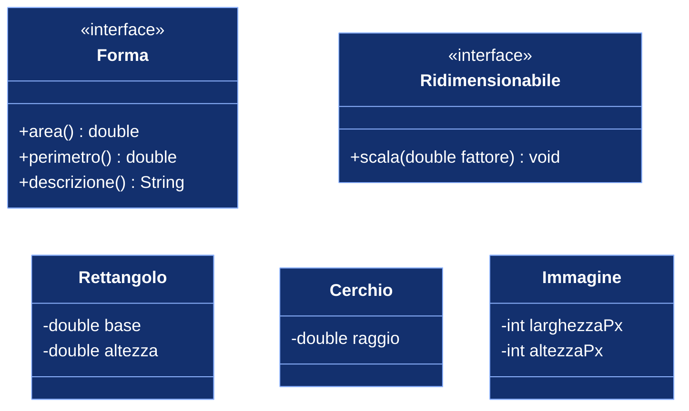

# Interfacce Java

## 1. Concetti

### Definizioni

- Classe  
  Modello da cui si creano oggetti: definisce lo stato (attributi) e il comportamento (metodi con il codice che li realizza). Risponde alla domanda "che cosa è questo oggetto e come funziona".
- Interfaccia  
  Tipo di riferimento che dichiara un insieme di metodi senza implementarli (salvo i metodi `default` e `static`). Non ha stato proprio e non si può istanziare. Risponde alla domanda "che cosa sa fare un oggetto", senza dire come.
- Contratto  
  Una classe che dichiara `implements NomeInterfaccia` si impegna a fornire il codice di tutti i metodi astratti dell'interfaccia. Il compilatore verifica che il contratto sia rispettato: se manca un metodo, il programma non compila.

Riferimento: Oracle, The Java Tutorials, "Interfaces": https://docs.oracle.com/javase/tutorial/java/IandI/createinterface.html

### Differenza concettuale tra interfaccia e classe

Una classe descrive un'entità concreta, con i suoi dati e il codice che li manipola. Un'interfaccia descrive una capacità o un ruolo, separando il "che cosa" dal "come".

Esempio: "essere ridimensionabile" è una capacità che possono avere oggetti molto diversi tra loro, come un cerchio, un'immagine, una finestra. Non ha senso farli derivare da una superclasse comune, perché non condividono né dati né codice; ha senso invece che tutti dichiarino di saper eseguire l'operazione `scala(fattore)`.

| Aspetto | Classe | Interfaccia |
|---|---|---|
| Descrive | che cosa è un oggetto e come funziona | che cosa sa fare un oggetto |
| Stato (attributi d'istanza) | sì | no (solo costanti `public static final`) |
| Codice dei metodi | sì | no, eccetto metodi `default` e `static` |
| Istanziabile con `new` | sì (se non `abstract`) | no |
| Ereditarietà | `extends` di una sola classe | una classe può fare `implements` di più interfacce |
| Visibilità dei metodi | qualunque | `public` (implicitamente) |
| Relazione espressa | "è un" (`Cerchio` è una `Forma` concreta) | "sa fare" (`Cerchio` è `Ridimensionabile`) |

Diagramma: una classe estende al massimo una superclasse, ma può implementare più interfacce.



Nella notazione UML la freccia tratteggiata con triangolo vuoto indica la realizzazione di un'interfaccia; `<<interface>>` è lo stereotipo che identifica un'interfaccia.

### Perché servono

- Polimorfismo senza ereditarietà  
  Un metodo che riceve un parametro di tipo `Forma` funziona con qualunque classe che implementi `Forma`, anche scritta in futuro.
- Disaccoppiamento  
  Chi usa un oggetto dipende solo dal contratto, non dalla classe concreta: l'implementazione si può sostituire senza modificare il codice cliente.
- Ereditarietà multipla di tipo  
  Java non consente di estendere più classi, ma una classe può implementare più interfacce e quindi appartenere a più tipi.
- Lavoro in team e API  
  Gruppi diversi concordano l'interfaccia e poi sviluppano in parallelo: uno scrive le implementazioni, l'altro il codice che le usa.

### Casi d'uso reali nella libreria Java

- `Comparable<T>`: oggetti confrontabili, quindi ordinabili con `Arrays.sort` e `Collections.sort`  
- `List<E>`: implementata da `ArrayList` e `LinkedList`; si scrive `List<String> l = new ArrayList<>();` e si può cambiare implementazione modificando una sola riga  
- `Runnable`: un compito eseguibile da un thread  
- listener delle interfacce grafiche (per esempio `ActionListener` in Swing): il framework chiama il metodo dell'interfaccia quando avviene un evento  

## 2. Passo 1: definire e implementare un'interfaccia

Creare un progetto con i file seguenti. In Java ogni tipo `public` va in un file con lo stesso nome.

`Forma.java` (versione iniziale):

```java
public interface Forma {

    double area();
    double perimetro();
}
```

I metodi non hanno corpo: terminano con `;`. Sono implicitamente `public` e `abstract`.

`Rettangolo.java`:

```java
public class Rettangolo implements Forma {

    private double base;
    private double altezza;

    public Rettangolo(double base, double altezza) {
        this.base = base;
        this.altezza = altezza;
    }

    @Override
    public double area() {
        return base * altezza;
    }

    @Override
    public double perimetro() {
        return 2 * (base + altezza);
    }
}
```

`Cerchio.java`:

```java
public class Cerchio implements Forma {

    private double raggio;

    public Cerchio(double raggio) {
        this.raggio = raggio;
    }

    @Override
    public double area() {
        return Math.PI * raggio * raggio;
    }

    @Override
    public double perimetro() {
        return 2 * Math.PI * raggio;
    }
}
```

Note:

- l'interfaccia non contiene attributi: `base`, `altezza` e `raggio` sono stato delle singole classi  
- nell'implementazione i metodi devono essere dichiarati `public`, altrimenti il compilatore segnala un errore (si ridurrebbe la visibilità)  

### Verifiche sperimentali sul compilatore

Eseguire le due prove e leggere i messaggi di errore.

1. Nel `main` scrivere `Forma f = new Forma();`  
   Errore atteso: `Forma is abstract; cannot be instantiated`. Un'interfaccia non si istanzia.
2. In `Rettangolo` commentare il metodo `perimetro()`  
   Errore atteso: `Rettangolo is not abstract and does not override abstract method perimetro() in Forma`. Il contratto non è rispettato.

Ripristinare il codice dopo le prove.

## 3. Passo 2: l'interfaccia come tipo

Una variabile, un parametro o un elemento di array possono avere come tipo un'interfaccia. Possono contenere qualunque oggetto di una classe che la implementa.

`Main.java` (prima versione):

```java
public class Main {

    static double areaTotale(Forma[] forme) {
        double totale = 0;
        for (Forma f : forme) {
            totale += f.area();
        }
        return totale;
    }

    public static void main(String[] args) {
        Forma[] forme = {
            new Rettangolo(4, 5),
            new Cerchio(1),
            new Rettangolo(1, 2)
        };

        for (Forma f : forme) {
            System.out.printf("area = %.2f, perimetro = %.2f%n",
                    f.area(), f.perimetro());
        }
        System.out.printf("Area totale: %.2f%n", areaTotale(forme));
    }
}
```

Punti da osservare:

- `areaTotale` non conosce `Rettangolo` né `Cerchio`: dipende solo da `Forma`  
- la chiamata `f.area()` esegue il metodo della classe effettiva dell'oggetto (binding dinamico): è il polimorfismo  
- aggiungendo una nuova classe `Quadrato implements Forma`, `areaTotale` funziona senza modifiche  

### Metodi `default`

Da Java 8 un'interfaccia può contenere metodi con corpo, marcati `default`. Le classi li ereditano e possono ridefinirli. Servono per offrire comportamento comune costruito sui metodi astratti, o per aggiungere metodi a un'interfaccia senza rompere le classi già esistenti.

Aggiungere a `Forma`:

```java
    default String descrizione() {
        return String.format("%s: area = %.2f, perimetro = %.2f",
                getClass().getSimpleName(), area(), perimetro());
    }
```

`descrizione()` usa `area()` e `perimetro()`, che l'interfaccia dichiara ma non implementa: il codice funziona perché ogni oggetto concreto avrà certamente quei metodi.

Riferimento: Oracle, The Java Tutorials, "Default Methods": https://docs.oracle.com/javase/tutorial/java/IandI/defaultmethods.html

## 4. Passo 3: più interfacce, classi non imparentate

`Ridimensionabile.java`:

```java
public interface Ridimensionabile {
    void scala(double fattore);
}
```

Modificare le intestazioni di `Rettangolo` e `Cerchio`:

```java
public class Rettangolo implements Forma, Ridimensionabile {
```

```java
public class Cerchio implements Forma, Ridimensionabile {
```

e aggiungere a ciascuna il metodo richiesto:

```java
    // in Rettangolo
    @Override
    public void scala(double fattore) {
        base = base * fattore;
        altezza = altezza * fattore;
    }
```

```java
    // in Cerchio
    @Override
    public void scala(double fattore) {
        raggio = raggio * fattore;
    }
```

`Immagine.java`, classe che non è una forma geometrica ma è ridimensionabile:

```java
public class Immagine implements Ridimensionabile {

    private int larghezzaPx;
    private int altezzaPx;

    public Immagine(int larghezzaPx, int altezzaPx) {
        this.larghezzaPx = larghezzaPx;
        this.altezzaPx = altezzaPx;
    }

    @Override
    public void scala(double fattore) {
        larghezzaPx = (int) Math.round(larghezzaPx * fattore);
        altezzaPx = (int) Math.round(altezzaPx * fattore);
    }

    @Override
    public String toString() {
        return "Immagine " + larghezzaPx + "x" + altezzaPx + " px";
    }
}
```

Metodo da aggiungere in `Main`:

```java
    static void raddoppiaTutti(Ridimensionabile[] oggetti) {
        for (Ridimensionabile r : oggetti) {
            r.scala(2);
        }
    }
```

Un `Cerchio` e un'`Immagine` non hanno nulla in comune come dati, quindi una superclasse comune sarebbe una forzatura. L'interfaccia `Ridimensionabile` permette comunque di trattarli in modo uniforme per l'unica cosa che condividono: la capacità di essere scalati.

Uno stesso oggetto `Cerchio` può essere referenziato come `Cerchio`, come `Forma` o come `Ridimensionabile`; il tipo della variabile determina quali metodi si possono chiamare:

```java
Cerchio c = new Cerchio(1);
Forma f = c;              // vede area(), perimetro(), descrizione()
Ridimensionabile r = c;   // vede solo scala()
r.scala(3);               // modifica lo stesso oggetto
System.out.println(f.area());
```

## 5. Passo 4: `Comparable` e ordinamento

`Arrays.sort(array)` ordina un array di oggetti a condizione che la loro classe implementi `java.lang.Comparable<T>`, che dichiara un solo metodo:

```java
int compareTo(T altro);
```

Il risultato deve essere negativo se `this` precede `altro`, zero se sono equivalenti, positivo se `this` segue `altro`.

`Arrays.sort` non conosce le forme: conosce soltanto il contratto `Comparable`. È lo stesso meccanismo del Passo 2, applicato a codice scritto da altri (la libreria standard).

Versione finale di `Forma.java`: l'interfaccia estende `Comparable<Forma>` e fornisce un confronto per area come metodo `default`, quindi tutte le forme diventano ordinabili senza modificare le classi.

```java
public interface Forma extends Comparable<Forma> {

    double area();
    double perimetro();

    default String descrizione() {
        return String.format("%s: area = %.2f, perimetro = %.2f",
                getClass().getSimpleName(), area(), perimetro());
    }

    default int compareTo(Forma altra) {
        return Double.compare(this.area(), altra.area());
    }
}
```

Un'interfaccia può estendere un'altra interfaccia con `extends`.

Versione finale di `Main.java`:

```java
import java.util.Arrays;

public class Main {

    static double areaTotale(Forma[] forme) {
        double totale = 0;
        for (Forma f : forme) {
            totale += f.area();
        }
        return totale;
    }

    static void raddoppiaTutti(Ridimensionabile[] oggetti) {
        for (Ridimensionabile r : oggetti) {
            r.scala(2);
        }
    }

    public static void main(String[] args) {
        Forma[] forme = {
            new Rettangolo(4, 5),
            new Cerchio(1),
            new Rettangolo(1, 2)
        };

        System.out.println("--- Forme ---");
        for (Forma f : forme) {
            System.out.println(f.descrizione());
        }
        System.out.printf("Area totale: %.2f%n", areaTotale(forme));

        System.out.println("--- Ordinate per area ---");
        Arrays.sort(forme);
        for (Forma f : forme) {
            System.out.println(f.descrizione());
        }

        System.out.println("--- Raddoppio ---");
        Cerchio c = new Cerchio(1);
        Immagine img = new Immagine(800, 600);
        Ridimensionabile[] daScalare = { c, img };
        raddoppiaTutti(daScalare);
        System.out.println(c.descrizione());
        System.out.println(img);
    }
}
```

Output atteso:

```text
--- Forme ---
Rettangolo: area = 20.00, perimetro = 18.00
Cerchio: area = 3.14, perimetro = 6.28
Rettangolo: area = 2.00, perimetro = 6.00
Area totale: 25.14
--- Ordinate per area ---
Rettangolo: area = 2.00, perimetro = 6.00
Cerchio: area = 3.14, perimetro = 6.28
Rettangolo: area = 20.00, perimetro = 18.00
--- Raddoppio ---
Cerchio: area = 12.57, perimetro = 12.57
Immagine 1600x1200 px
```

Con impostazioni locali italiane della JVM i decimali compaiono con la virgola (`20,00`), perché `String.format` e `printf` usano il locale predefinito.

## 6. Interfaccia, classe astratta, classe concreta

La classe astratta è una via intermedia: non si istanzia, può avere metodi astratti, ma può anche avere attributi d'istanza e codice condiviso. Criterio pratico di scelta:

- classe astratta  
  quando più classi strettamente imparentate condividono dati e codice (per esempio una superclasse `Veicolo` con `targa` e `velocita` comuni a `Auto` e `Moto`)
- interfaccia  
  quando si vuole descrivere un comportamento che possono avere classi non imparentate, oppure quando una classe deve appartenere a più tipi

Le due soluzioni si combinano spesso: nella libreria standard `HashMap` estende la classe astratta `AbstractMap` e implementa le interfacce `Map`, `Cloneable` e `Serializable`.

Riferimento: Oracle, The Java Tutorials, "Abstract Methods and Classes" (sezione "Abstract Classes Compared to Interfaces"): https://docs.oracle.com/javase/tutorial/java/IandI/abstract.html

## 7. Esercizi autonomi

1. Scrivere `Quadrato implements Forma, Ridimensionabile`, aggiungerlo all'array `forme` e verificare che `areaTotale` e l'ordinamento funzionino senza altre modifiche.  
2. Scrivere `Triangolo implements Forma` con i tre lati come attributi; calcolare l'area con la formula di Erone.  
3. Ridefinire `descrizione()` in `Cerchio` in modo che riporti anche il raggio; osservare quale versione viene eseguita.  
4. Definire l'interfaccia `Pagabile` con il metodo `double importo()`. Implementarla in due classi non imparentate, `Fattura` e `Stipendio`, e scrivere un metodo `static double totale(Pagabile[] voci)`.  
5. (Approfondimento) Ordinare le forme per perimetro invece che per area, senza modificare `Forma`, usando `Arrays.sort(forme, (a, b) -> Double.compare(a.perimetro(), b.perimetro()));` e spiegare perché funziona (`Comparator` è un'interfaccia con un solo metodo astratto).  

## 8. Domande di verifica

1. Perché `new Forma()` non compila?  
2. Che cosa succede se una classe dichiara `implements Forma` ma non implementa `perimetro()`?  
3. Perché per `Cerchio` e `Immagine` un'interfaccia è preferibile a una superclasse comune?  
4. Una variabile di tipo `Ridimensionabile` che contiene un `Cerchio` permette di chiamare `area()`? Perché?  
5. Quali due problemi risolvono i metodi `default`?  
6. Quale contratto deve rispettare una classe perché i suoi oggetti si possano ordinare con `Arrays.sort`?  

## Riferimenti

- Oracle, The Java Tutorials, "Lesson: Interfaces and Inheritance": https://docs.oracle.com/javase/tutorial/java/IandI/  
- Oracle, The Java Tutorials, "Interfaces": https://docs.oracle.com/javase/tutorial/java/IandI/createinterface.html  
- Oracle, The Java Tutorials, "Default Methods": https://docs.oracle.com/javase/tutorial/java/IandI/defaultmethods.html  
- Oracle, The Java Tutorials, "Abstract Methods and Classes": https://docs.oracle.com/javase/tutorial/java/IandI/abstract.html  

I tutorial Oracle sono scritti per JDK 8; i concetti trattati in questa lezione sono invariati nelle versioni successive.