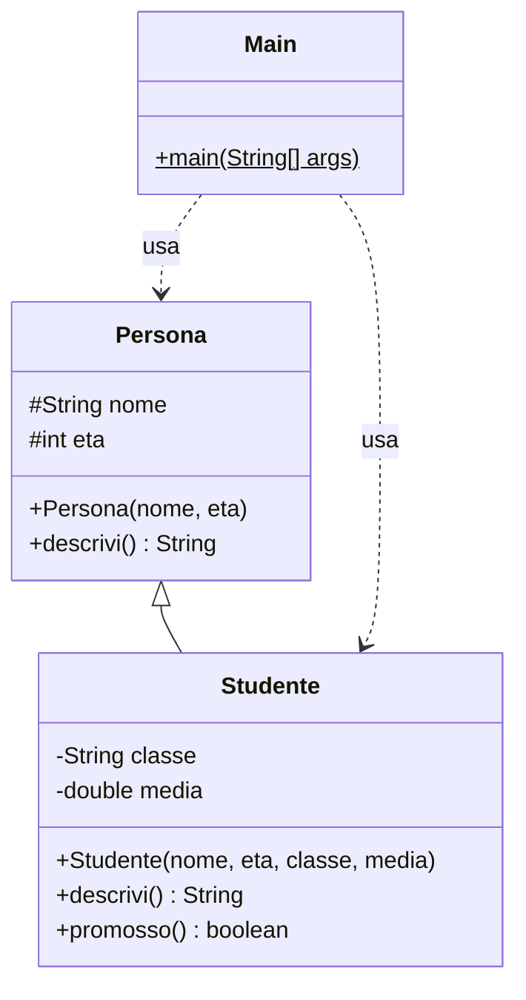
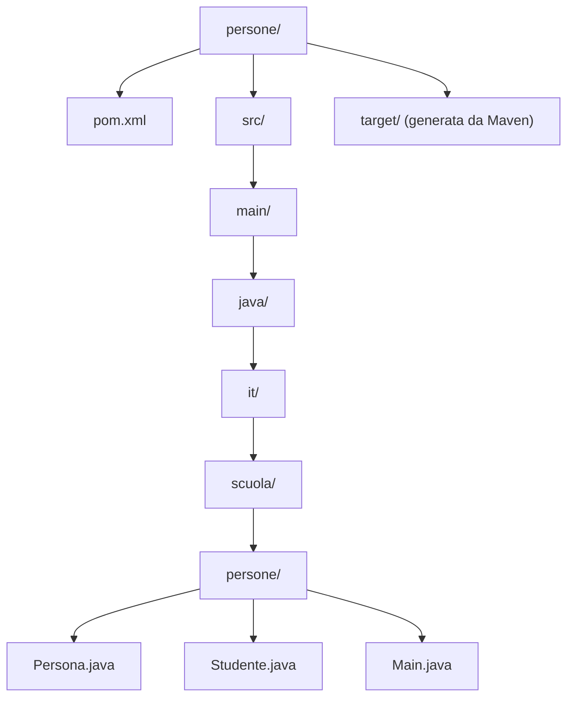

# Progetto Java con Maven: Persona, Studente, Main

## Obiettivo

Creare da terminale, con Maven, un programma Java composto da tre classi:

- `Persona`  
  classe base con nome ed età e un metodo `descrivi()` che ne restituisce la descrizione
- `Studente`  
  sottoclasse di `Persona`, aggiunge classe e media, ridefinisce `descrivi()` e offre il metodo `promosso()`
- `Main`  
  contiene il metodo `main`, crea gli oggetti, li inserisce in un array e ne stampa i dati

Diagramma delle classi (`#` indica un membro `protected`, `-` uno `private`, `+` uno `public`):



## Concetti di base

### Maven

Maven è uno strumento di build automation per progetti Java: compila il codice, scarica le librerie necessarie (dipendenze), esegue i test e produce il pacchetto finale (per esempio un file `.jar`). Tutto il progetto è descritto in un unico file di configurazione, il `pom.xml`.

Sito ufficiale e guida introduttiva: Maven in 5 Minutes, https://maven.apache.org/guides/getting-started/maven-in-five-minutes.html

### POM (Project Object Model)

Il file `pom.xml`, nella cartella radice del progetto, descrive il progetto: identità, versione di Java, plugin e dipendenze. Maven legge questo file per sapere cosa fare.

Riferimento: Introduction to the POM, https://maven.apache.org/guides/introduction/introduction-to-the-pom.html

### Coordinate del progetto

Ogni progetto Maven è identificato da tre valori:

- `groupId`  
  organizzazione o gruppo a cui appartiene il progetto, scritto come un dominio rovesciato, per esempio `it.scuola`
- `artifactId`  
  nome del progetto, per esempio `persone`
- `version`  
  versione del progetto; il suffisso `SNAPSHOT` indica una versione in sviluppo, non ancora definitiva

### Struttura standard delle cartelle

Maven si aspetta che i file si trovino in cartelle precise (convention over configuration): se si rispetta la convenzione non serve configurare nulla.

- `src/main/java`  
  codice sorgente Java del programma
- `src/test/java`  
  codice dei test (non usato in questa lezione)
- `target`  
  cartella creata da Maven, contiene i file compilati e il pacchetto finale; non va modificata a mano

Dentro `src/main/java` le cartelle seguono il nome del package: il package `it.scuola.persone` corrisponde al percorso `it/scuola/persone`.

Riferimento: Introduction to the Standard Directory Layout, https://maven.apache.org/guides/introduction/introduction-to-the-standard-directory-layout.html

Diagramma: struttura del progetto



### Ciclo di vita (lifecycle) e fasi

Maven esegue il lavoro in fasi ordinate. Quando si richiede una fase, Maven esegue anche tutte quelle precedenti. Le fasi usate in questa lezione:

- `compile`  
  compila i sorgenti di `src/main/java` in file `.class` dentro `target/classes`
- `test`  
  esegue i test automatici (in questo progetto non ce ne sono)
- `package`  
  crea il file `.jar` dentro `target`
- `clean`  
  appartiene a un ciclo di vita separato; cancella la cartella `target`


Riferimento: Introduction to the Build Lifecycle, https://maven.apache.org/guides/introduction/introduction-to-the-lifecycle.html

## Passo 0: verifica dei prerequisiti

Servono un JDK (Java Development Kit) e Maven installati e raggiungibili dal terminale.

```bash
java -version
mvn -v
```

Entrambi i comandi devono stampare una versione. In questa lezione si usa Java 21; con una versione diversa (per esempio 17) basta cambiare il numero nel `pom.xml` (Passo 2).

Se `mvn` non viene trovato, Maven non è installato o non è nel `PATH`. Istruzioni ufficiali: Installation, https://maven.apache.org/install.html

Alla prima esecuzione Maven scarica da Internet (repository Maven Central) i plugin di cui ha bisogno e li salva nella cartella locale `~/.m2/repository`; serve quindi una connessione attiva. Le esecuzioni successive usano la copia locale.

## Passo 1: creazione della struttura delle cartelle

```bash
mkdir -p persone/src/main/java/it/scuola/persone
cd persone
```

L'opzione `-p` crea anche tutte le cartelle intermedie. Su Windows, in PowerShell, il comando `mkdir persone\src\main\java\it\scuola\persone` produce lo stesso risultato.

Tutti i comandi successivi vanno eseguiti dalla cartella `persone`, quella che contiene il `pom.xml`.

### Alternativa: generazione automatica con un archetype

Un archetype è un modello di progetto da cui Maven genera cartelle e `pom.xml`:

```bash
mvn archetype:generate -DgroupId=it.scuola -DartifactId=persone \
    -DarchetypeArtifactId=maven-archetype-quickstart \
    -DarchetypeVersion=1.5 -DinteractiveMode=false
```

Il progetto generato contiene anche una classe `App`, un test di esempio e un `pom.xml` più lungo. Per un progetto di tre classi la creazione manuale è più semplice e rende visibile ogni elemento; nel resto della lezione si procede manualmente.

## Passo 2: il file `pom.xml`

Creare il file `pom.xml` nella cartella `persone`:

```xml
<?xml version="1.0" encoding="UTF-8"?>
<project xmlns="http://maven.apache.org/POM/4.0.0"
         xmlns:xsi="http://www.w3.org/2001/XMLSchema-instance"
         xsi:schemaLocation="http://maven.apache.org/POM/4.0.0
                             https://maven.apache.org/xsd/maven-4.0.0.xsd">
  <modelVersion>4.0.0</modelVersion>

  <groupId>it.scuola</groupId>
  <artifactId>persone</artifactId>
  <version>1.0-SNAPSHOT</version>
  <packaging>jar</packaging>

  <properties>
    <maven.compiler.release>21</maven.compiler.release>
    <project.build.sourceEncoding>UTF-8</project.build.sourceEncoding>
  </properties>

  <build>
    <plugins>
      <plugin>
        <groupId>org.apache.maven.plugins</groupId>
        <artifactId>maven-compiler-plugin</artifactId>
        <version>3.13.0</version>
      </plugin>
      <plugin>
        <groupId>org.apache.maven.plugins</groupId>
        <artifactId>maven-jar-plugin</artifactId>
        <version>3.4.1</version>
        <configuration>
          <archive>
            <manifest>
              <mainClass>it.scuola.persone.Main</mainClass>
            </manifest>
          </archive>
        </configuration>
      </plugin>
    </plugins>
  </build>
</project>
```

Significato delle parti:

- `modelVersion`  
  versione del formato del POM; per Maven 3 vale sempre `4.0.0`
- `groupId`, `artifactId`, `version`  
  coordinate del progetto
- `packaging`  
  tipo di pacchetto prodotto, qui un file `.jar`
- `maven.compiler.release`  
  versione di Java per cui compilare; deve essere minore o uguale a quella del JDK installato
- `project.build.sourceEncoding`  
  codifica dei file sorgente; `UTF-8` evita problemi con le lettere accentate
- `maven-compiler-plugin`  
  plugin che compila il codice Java; indicare la versione rende la build ripetibile
- `maven-jar-plugin` con `mainClass`  
  plugin che crea il `.jar`; la sezione `manifest` indica quale classe contiene il metodo `main`, così il `.jar` si può avviare con `java -jar`

In Maven quasi tutto il lavoro è svolto da plugin: ogni fase del ciclo di vita è collegata a un plugin (`compile` al compiler plugin, `package` al jar plugin, e così via).

## Passo 3: la classe `Persona`

File `src/main/java/it/scuola/persone/Persona.java`:

```java
package it.scuola.persone;

public class Persona {

    private String nome;
    private String cognome;
    private int eta;

    public Persona(String nome, String cognome, int eta) {
        this.nome = nome;
        this.cognome = cognome;
        this.eta = eta;
    }

    public String getNome() {
        return nome;
    }

    public String getCognome() {
        return cognome;
    }

    public int getEta() {
        return eta;
    }

    @Override
    public String toString() {
        return nome + " " + cognome + ", " + eta + " anni";
    }
}
```

Elementi principali:

- `package it.scuola.persone;`  
  dichiara il package; deve corrispondere al percorso delle cartelle
- attributi `private`  
  incapsulamento: i dati sono accessibili dall'esterno solo tramite i metodi `get`
- costruttore  
  inizializza gli attributi; `this.nome` indica l'attributo, `nome` il parametro
- `toString()`  
  ridefinisce (override) il metodo ereditato da `Object` e restituisce una descrizione testuale dell'oggetto; viene chiamato automaticamente da `System.out.println`

## Passo 4: la classe `Studente`

File `src/main/java/it/scuola/persone/Studente.java`:

```java
package it.scuola.persone;

public class Studente extends Persona {

    private String matricola;
    private String classe;

    public Studente(String nome, String cognome, int eta,
                    String matricola, String classe) {
        super(nome, cognome, eta);
        this.matricola = matricola;
        this.classe = classe;
    }

    public String getMatricola() {
        return matricola;
    }

    public String getClasse() {
        return classe;
    }

    @Override
    public String toString() {
        return super.toString() + ", matricola " + matricola + ", classe " + classe;
    }
}
```

Elementi principali:

- `extends Persona`  
  ereditarietà: `Studente` eredita attributi e metodi di `Persona` e ne aggiunge di propri; uno studente "è una" persona
- `super(nome, cognome, eta)`  
  chiama il costruttore della superclasse; deve essere la prima istruzione del costruttore. È necessario perché gli attributi di `Persona` sono `private` e vengono inizializzati solo dal costruttore di `Persona`
- `super.toString()`  
  riusa la versione di `toString()` della superclasse e vi aggiunge i dati specifici dello studente

Riferimento: The Java Tutorials, Inheritance, https://docs.oracle.com/javase/tutorial/java/IandI/subclasses.html

## Passo 5: la classe `Main`

File `src/main/java/it/scuola/persone/Main.java`:

```java
package it.scuola.persone;

public class Main {

    public static void main(String[] args) {
        Persona p = new Persona("Mario", "Rossi", 45);
        Studente s = new Studente("Giulia", "Bianchi", 16, "S001", "3A");

        System.out.println(p);
        System.out.println(s);

        // Polimorfismo: un riferimento di tipo Persona a un oggetto Studente
        Persona q = s;
        System.out.println(q);
    }
}
```

L'ultima istruzione mostra il polimorfismo: la variabile `q` è di tipo `Persona` ma l'oggetto è uno `Studente`, quindi viene eseguita la versione di `toString()` di `Studente`. Il metodo eseguito dipende dal tipo dell'oggetto, non dal tipo della variabile.

## Passo 6: compilazione ed esecuzione

Compilazione:

```bash
mvn compile
```

Al termine deve comparire `BUILD SUCCESS`. I file compilati si trovano in `target/classes/it/scuola/persone/`.

Esecuzione delle classi compilate:

```bash
java -cp target/classes it.scuola.persone.Main
```

- `-cp target/classes`  
  classpath: la cartella in cui la JVM cerca le classi
- `it.scuola.persone.Main`  
  nome completo (fully qualified name) della classe con il metodo `main`, package compreso

Output atteso:

```text
Mario Rossi, 45 anni
Giulia Bianchi, 16 anni, matricola S001, classe 3A
Giulia Bianchi, 16 anni, matricola S001, classe 3A
```

## Passo 7: creazione ed esecuzione del file `.jar`

```bash
mvn package
java -jar target/persone-1.0-SNAPSHOT.jar
```

`mvn package` esegue tutte le fasi fino a `package` (quindi anche `compile` e `test`) e crea `target/persone-1.0-SNAPSHOT.jar`; il nome deriva da `artifactId` e `version`. Grazie alla `mainClass` indicata nel `pom.xml`, `java -jar` sa quale classe avviare. Il file `.jar` può essere copiato ed eseguito su qualsiasi computer con una JVM di versione adeguata.

## Passo 8: pulizia

```bash
mvn clean
```

Cancella la cartella `target`. Si usa spesso in combinazione con altre fasi, per ricompilare tutto da zero:

```bash
mvn clean package
```

## Errori frequenti

- `mvn: command not found`  
  Maven non è installato o la sua cartella `bin` non è nel `PATH`
- `The goal you specified requires a project to execute but there is no POM in this directory`  
  il comando è stato lanciato da una cartella diversa da quella che contiene `pom.xml`
- `error: release version 21 not supported`  
  il JDK installato è più vecchio della versione indicata in `maven.compiler.release`; abbassare il valore o aggiornare il JDK
- `Could not find or load main class`  
  nome della classe scritto senza package, oppure classpath errato; il nome corretto è `it.scuola.persone.Main`
- errori di download dei plugin alla prima esecuzione  
  manca la connessione a Internet, oppure un proxy o un firewall blocca l'accesso a Maven Central
- `class Studente is public, should be declared in a file named Studente.java`  
  il nome del file deve coincidere esattamente, maiuscole comprese, con il nome della classe pubblica

## Riepilogo dei comandi

| Comando | Effetto |
|---|---|
| `mvn compile` | compila i sorgenti in `target/classes` |
| `java -cp target/classes it.scuola.persone.Main` | esegue il programma compilato |
| `mvn package` | compila e crea il file `.jar` in `target` |
| `java -jar target/persone-1.0-SNAPSHOT.jar` | esegue il programma dal `.jar` |
| `mvn clean` | cancella la cartella `target` |
| `mvn clean package` | ricostruisce tutto da zero |
