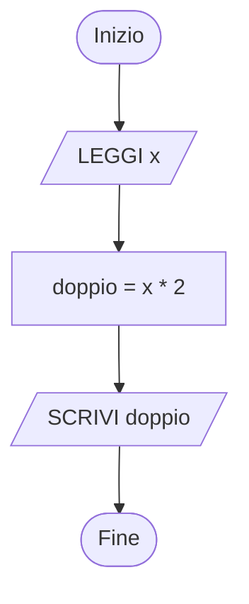
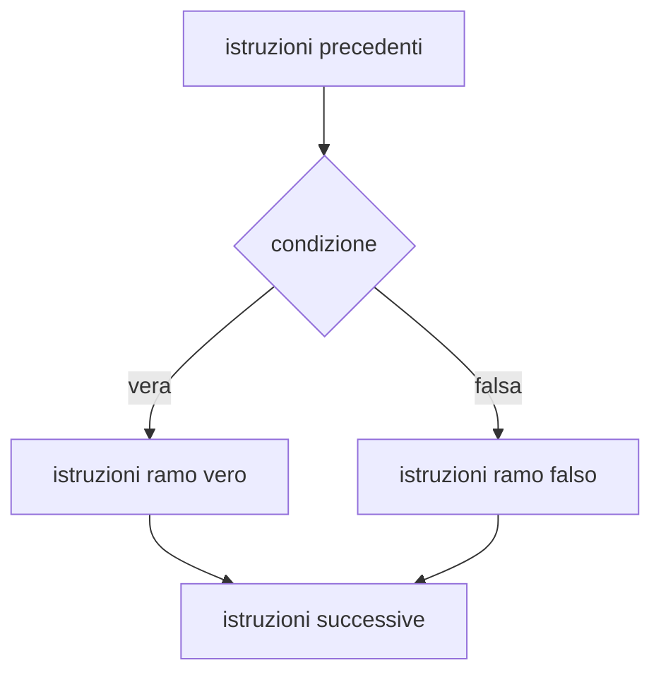
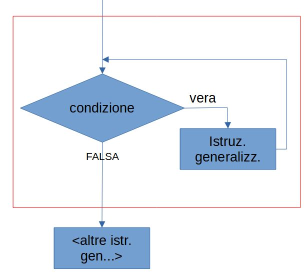
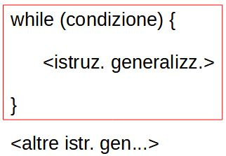
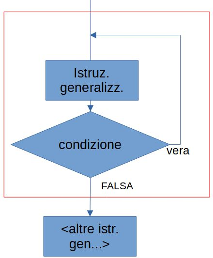
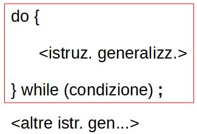
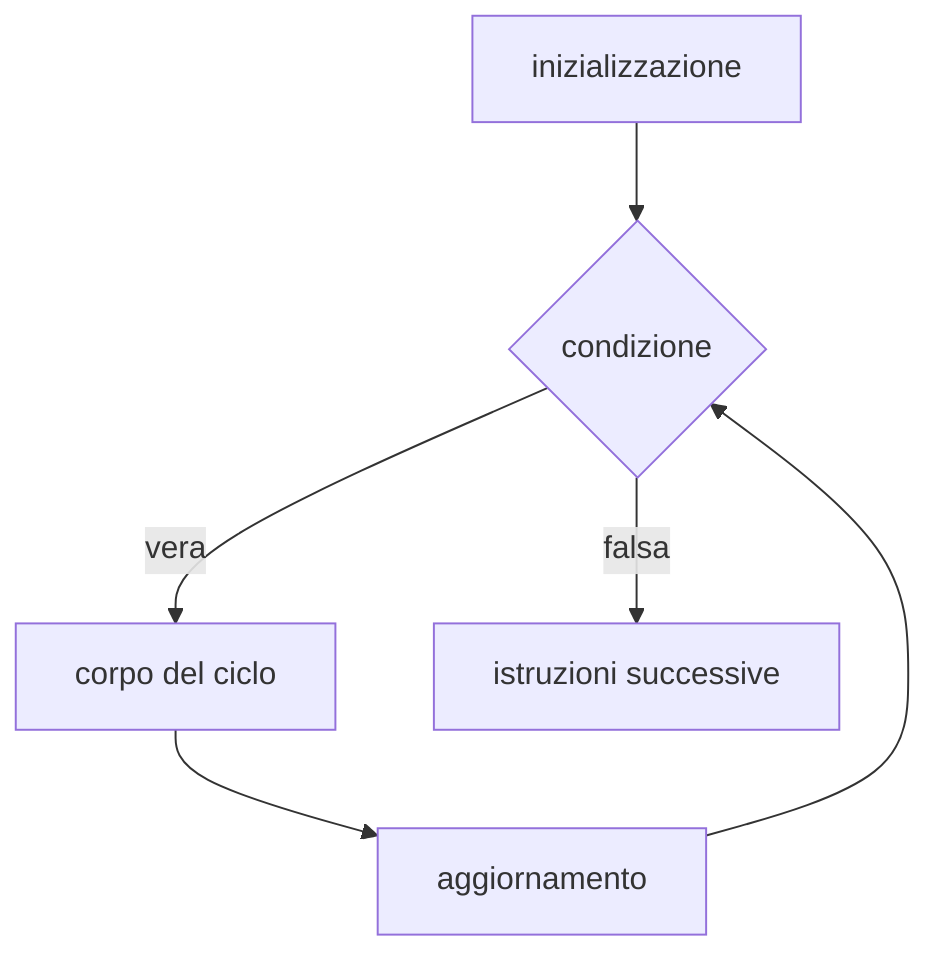

# Programmazione di base in Java: esercizi graduali

Il libro di testo resta il riferimento principale.

## Indice

- Come usare questo documento  
- Metodo di lavoro  
- Compilare ed eseguire un programma  
- Leggere gli errori  
- Pseudo-codice e Java  
- Tappe  
  - Tappa 1 - Sequenza, variabili, input e output  
  - Tappa 2 - Espressioni e operatori  
  - Tappa 3 - Selezione: if, if-else, if annidati  
  - Tappa 4 - Selezione multipla: switch  
  - Tappa 5 - Iterazione con while  
  - Tappa 6 - Iterazione con do-while  
  - Tappa 7 - Iterazione con for  
  - Tappa 8 - Cicli annidati  
  - Tappa 9 - Esercizi riassuntivi  
  - Tappa 10 - Metodi statici (funzioni)  
  - Tappa 11 - Array  
  - Tappa 12 - Stringhe  
  - Tappa 13 - Classi come contenitori di dati  
  - Tappa 14 - Riferimenti e memoria  
  - Tappa 15 - Classi, package e jar  

---

# Come usare questo documento

Ogni tappa contiene:

- **Concetto**: spiegazione breve  
- **Esempio svolto**: da copiare, eseguire e modificare  
- **Esercizi**: dal più semplice al più complesso  

Livelli degli esercizi:

- **[B] Base**: da svolgere nell'ordine  
- **[A] Approfondimento**: facoltativi  

Negli esempi di esecuzione, le righe che iniziano con `>` sono i valori digitati dall'utente.

Il **Suggerimento** si apre cliccando sulla riga "Suggerimento".

In caso di blocco: scrivere al docente, anche in privato, il codice dell'esercizio (per esempio E5.3) e cosa non funziona.

---

# Metodo di lavoro

Per ogni esercizio:

1. **Capire la consegna**: quali dati entrano, quali risultati escono.  
2. **Scrivere l'algoritmo**: diagramma di flusso o pseudo-codice.  
3. **Tradurre in Java**: con la tabella "Pseudo-codice e Java".  
4. **Provare**: con i valori dell'esempio e con altri valori.  

---

# Compilare ed eseguire un programma

```java
public class Ciao {
    public static void main(String[] args) {
        System.out.println("Ciao");
    }
}
```

Regole:

- il programma parte dal metodo `main`  
- la classe `Ciao` va nel file `Ciao.java`, con le stesse maiuscole  

Comandi, dalla cartella che contiene il file:

```text
javac Ciao.java
java Ciao
```

- `javac` compila: riceve il nome del file, con `.java`  
- `java` esegue: riceve il nome della classe, senza estensione  

Scorciatoia per un programma di un solo file: `java Ciao.java` compila ed esegue in un solo comando.

Programma su più file: si compilano tutti insieme e si esegue la classe con il `main`.

```text
javac Punto.java Main.java
java Main
```

---

# Leggere gli errori

Errore del compilatore:

```text
Media.java:7: error: ';' expected
```

- `Media.java:7` indica file e riga  
- correggere sempre il **primo** errore e ricompilare: spesso gli altri spariscono  

Errori frequenti:

| Messaggio o sintomo | Causa probabile |
|---|---|
| `';' expected` | manca il punto e virgola |
| `cannot find symbol` | nome scritto in modo diverso (maiuscole comprese) o variabile non dichiarata |
| `InputMismatchException` | dato del tipo sbagliato; i numeri con la virgola si scrivono `3,5` |
| `ArrayIndexOutOfBoundsException` | indice fuori dall'array |
| `NullPointerException` | oggetto non creato con `new` |
| il programma non termina | nel ciclo manca l'aggiornamento della variabile |
| la media è un numero intero | dividere per `2.0` invece che per `2` |

Quando il risultato è sbagliato: stampare i valori delle variabili, per esempio  
`System.out.println("DEBUG i=" + i + " somma=" + somma);`  
e confrontarli con quelli previsti.

---

# Pseudo-codice e Java

| Pseudo-codice | Java |
|---|---|
| `SCRIVI "Ciao"` | `System.out.println("Ciao");` |
| `SCRIVI x` (senza andare a capo) | `System.out.print(x);` |
| `LEGGI x` (intero) | `x = sc.nextInt();` |
| `x ← 5` | `x = 5;` |
| `SE c ALLORA ... ALTRIMENTI ... FINE SE` | `if (c) { ... } else { ... }` |
| `MENTRE c ESEGUI ... FINE MENTRE` | `while (c) { ... }` |
| `ESEGUI ... MENTRE c` | `do { ... } while (c);` |
| `PER i DA 0 A 9 ... FINE PER` | `for (int i = 0; i <= 9; i++) { ... }` |
| `FUNZIONE f(a) ... RESTITUISCI r` | `static int f(int a) { ... return r; }` |

Schema di un programma che legge da tastiera:

```java
import java.util.Scanner;

public class Esercizio {
    public static void main(String[] args) {
        Scanner sc = new Scanner(System.in);
        // istruzioni
    }
}
```

Negli esempi successivi è mostrato solo il contenuto del `main`.

Lettura con `Scanner`:

| Tipo di dato | Istruzione |
|---|---|
| intero | `int n = sc.nextInt();` |
| numero con la virgola | `double d = sc.nextDouble();` |
| una parola | `String s = sc.next();` |
| una riga intera | `String s = sc.nextLine();` |
| un carattere | `char c = sc.next().charAt(0);` |

---

# Tappe

## Tappa 1 - Sequenza, variabili, input e output

### Concetto

- **Sequenza**: le istruzioni vengono eseguite una dopo l'altra, dall'alto in basso.  
- **Variabile**: contenitore con un nome e un tipo. Tipi principali: `int`, `double`, `char`, `boolean`, `String`.  
- **Assegnamento**: `x = 5;` significa "metti 5 in x".  



### Esempio svolto

Leggere un numero intero e stamparne il doppio.

```text
INIZIO
    SCRIVI "Inserisci un numero: "
    LEGGI x
    doppio ← x * 2
    SCRIVI "Il doppio e' ", doppio
FINE
```

```java
import java.util.Scanner;

public class Doppio {
    public static void main(String[] args) {
        Scanner sc = new Scanner(System.in);
        System.out.print("Inserisci un numero: ");
        int x = sc.nextInt();
        int doppio = x * 2;
        System.out.println("Il doppio e' " + doppio);
    }
}
```

Il `+` tra testo e numero li unisce: `"Il doppio e' " + 14` produce `Il doppio e' 14`.

```text
Inserisci un numero: 
> 7
Il doppio e' 14
```

### Esercizi

#### E1.1 [B] Primo programma

Stampare il messaggio `Hello world`. Compilare con `javac` ed eseguire con `java`.

#### E1.2 [B] Stampare una variabile

Dichiarare una variabile intera `num`, assegnarle il valore 5 e stamparla preceduta dal testo `num = `.

```text
num = 5
```

#### E1.3 [B] Cambiare valore

Partendo da E1.2: dopo la stampa, assegnare a `num` il valore 8 e stamparla di nuovo.

```text
num = 5
num = 8
```

#### E1.4 [B] Leggere un numero

Leggere un numero intero da tastiera e stamparlo.

```text
Inserisci un numero: 
> 42
Hai inserito 42
```

#### E1.5 [B] Leggere un numero con la virgola

Come E1.4, ma con un numero di tipo `double`.

```text
Inserisci un numero: 
> 3,5
Hai inserito 3.5
```

<details>
<summary>Suggerimento</summary>

Su un PC in italiano il numero si digita con la virgola: `3,5`. Java lo stampa con il punto: `3.5`.

</details>

#### E1.6 [B] Leggere una parola

Leggere una parola e stamparla.

```text
Come ti chiami? 
> Anna
Ciao Anna
```

<details>
<summary>Suggerimento</summary>

`sc.next()` legge una parola.

</details>

#### E1.7 [A] Scambio di due variabili

Assegnare `a = 3` e `b = 8`, scambiarne i valori e stamparli.

```text
Prima: a = 3, b = 8
Dopo: a = 8, b = 3
```

<details>
<summary>Suggerimento</summary>

Serve una terza variabile di appoggio.

</details>

---

## Tappa 2 - Espressioni e operatori

### Concetto

- **Operatori aritmetici**: `+  -  *  /  %`  
  Tra interi: `7 / 2` vale 3 (divisione intera), `7 % 2` vale 1 (resto).  
- **Operatori di confronto**: `==  !=  <  <=  >  >=`  
  Il risultato è `true` o `false`. `=` assegna, `==` confronta.  
- **Operatori logici**: `&&` (e), `||` (o), `!` (non)  

| Condizione | Significato |
|---|---|
| `n % 2 == 0` | n è pari |
| `n % 2 != 0` | n è dispari |
| `n % 5 == 0` | n è multiplo di 5 |

### Esempio svolto

Leggere i minuti totali e stamparli come ore e minuti.

```java
int totale = sc.nextInt();
int ore = totale / 60;
int minuti = totale % 60;
System.out.println(ore + " ore e " + minuti + " minuti");
```

```text
> 135
2 ore e 15 minuti
```

### Esercizi

#### E2.1 [B] Le quattro operazioni

Leggere due interi `a` e `b` e stampare somma, differenza, prodotto, divisione intera e resto.

```text
> 17
> 5
Somma: 22
Differenza: 12
Prodotto: 85
Divisione intera: 3
Resto: 2
```

<details>
<summary>Suggerimento</summary>

Nella stampa mettere le operazioni tra parentesi: `"Somma: " + (a + b)`.

</details>

#### E2.2 [B] Media di due numeri

Leggere due interi e stampare la media con la virgola.

```text
> 7
> 8
Media: 7.5
```

<details>
<summary>Suggerimento</summary>

Dividere per `2.0` invece che per `2`.

</details>

#### E2.3 [B] Pari o dispari (solo calcolo)

Leggere un intero e stampare il resto della divisione per 2. Provare con diversi numeri e osservare: per quali numeri il resto è 0?

#### E2.4 [B] Valore di una condizione

Leggere un intero `n` e stampare il valore delle espressioni `n > 10`, `n % 2 == 0`, `n > 10 && n % 2 == 0`.

```text
> 12
n > 10: true
n pari: true
n > 10 e pari: true
```

#### E2.5 [A] Cifre di un numero

Leggere un intero di tre cifre e stampare separatamente centinaia, decine e unità.

```text
> 472
Centinaia: 4
Decine: 7
Unita': 2
```

<details>
<summary>Suggerimento</summary>

Unità: `n % 10`. Centinaia: `n / 100`. Per le decine combinare `/` e `%`.

</details>

---

## Tappa 3 - Selezione: if, if-else, if annidati

### Concetto



```java
if (eta >= 18) {
    System.out.println("maggiorenne");
} else {
    System.out.println("minorenne");
}
```

Con più di due casi si usa una **catena**: viene eseguito solo il primo ramo con condizione vera.

```java
if (n > 0) {
    System.out.println("positivo");
} else if (n < 0) {
    System.out.println("negativo");
} else {
    System.out.println("zero");
}
```

### Esempio svolto

Leggere un voto da 1 a 10 e stampare "insufficiente" (sotto 6), "sufficiente" (6) o "buono" (7 o più); fuori dall'intervallo stampare "voto non valido".

```java
int voto = sc.nextInt();
if (voto < 1 || voto > 10) {
    System.out.println("voto non valido");
} else if (voto < 6) {
    System.out.println("insufficiente");
} else if (voto == 6) {
    System.out.println("sufficiente");
} else {
    System.out.println("buono");
}
```

### Esercizi

In questa tappa i valori si leggono da tastiera.

#### E3.1 [B] Maggiorenne

Leggere l'età di una persona e stampare `maggiorenne` se è maggiore o uguale a 18. Per le altre età non stampare nulla.

#### E3.2 [B] Minorenne

Leggere l'età e stampare `minorenne` se è minore di 18.

#### E3.3 [B] Maggiorenne o minorenne

Leggere l'età e stampare `maggiorenne` oppure `minorenne`, usando un solo `if-else`.

```text
> 15
minorenne
```

Provare con 17, 18 e 19.

#### E3.4 [B] Positivo o negativo

Leggere un intero e stampare `positivo` se è maggiore o uguale a zero, altrimenti `negativo`.

#### E3.5 [B] Positivo, negativo o zero

Leggere un intero e stampare `positivo`, `negativo` oppure `zero`.

#### E3.6 [B] Pari o dispari

Leggere un intero e stampare `pari` o `dispari`.

#### E3.7 [B] Il maggiore di due

Leggere due interi e stampare il maggiore; se sono uguali stampare `uguali`.

#### E3.8 [B] Esito dell'esame

Leggere un voto universitario e stampare:

- `esame non passato` se è minore di 18  
- `sufficiente` se è da 18 a 24 (estremi inclusi)  
- `buono` se è da 25 a 27  
- `molto buono` se è da 28 a 30  
- `voto non valido` se è minore di 0 o maggiore di 30  

#### E3.9 [B] Condizioni composte

Leggere l'età e un carattere per il sesso (`M` o `F`) e stampare:

- `ragazzo` se età <= 20 e sesso `M`  
- `ragazza` se età <= 20 e sesso `F`  
- `uomo` se età > 20 e sesso `M`  
- `donna` se età > 20 e sesso `F`  
- `dato non valido` se il carattere non è né `M` né `F`  

```text
> 16
> F
ragazza
```

<details>
<summary>Suggerimento</summary>

Leggere il carattere con `char sesso = sc.next().charAt(0);` e confrontarlo con `sesso == 'M'` (apici singoli).

</details>

#### E3.10 [A] Il maggiore di tre

Leggere tre interi e stampare il maggiore.

#### E3.11 [A] Anno bisestile

Leggere un anno e stampare se è bisestile. Un anno è bisestile se è divisibile per 4 ma non per 100, oppure se è divisibile per 400 (2024 sì, 1900 no, 2000 sì).

---

## Tappa 4 - Selezione multipla: switch

### Concetto

`switch` confronta una variabile con un elenco di valori:

```java
switch (scelta) {
    case 1:
        System.out.println("uno");
        break;
    case 2:
        System.out.println("due");
        break;
    default:
        System.out.println("altro");
}
```

- funziona con `int`, `char` e `String`  
- ogni `case` indica un valore singolo, non un intervallo  
- `break` fa uscire dallo `switch`  
- `default` gestisce tutti gli altri valori  

### Esempio svolto

Leggere un carattere e stampare se è una vocale minuscola.

```java
char c = sc.next().charAt(0);
switch (c) {
    case 'a':
    case 'e':
    case 'i':
    case 'o':
    case 'u':
        System.out.println("vocale");
        break;
    default:
        System.out.println("non vocale");
}
```

### Esercizi

#### E4.1 [B] Premi

Leggere un numero e stampare:

- 20: `vinto il terzo premio`  
- 30: `vinto il secondo premio`  
- 40: `vinto il primo premio`  
- qualunque altro valore: `riprova, sarai piu' fortunato`  

#### E4.2 [B] Giorno della settimana

Leggere un numero da 1 a 7 e stampare il nome del giorno (1 = lunedì). Per altri valori stampare `numero non valido`.

#### E4.3 [B] Più valori, stesso codice

Leggere un numero da 1 a 7 e stampare `feriale` per i valori da 1 a 6 e `festivo` per 7.

#### E4.4 [B] Calcolatrice

Leggere due interi e un carattere operatore (`+`, `-`, `*`, `/`) e stampare il risultato. Con un operatore diverso stampare `operatore non valido`; con `/` e secondo numero 0 stampare `divisione per zero`.

```text
> 12
> 4
> *
48
```

#### E4.5 [B] Effetto del break

Senza eseguirlo, scrivere su carta cosa stampa questo codice con `n = 2`. Poi eseguirlo e confrontare.

```java
switch (n) {
    case 1: System.out.print("uno ");
    case 2: System.out.print("due ");
    case 3: System.out.print("tre ");
        break;
    default: System.out.print("altro ");
}
```

#### E4.6 [A] Switch su una stringa

Leggere una parola tra `rosso`, `giallo`, `verde` e stampare l'azione corrispondente del semaforo (`fermati`, `rallenta`, `passa`); per altre parole stampare `colore non valido`.

#### E4.7 [A] Confronto if e switch

Riscrivere E4.2 con una catena di `if ... else if`. Quale delle due versioni è più leggibile? Perché per E3.8 invece lo `switch` non è adatto?

#### E4.8 [A] Switch con le frecce

Riscrivere E4.2 con la forma `case 1 -> System.out.println("lunedi'");`. In questa forma non serve `break`.

---

## Tappa 5 - Iterazione con while

### Concetto

Il ciclo `while` ripete le istruzioni finché la condizione è vera. La condizione si controlla **prima** di ogni ripetizione.





Ogni ciclo ha tre elementi:

| Elemento | Esempio |
|---|---|
| inizializzazione, prima del ciclo | `i = 0;` |
| condizione | `while (i <= 10)` |
| aggiornamento, nel corpo | `i = i + 1;` |

Due schemi ricorrenti:

- **contatore**: aumenta di 1 a ogni ripetizione, `conta = conta + 1;`  
- **accumulatore**: raccoglie un risultato, `somma = somma + x;`, inizializzato a 0 prima del ciclo  

### Esempio svolto

Stampare la somma dei numeri da 1 a 5.

```java
int somma = 0;
int i = 1;
while (i <= 5) {
    somma = somma + i;
    i = i + 1;
}
System.out.println("Somma: " + somma);
```

Esecuzione passo per passo:

| Ripetizione | i all'inizio | somma alla fine |
|---|---|---|
| 1 | 1 | 1 |
| 2 | 2 | 3 |
| 3 | 3 | 6 |
| 4 | 4 | 10 |
| 5 | 5 | 15 |
| controllo finale | 6 | condizione falsa, uscita |

### Esercizi

#### E5.1 [B] Contare da 0 a 10

Stampare i numeri da 0 a 10 (estremi inclusi), uno per riga.

#### E5.2 [B] Contare all'indietro

Stampare i numeri da 0 a -10 (estremi inclusi): 0, -1, -2, ..., -10.

#### E5.3 [B] Numeri pari

Stampare i numeri pari da 0 a 10 (estremi inclusi).

```text
0 2 4 6 8 10
```

<details>
<summary>Suggerimento</summary>

Aumentare la variabile di 2 a ogni ripetizione. Per stampare sulla stessa riga: `System.out.print(i + " ");`.

</details>

#### E5.4 [B] Multipli di 5

Stampare i multipli di 5 minori di 30, partendo da 0.

```text
0 5 10 15 20 25
```

#### E5.5 [B] Somma dei numeri inseriti

Leggere numeri interi finché l'utente inserisce 0, poi stampare la somma dei numeri inseriti.

```text
> 4
> 7
> 2
> 0
Somma: 13
```

<details>
<summary>Suggerimento</summary>

Leggere il primo numero prima del ciclo; nel ciclo sommare il numero e leggere il successivo.

</details>

#### E5.6 [B] Moltiplicazione con le somme

Leggere due interi non negativi `m` e `n` e calcolare `m * n` sommando `n` volte `m`, senza usare l'operatore `*`.

```text
> 4
> 3
4 * 3 = 12
```

#### E5.7 [A] Divisione con le sottrazioni

Leggere due interi positivi `a` e `b` e calcolare quoziente e resto della divisione intera sottraendo `b` da `a` finché è possibile, senza usare `/` e `%`.

```text
> 17
> 5
Quoziente: 3, resto: 2
```

<details>
<summary>Suggerimento</summary>

Il quoziente è il numero di sottrazioni; il resto è il valore rimasto in `a`.

</details>

#### E5.8 [A] Conteggio delle cifre

Leggere un intero positivo e stampare quante cifre ha.

---

## Tappa 6 - Iterazione con do-while

### Concetto

Il ciclo `do-while` controlla la condizione **dopo** ogni ripetizione: il corpo viene eseguito almeno una volta. Si usa per chiedere un dato finché non è corretto.





Dopo `while (condizione)` serve il punto e virgola.

### Esempio svolto

Chiedere un numero da 1 a 10, ripetendo la richiesta finché il valore non è valido.

```java
int n;
do {
    System.out.print("Numero da 1 a 10: ");
    n = sc.nextInt();
} while (n < 1 || n > 10);
System.out.println("Hai scelto " + n);
```

```text
Numero da 1 a 10: 
> 15
Numero da 1 a 10: 
> 7
Hai scelto 7
```

### Esercizi

#### E6.1 [B] Numero positivo

Chiedere un intero positivo, ripetendo la richiesta finché il valore inserito è minore o uguale a zero. Alla fine stamparlo.

#### E6.2 [B] Indovinello semplice

Il numero segreto è 10. Chiedere un numero con il messaggio `Inserisci un numero per indovinare: ` e ripetere la richiesta finché l'utente non inserisce 10; a quel punto stampare `Hai indovinato` e terminare.

#### E6.3 [B] Indovinello con messaggi

Come E6.2, ma dopo ogni tentativo sbagliato stampare `Non hai indovinato`.

```text
Inserisci un numero per indovinare: 
> 4
Non hai indovinato
Inserisci un numero per indovinare: 
> 10
Hai indovinato
```

#### E6.4 [A] Indovinello con aiuto e tentativi

Come E6.3, ma dopo ogni tentativo sbagliato stampare `troppo alto` o `troppo basso`; alla fine stampare il numero di tentativi.

#### E6.5 [A] Menu ripetuto

Mostrare un menu con le voci `1. Saluta`, `2. Stampa la data di oggi (scritta nel codice)`, `0. Esci`; eseguire la voce scelta e ripresentare il menu finché l'utente non sceglie 0. Usare `do-while` per la ripetizione e `switch` per la scelta.

---

## Tappa 7 - Iterazione con for

### Concetto

Il `for` scrive in una sola riga i tre elementi del ciclo. Si usa quando il numero di ripetizioni è noto.

```java
for (int i = 0; i <= 10; i++) {
    System.out.println(i);
}
```

| Parte | Esempio |
|---|---|
| inizializzazione | `int i = 0` |
| condizione | `i <= 10` |
| aggiornamento | `i++` |

`i++` equivale a `i = i + 1`; `i += 2` equivale a `i = i + 2`.



### Esempio svolto

Stampare la tabellina di un numero letto da tastiera.

```java
int n = sc.nextInt();
for (int i = 1; i <= 10; i++) {
    System.out.println(n + " x " + i + " = " + (n * i));
}
```

### Esercizi

Usare una costante per il limite: `final int N = 10;`

#### E7.1 [B] Contare da 0 a N

Stampare i numeri da 0 a N (estremi inclusi).

#### E7.2 [B] Pari con passo 2

Stampare i numeri pari da 0 a N usando `i += 2` come aggiornamento.

#### E7.3 [B] Multipli di 5 con passo 5

Stampare i multipli di 5 da 0 a N usando `i += 5`.

#### E7.4 [B] Pari con if

Stampare i numeri pari da 0 a N aumentando `i` di 1 e controllando con un `if` nel corpo del ciclo se il numero è pari.

#### E7.5 [B] Multipli di 5 con if

Come E7.4, per i multipli di 5.

#### E7.6 [B] Conto alla rovescia

Stampare i numeri da N-1 a 0.

```text
9 8 7 6 5 4 3 2 1 0
```

#### E7.7 [B] Dispari all'indietro

Stampare i numeri dispari da N-1 a 0 usando `i -= 2`.

#### E7.8 [B] Moltiplicazione con le somme

Riscrivere E5.6 con un ciclo `for`.

#### E7.9 [B] Potenza

Leggere base e esponente (intero non negativo) e calcolare la potenza con un ciclo `for`, senza usare `Math.pow`.

```text
> 2
> 5
2^5 = 32
```

<details>
<summary>Suggerimento</summary>

Accumulatore per il prodotto, inizializzato a 1.

</details>

#### E7.10 [A] Fattoriale

Leggere un intero n da 0 a 20 e calcolare n! = 1 * 2 * ... * n (0! vale 1). Usare una variabile di tipo `long`.

#### E7.11 [A] for senza condizione e break

Completare il codice in modo che il ciclo termini dopo 10 ripetizioni, usando l'istruzione `break` (che esce immediatamente dal ciclo).

```java
int i = 0;
for ( ; ; ) {
    System.out.println(i + " questo ciclo non termina da solo");
    // aggiungere qui il codice per uscire dopo 10 ripetizioni
}
```

---

## Tappa 8 - Cicli annidati

### Concetto

Un ciclo dentro un altro: per ogni ripetizione del ciclo esterno, il ciclo interno viene eseguito tutto.

```java
for (int riga = 1; riga <= 3; riga++) {
    for (int col = 1; col <= 4; col++) {
        System.out.print("* ");
    }
    System.out.println();
}
```

```text
* * * * 
* * * * 
* * * * 
```

### Esercizi

#### E8.1 [B] Rettangolo

Leggere numero di righe e di colonne e stampare un rettangolo di asterischi.

#### E8.2 [B] Triangolo

Leggere un numero n e stampare un triangolo di n righe: la riga 1 ha un asterisco, la riga 2 ne ha due, e così via.

```text
> 4
* 
* * 
* * * 
* * * * 
```

<details>
<summary>Suggerimento</summary>

Il limite del ciclo interno è il numero della riga.

</details>

#### E8.3 [B] Tavola pitagorica

Stampare la tavola pitagorica da 1 a 10.

#### E8.4 [A] Triangolo rovesciato

Come E8.2, ma con la riga più lunga in alto.

---

## Tappa 9 - Esercizi riassuntivi

#### E9.1 [B] Esercizio riassuntivo

Scrivere un programma che:

- chieda all'utente un intero positivo, ripetendo la richiesta finché il valore non è positivo (`do-while`)  
- stampi tutti i numeri da 1 fino al numero inserito (`while` o `for`)  
- accanto a ogni numero scriva `pari` o `dispari` (`if`)  

```text
Inserisci un intero positivo: 
> -2
Inserisci un intero positivo: 
> 4
1 dispari
2 pari
3 dispari
4 pari
```

#### E9.2 [A] Statistiche

Leggere numeri interi finché l'utente inserisce 0 e stampare: quanti numeri sono stati inseriti (escluso lo 0), la somma, il massimo, quanti sono pari.

---

## Tappa 10 - Metodi statici (funzioni)

### Concetto

Un **metodo** è un blocco di istruzioni con un nome, che si può chiamare più volte. Per ora si scrive `static`, nella stessa classe del `main`.

```java
static int quadrato(int x) {
    return x * x;
}
```

- **parametri**: i dati ricevuti, tra parentesi  
- **valore restituito**: indicato con `return`; se non c'è, il tipo è `void`  
- **chiamata**: `int r = quadrato(5);` mette 25 in `r`  

### Esempio svolto

Metodo che riceve due interi e restituisce il maggiore.

```java
import java.util.Scanner;

public class Maggiore {

    static int maggiore(int a, int b) {
        if (a > b) {
            return a;
        }
        return b;
    }

    public static void main(String[] args) {
        Scanner sc = new Scanner(System.in);
        int x = sc.nextInt();
        int y = sc.nextInt();
        System.out.println("Il maggiore e' " + maggiore(x, y));
    }
}
```

### Esercizi

Ogni esercizio richiede un `main` che chiama il metodo e stampa il risultato.

#### E10.1 [B] Metodo senza parametri

Scrivere un metodo `saluta()` che non riceve parametri, non restituisce valori (`void`) e stampa `Hello world`. Chiamarlo tre volte dal `main`.

#### E10.2 [B] Successivo

Scrivere un metodo che riceve un intero e restituisce il valore aumentato di 1.

#### E10.3 [B] Calcolo

Scrivere un metodo che riceve un intero, gli aggiunge 10 e restituisce il risultato moltiplicato per 2. Con 5 deve restituire 30.

#### E10.4 [B] Non negativo

Scrivere un metodo che riceve un intero e restituisce un `boolean`: `true` se l'intero è maggiore o uguale a zero, `false` se è negativo.

#### E10.5 [B] Pari

Scrivere un metodo `pari(n)` che restituisce `true` se n è pari. Usarlo nel `main` per stampare i numeri pari da 1 a 20.

#### E10.6 [B] Due parametri

Scrivere un metodo che riceve due interi e restituisce il primo moltiplicato per 2 più il secondo moltiplicato per 3. Con 4 e 5 deve restituire 23.

#### E10.7 [B] Minore di due

Scrivere un metodo che riceve due numeri `double` e restituisce il minore.

#### E10.8 [B] Maggiore di tre

Scrivere un metodo che riceve tre numeri `double` e restituisce il maggiore.

<details>
<summary>Suggerimento</summary>

Si può usare un metodo "maggiore di due" già scritto.

</details>

#### E10.9 [B] Potenza come metodo

Trasformare E7.9 in un metodo `potenza(base, esponente)` e usarlo per stampare le potenze di 2 da 2^0 a 2^10.

#### E10.10 [A] Aggiungere testo a una stringa

Scrivere un metodo che riceve una `String` e restituisce una stringa formata dai caratteri del parametro seguiti da `xxx`. Con `"hello"` deve restituire `"helloxxx"`.

#### E10.11 [A] Numero primo

Scrivere un metodo `primo(n)` che restituisce `true` se n è un numero primo (divisibile solo per 1 e per sé stesso). Usarlo per stampare i numeri primi minori di 50.

---

## Tappa 11 - Array

### Concetto

Un **array** è una sequenza di variabili dello stesso tipo, numerate da un **indice** che parte da 0.

```java
int[] v = new int[5];            // 5 interi, tutti 0
int[] w = {7, 3, 5, 2, 4};       // con valori iniziali
```

| Indice | 0 | 1 | 2 | 3 | 4 |
|---|---|---|---|---|---|
| Valore di w | 7 | 3 | 5 | 2 | 4 |

- `w[0]` è il primo elemento  
- `w.length` è il numero di elementi  

Per scorrere tutti gli elementi:

```java
for (int i = 0; i < w.length; i++) {
    System.out.println("w[" + i + "] = " + w[i]);
}
```

### Esempio svolto

Leggere 5 numeri e stampare il massimo.

```java
int[] v = new int[5];
for (int i = 0; i < v.length; i++) {
    v[i] = sc.nextInt();
}
int massimo = v[0];
for (int i = 1; i < v.length; i++) {
    if (v[i] > massimo) {
        massimo = v[i];
    }
}
System.out.println("Massimo: " + massimo);
```

### Esercizi

Dove non indicato diversamente, usare un array di 5 interi.

#### E11.1 [B] Inserire e stampare

Leggere 5 numeri da tastiera, assegnarli agli elementi dell'array e stamparli con il loro indice.

```text
v[0] = 7
v[1] = 3
...
```

#### E11.2 [B] Somma

Popolare l'array e stampare la somma degli elementi.

#### E11.3 [B] Media

Popolare l'array e stampare la media degli elementi, con la virgola.

#### E11.4 [B] Ricerca

Popolare l'array, leggere un numero da cercare e stampare `presente` o `non presente`.

#### E11.5 [B] Conteggio dei pari

Popolare un array di 6 interi e stampare quanti elementi sono pari.

#### E11.6 [B] Positivi e negativi

Popolare un array di 6 interi e stampare quanti elementi sono positivi e quanti negativi (lo zero non si conta).

#### E11.7 [B] Massimo e minimo

Popolare l'array e stampare il massimo, il minimo e la differenza tra massimo e minimo.

```text
Valori: 7 3 5 2 4
Massimo: 7, minimo: 2, differenza: 5
```

#### E11.8 [B] Al contrario

Popolare l'array e stampare gli elementi con il loro indice, dall'ultimo al primo.

#### E11.9 [B] Copia rovesciata

Creare due array di 5 elementi e popolare il primo. Copiare nel secondo gli elementi del primo in ordine inverso, poi stampare il secondo. Se il primo contiene `7 3 5 2 4`, il secondo deve contenere `4 2 5 3 7`.

#### E11.10 [A] Array e metodo

Scrivere un metodo `static int somma(int[] v)` che restituisce la somma degli elementi di un array e usarlo nel `main`. Il metodo ricava la dimensione con `v.length`.

#### E11.11 [A] Ciclo for-each

Java ha una forma di `for` che scorre tutti gli elementi senza usare l'indice:

```java
int[] v = {0, 1, 2, 3};
for (int x : v) {
    System.out.println(x);
}
```

Riscrivere E11.2 con questa forma. Perché non è adatta a E11.8?

#### E11.12 [A] Array ordinato

Popolare l'array e stampare `ordinato` se ogni elemento è minore o uguale al successivo, altrimenti `NON ordinato`.

---

## Tappa 12 - Stringhe

### Concetto

`String` rappresenta un testo. I caratteri sono numerati da 0:

```java
String s = "ciao";
System.out.println(s.length());   // 4
System.out.println(s.charAt(0));  // c
```

Due stringhe si confrontano con `equals`, non con `==`:

```java
if (risposta.equals("si")) { ... }
```

### Esercizi

#### E12.1 [B] Lunghezza

Leggere una parola e stamparne la lunghezza.

#### E12.2 [B] Un carattere per riga

Leggere una parola e stamparne i caratteri uno per riga.

#### E12.3 [B] Contare le vocali

Leggere una parola e stampare quante vocali contiene.

<details>
<summary>Suggerimento</summary>

Scorrere i caratteri con un `for` e `charAt(i)`, e usare lo `switch` dell'esempio della tappa 4.

</details>

#### E12.4 [B] Password

Il programma conosce una password scritta nel codice. Chiedere la password finché l'utente non inserisce quella corretta (`do-while` ed `equals`), poi stampare `accesso consentito`.

#### E12.5 [A] Parola rovesciata

Leggere una parola e stamparla al contrario.

#### E12.6 [A] Palindroma

Leggere una parola e stampare se è palindroma (si legge uguale nei due sensi, come `anna` o `radar`).

---

## Tappa 13 - Classi come contenitori di dati

### Concetto

Una **classe** raggruppa dati diversi che descrivono la stessa cosa:

```java
class Studente {
    String nome;
    int eta;
}
```

Un **oggetto** si crea con `new`; ai campi si accede con il punto:

```java
Studente s = new Studente();
s.nome = "Anna";
s.eta = 16;
System.out.println(s.nome + " " + s.eta);
```

La classe `Studente` si scrive nello stesso file, dopo la classe con il `main` e senza `public`.

### Esercizi

#### E13.1 [B] Prima classe di dati

Definire una classe `Studente` con i campi nome ed età. Nel `main` creare un oggetto `Studente`, assegnare valori a scelta ai campi e stamparli.

#### E13.2 [B] Inserimento da tastiera

Definire una classe `Libro` con titolo e numero di pagine. Leggere da tastiera i valori dei campi di un oggetto `Libro` e stamparli.

#### E13.3 [B] Più campi

Definire una classe `Auto` con marca, modello e anno. Leggere i valori da tastiera e stampare una frase nel formato:

```text
Auto: Fiat Panda - 2018
```

#### E13.4 [B] Numeri con la virgola

Definire una classe `Prodotto` con nome e prezzo (`double`). Leggere i valori e stamparli.

#### E13.5 [B] Calcolo con i campi

Definire una classe `Articolo` con nome, prezzo e quantità. Leggere i valori e stampare il costo totale (prezzo per quantità).

#### E13.6 [B] Array di oggetti

Definire una classe `Studente` con nome e voto. Creare un array di 3 studenti, assegnare valori a tutti i campi e stampare tutti gli studenti.

<details>
<summary>Suggerimento</summary>

Dopo `Studente[] classe = new Studente[3];` ogni elemento va creato: `classe[0] = new Studente();`.

</details>

#### E13.7 [B] Ricerca in un array di oggetti

Partendo da E13.6, stampare solo gli studenti con voto maggiore o uguale a 6.

#### E13.8 [A] Oggetto dentro un oggetto

Definire una classe `Data` con giorno, mese e anno, e una classe `Evento` con il nome dell'evento e un campo di tipo `Data`. Creare un oggetto `Evento`, assegnare valori a tutti i campi e stamparli.

```text
Gita scolastica: 15/4/2027
```

<details>
<summary>Suggerimento</summary>

Anche il campo `data` va creato: `e.data = new Data();`. Poi: `e.data.giorno`.

</details>

#### E13.9 [A] Menu per un contatto

Definire una classe `Contatto` con nome e telefono. Realizzare un menu ripetuto con `do-while`:

```text
1. Inserisci contatto
2. Visualizza contatto
0. Esci
```

Il programma gestisce un solo contatto: la voce 1 lo inserisce o lo sostituisce, la voce 2 lo stampa (o stampa `nessun contatto` se non è ancora stato inserito).

#### E13.10 [A] Mini rubrica

Definire una classe `Contatto` con nome, telefono ed email. Il programma deve:

- leggere 5 contatti e memorizzarli in un array  
- stamparli tutti  
- leggere un nome e stampare i dati del contatto con quel nome, oppure `non trovato`  

#### E13.11 [A] Record

Per classi che contengono solo dati, Java offre i **record**: `record Punto(int x, int y) {}` definisce una classe con due campi, letti con `x()` e `y()`. Riscrivere E13.4 con un record.

---

## Tappa 14 - Riferimenti e memoria

### Concetto

- **tipi primitivi** (`int`, `double`, `char`, `boolean`): la variabile contiene il valore  
- **tipi riferimento** (array, `String`, oggetti): la variabile indica dove si trova l'oggetto  

```java
int a = 5;
int b = a;      // b riceve una copia
b = 10;         // a vale ancora 5

int[] v = {1, 2, 3};
int[] w = v;    // w indica lo STESSO array di v
w[0] = 99;      // anche v[0] vale 99
```

Un array può avere una dimensione letta da tastiera: `int[] v = new int[n];`

### Esercizi

#### E14.1 [B] Copia di valore e copia di riferimento

Eseguire il codice dell'esempio sopra stampando `a`, `b`, `v[0]` e `w[0]` alla fine. Prima di eseguirlo, scrivere su carta i valori previsti.

#### E14.2 [B] Array di dimensione scelta

Leggere un numero n, creare un array di n interi, leggere i valori, stampare la loro somma.

#### E14.3 [A] Metodo che modifica un array

Scrivere un metodo `static void azzera(int[] v)` che mette a 0 tutti gli elementi, e un metodo `static void azzeraNumero(int x)` che esegue `x = 0;`. Chiamarli dal `main` e stampare i valori prima e dopo: perché il primo ha effetto e il secondo no?

#### E14.4 [A] Copia vera di un array

Scrivere un metodo che riceve un array e restituisce un **nuovo** array con gli stessi valori. Verificare che, modificando la copia, l'originale non cambia.

---

## Tappa 15 - Classi, package e jar

### Concetto

Una classe contiene dati (**attributi**) e **metodi**. Gli attributi sono `private`: si usano solo tramite metodi.

- **getter**: metodo che restituisce un attributo  
- **setter**: metodo che modifica un attributo  
- **costruttore**: metodo con lo stesso nome della classe, eseguito da `new`  

```java
public class Contatore {
    private int valore;

    public Contatore() {
        valore = 0;
    }

    public void incrementa() {
        valore++;
    }

    public int getValore() {
        return valore;
    }
}
```

```java
public class Main {
    public static void main(String[] args) {
        Contatore c = new Contatore();
        c.incrementa();
        c.incrementa();
        System.out.println(c.getValore());   // 2
    }
}
```

File `Contatore.java` e `Main.java`; comandi: `javac Contatore.java Main.java` e `java Main`.

### Comandi per package e jar (esercizi E15.5, E15.6, E15.7)

Un **package** è un gruppo di classi. Il nome del package corrisponde alle cartelle: `it.scuola.geometria` sta in `it/scuola/geometria/`.

```text
progetto/
    src/
        it/scuola/geometria/PuntoNelPiano.java
        it/scuola/app/Main.java
```

Comandi, dalla cartella `progetto`:

| Obiettivo | Comando |
|---|---|
| compilare | `javac -d out -sourcepath src src/it/scuola/app/Main.java` |
| eseguire | `java -cp out it.scuola.app.Main` |
| creare un jar eseguibile | `jar --create --file geometria-app.jar --main-class it.scuola.app.Main -C out .` |
| eseguire il jar | `java -jar geometria-app.jar` |
| vedere il contenuto del jar | `jar --list --file geometria-app.jar` |
| jar con il solo package geometria | `jar --create --file geometria.jar -C out it/scuola/geometria` |
| compilare usando un jar | `javac -d outapp -cp geometria.jar src/it/scuola/app/Main.java` |
| eseguire con cartella e jar | `java -cp outapp:geometria.jar it.scuola.app.Main` |

Su Windows, nell'ultimo comando, `:` va sostituito con `;`.

### Esercizi

#### E15.1 [B] Prima classe

Scrivere una classe `ClasseSemplicissima` con:

- un attributo intero `x` **privato**  
- un metodo setter `public void setX(int val)` che imposta il valore di `x`  
- un metodo getter `public int getX()` che restituisce il valore di `x`  

Scrivere la classe nel file `ClasseSemplicissima.java` e il `main` in un file `Main.java`. Nel `main` creare un oggetto, impostare `x` a 10 con il setter e stampare il valore usando il getter. Compilare ed eseguire da linea di comando.

#### E15.2 [B] Costruttore

Aggiungere a `ClasseSemplicissima` un costruttore che riceve come parametro il valore iniziale di `x`. Nel `main` creare un oggetto passando 10 al costruttore e stampare il valore con `getX()`.

#### E15.3 [B] Punto nel piano

Scrivere una classe `PuntoNelPiano` con:

- attributi privati `x` e `y` di tipo `double`  
- un costruttore pubblico che riceve le due coordinate  
- getter e setter per entrambi gli attributi  

Nel `main` creare due punti e stamparne le coordinate.

#### E15.4 [B] Distanza tra due punti

Aggiungere a `PuntoNelPiano` un metodo `public double distanza(PuntoNelPiano altro)` che restituisce la distanza dal punto passato come parametro. La distanza tra (0, 0) e (3, 4) è 5.

<details>
<summary>Suggerimento</summary>

Distanza = radice quadrata di (dx * dx + dy * dy). Radice quadrata: `Math.sqrt()`.

</details>

#### E15.5 [B] Package

Spostare `PuntoNelPiano` nel package `it.scuola.geometria` e la classe con il `main` nel package `it.scuola.app`, con la struttura di cartelle indicata sopra. Compilare ed eseguire con i comandi della tabella.

<details>
<summary>Suggerimento</summary>

Ogni file inizia con la riga `package ...;`. `Main` deve contenere `import it.scuola.geometria.PuntoNelPiano;`.

</details>

#### E15.6 [B] Jar eseguibile

Partendo da E15.5, creare un jar eseguibile `geometria-app.jar` ed eseguirlo con `java -jar`. Controllare il contenuto con `jar --list`.

#### E15.7 [A] Libreria in un jar e classpath

Partendo da E15.5:

- mettere solo il package `it.scuola.geometria` in un jar `geometria.jar`  
- compilare `Main` in una cartella separata `outapp`, indicando `geometria.jar` nel classpath di `javac`  
- eseguire il programma con un classpath che contiene `outapp` e `geometria.jar`  
- eseguirlo di nuovo senza `geometria.jar` nel classpath e annotare l'errore che si ottiene  
- comprimere il contenuto della cartella `out` in un file `classi.zip` ed eseguire il programma con `java -cp classi.zip it.scuola.app.Main`  

#### E15.8 [A] Collezione di punti

Scrivere una classe `Collezione` che contiene un array di 10 oggetti `PuntoNelPiano`. Il costruttore crea il punto di indice i con le coordinate x = i * 10 e y = 100 - i * 10. Un metodo `stampa()` stampa i punti, uno per riga:

```text
x = 0.0, y = 100.0
x = 10.0, y = 90.0
...
x = 90.0, y = 10.0
```

#### E15.9 [A] Vettore dinamico di dimensione fissa

Scrivere una classe `VettoreDinamico` che:

- ha come attributo privato un array di interi, creato nel costruttore con 10 elementi  
- ha un metodo `set(indice, valore)` e un metodo `get(indice)`  

Nel `main` usare i metodi per assegnare 1 alla prima posizione e 100 all'ultima, poi stampare i due valori.

#### E15.10 [A] Vettore dinamico di dimensione scelta

Modificare `VettoreDinamico` in modo che la dimensione dell'array sia passata come parametro al costruttore. Aggiungere un metodo `getDimensione()`.

#### E15.11 [A] Vettore dinamico ordinato

Aggiungere a `VettoreDinamico` un metodo `public boolean ordinato()` (vedi E11.12). Nel `main` creare un oggetto, leggere i valori da tastiera, stampare tutti gli indici e i valori e poi `ordinato` oppure `NON ordinato`.
