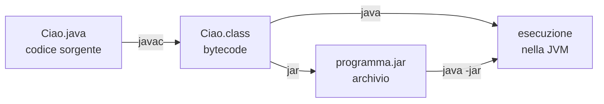
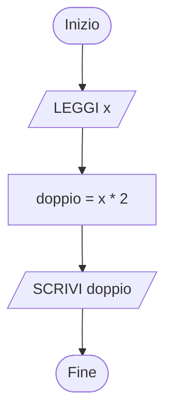
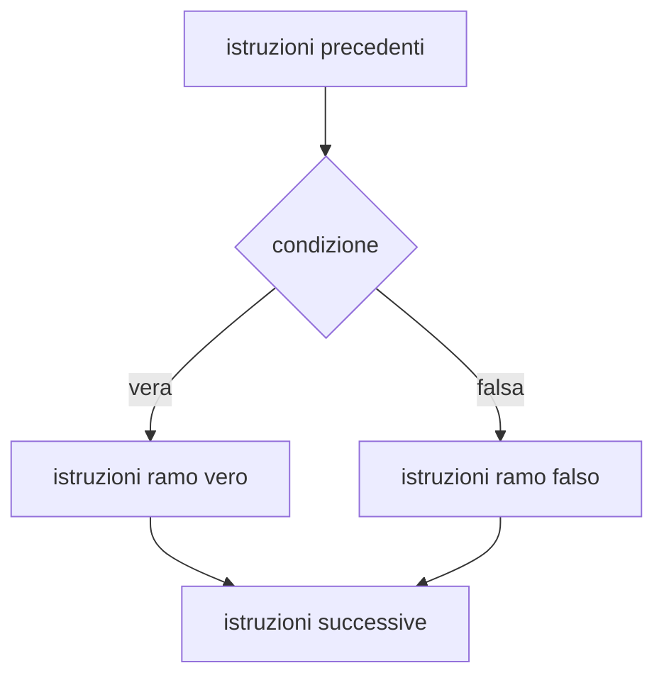
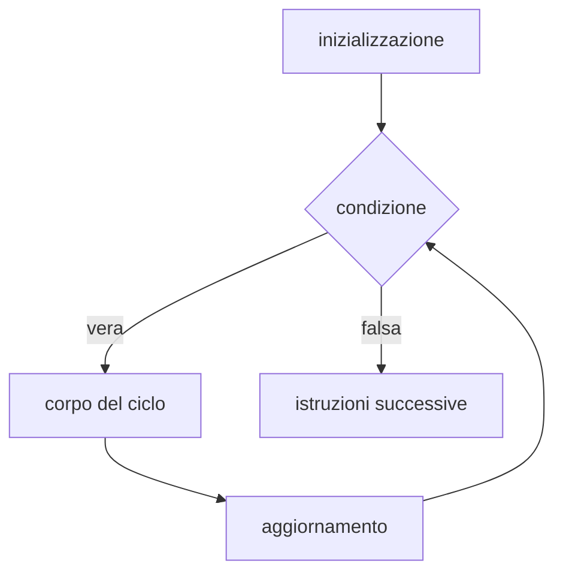

# Programmazione di base in Java: metodo ed esercizi graduali

Percorso di esercizi graduali sui concetti fondamentali della programmazione, per il recupero e il consolidamento.  
Ogni concetto è presentato prima in forma indipendente dal linguaggio (diagramma di flusso e pseudo-codice), poi in Java.

## Indice

- Parte 1 - Come usare questo documento
- Parte 2 - Perché la pratica regolare è decisiva
- Parte 3 - Metodo di lavoro e strumenti
- Parte 4 - Le attività dello sviluppo software
- Parte 5 - Gli strumenti di sviluppo del JDK: javac, java, classpath, jar, package
- Parte 6 - Errori frequenti e debug
- Parte 7 - Checklist di autoverifica
- Parte 8 - Pseudo-codice e corrispondenza con Java
- Parte 9 - Percorso a tappe
  - Tappa 1 - Sequenza, variabili, input e output
  - Tappa 2 - Espressioni e operatori
  - Tappa 3 - Selezione: if, if-else, if annidati
  - Tappa 4 - Selezione multipla: switch
  - Tappa 5 - Iterazione con while
  - Tappa 6 - Iterazione con do-while
  - Tappa 7 - Iterazione con for
  - Tappa 8 - Cicli annidati
  - Tappa 9 - Verifica sulle strutture di controllo
  - Tappa 10 - Metodi statici (funzioni)
  - Tappa 11 - Array
  - Tappa 12 - Stringhe
  - Tappa 13 - Classi come contenitori di dati
  - Tappa 14 - Riferimenti e memoria
  - Tappa 15 - Classi, package e jar

---

# Parte 1 - Come usare questo documento

## Struttura di ogni tappa

Ogni tappa ha la stessa struttura:

- **Obiettivi**  
  cosa si deve saper fare alla fine della tappa
- **Concetto**  
  spiegazione breve, con diagramma di flusso e pseudo-codice
- **Esempio svolto**  
  un problema risolto e commentato, da leggere, copiare, eseguire e modificare
- **Esercizi**  
  numerati, dal più semplice al più complesso

## Livelli degli esercizi

- **[B] Base**  
  esercizi che corrispondono agli obiettivi minimi; vanno svolti tutti, nell'ordine
- **[A] Approfondimento**  
  esercizi facoltativi o assegnati dal docente; si affrontano solo dopo aver completato quelli di base della stessa tappa

## Come è scritto un esercizio

Ogni esercizio ha un codice (per esempio **E5.3** = tappa 5, esercizio 3) e, quando utile:

- un **esempio di esecuzione**, cioè cosa deve comparire sullo schermo; le righe che iniziano con `>` sono i valori digitati dall'utente
- un **suggerimento**, nascosto: si apre cliccando sulla riga "Suggerimento" e va aperto solo dopo aver provato da soli

Un esercizio è completato quando il programma si compila senza errori, produce l'output dell'esempio e supera i controlli della Parte 7.

## Come segnalare una difficoltà

Gli esercizi sono graduali proprio per individuare il **primo punto di difficoltà**: quando ci si blocca va segnalato subito al docente, anche tramite la classroom digitale, indicando:

- il **codice dell'esercizio** (per esempio E5.3)
- cosa si è provato a fare e per quanto tempo
- cosa non funziona: messaggio di errore del compilatore, eccezione durante l'esecuzione, output diverso da quello atteso, oppure "non so da dove cominciare"
- il primo concetto non chiaro, se si tratta di teoria (pagina e frase del libro di testo o di questo documento)

Le informazioni si possono fornire anche in privato quando è preferibile.

---

# Parte 2 - Perché la pratica regolare è decisiva

La difficoltà più frequente per chi inizia a programmare è non sapere da dove cominciare a scrivere un programma. Un metodo di lavoro definito (Parte 3) aiuta, ma il fattore decisivo è la **pratica attiva e regolare**.

La programmazione richiede attitudini logico-matematiche, ma è anche una competenza operativa, un "saper fare". Da questo punto di vista il suo apprendimento è simile a quello di uno strumento musicale o di uno sport come il tennis o la pallavolo:

- a livello di base è alla portata di tutti, a condizione di praticare con regolarità
- senza pratica attiva e regolare i risultati mancano anche per le persone più predisposte

Con la pratica le difficoltà si riducono nel corso di settimane o di qualche mese. Il progresso spesso non è percepibile giorno per giorno, ma c'è.

Quando le difficoltà persistono è utile leggere, eseguire e modificare molti programmi elementari scritti da altri, a partire dagli esempi svolti di questo documento e del libro di testo: aiuta a riconoscere gli schemi ricorrenti (contatore, accumulatore, ricerca del massimo, controllo dell'input).

---

# Parte 3 - Metodo di lavoro e strumenti

## I quattro passi per ogni esercizio

1. **Capire la consegna**  
   Rileggere il testo, individuare i dati in ingresso (input), i risultati attesi (output) e la regola che li collega. Confrontarsi con l'esempio di esecuzione. Se qualcosa non è chiaro, chiedere al docente prima di scrivere codice.
2. **Scrivere l'algoritmo**  
   Diagramma di flusso (per esempio con Flowgorithm: <http://www.flowgorithm.org/>) oppure pseudo-codice. Questo passo è indipendente dal linguaggio ed è quello in cui si ragiona.
3. **Tradurre in codice**  
   Tradurre l'algoritmo in Java usando la tabella della Parte 8.
4. **Provare**  
   Eseguire il programma con i valori dell'esempio e con altri valori scelti apposta, compresi i casi limite (zero, numeri negativi, valori al confine di una condizione).

Il passo 2 non va saltato: scrivere direttamente codice è il motivo più frequente del "non so da dove cominciare".

La Parte 4 descrive le stesse attività nella forma usata nello sviluppo software professionale.

## Libro di testo e altre fonti

- Il **libro di testo** resta la base dello studio: questo documento lo integra, non lo sostituisce.
- Fa parte dello studio della teoria **eseguire al computer tutti gli esempi** del libro e capire ogni riga: in un programma un solo dettaglio sbagliato può impedirne il funzionamento.
- **Altre fonti** (siti, video) si usano dopo aver studiato l'argomento sul libro. Sono utili solo se lo studio è attivo: fermare il video, riscrivere il codice, eseguirlo, modificarlo. Guardare senza scrivere codice dà l'impressione di aver capito ma non produce apprendimento.
- Sito consigliato per esercitarsi, da concordare con il docente: W3Schools, tutorial Java: <https://www.w3schools.com/java/>

## Strumenti

- **JDK (Java Development Kit)**  
  contiene il compilatore e gli altri strumenti descritti nella Parte 5. Una distribuzione gratuita è Eclipse Temurin: <https://adoptium.net/installation>. Il docente indica la versione da installare; gli esempi di questo documento sono stati provati con JDK 21.
- **Editor/IDE**  
  quello usato nel libro di testo o indicato dal docente; in alternativa Visual Studio Code (<https://code.visualstudio.com/>) con l'estensione "Extension Pack for Java".
- **Linea di comando**  
  è consigliato saper compilare ed eseguire senza IDE, con i comandi della Parte 5: l'IDE esegue gli stessi comandi, e quando qualcosa non funziona sapere cosa fa aiuta a capire l'errore.

Strumenti diversi da quelli usati in classe vanno usati solo dopo aver imparato a usare quelli.

---

# Parte 4 - Le attività dello sviluppo software

Le attività seguenti ricorrono, in misura diversa, in tutti gli sviluppi software. Le metodologie di sviluppo vere e proprie, non necessarie a questo livello, le definiscono in dettaglio. I quattro passi della Parte 3 ne sono una versione semplificata.

| Attività | Nel mondo del lavoro | In questi esercizi |
|---|---|---|
| **Requisiti e specifiche** | descrizione completa di ciò che il software deve fare; può occupare centinaia o migliaia di pagine | il testo dell'esercizio |
| **Analisi** | verifica che requisiti e specifiche siano stati compresi; prime ipotesi di soluzione ad alto livello; produce documenti | capire la consegna, chiedendo al docente se necessario; nei progetti, un breve documento informale ma preciso |
| **Architettura** | struttura complessiva di un sistema software | non necessaria |
| **Algoritmo** | processo di soluzione indipendente dal linguaggio | diagramma di flusso (Flowgorithm), pseudo-codice; UML per la programmazione a oggetti |
| **Progettazione** | definizione delle soluzioni tenendo conto degli strumenti di implementazione | per esercizi semplici coincide con l'algoritmo; nei casi più complessi si usa UML |
| **Programmazione** | codifica nel linguaggio di programmazione | traduzione in Java |
| **Testing** | verifica sistematica, spesso con strumenti dedicati | prova con dati scelti (10-100 casi); utile scrivere un metodo che genera i dati di prova e uno che esegue i test |

---

# Parte 5 - Gli strumenti di sviluppo del JDK

## Dal codice sorgente all'esecuzione

Un programma Java passa per tre fasi:



- **Codice sorgente**: file di testo con estensione `.java`, scritto dal programmatore.
- **Bytecode**: file `.class` prodotto dal compilatore `javac`. Non è codice macchina di un processore specifico, ma istruzioni per la **JVM** (Java Virtual Machine).
- **Esecuzione**: il comando `java` avvia la JVM, che carica i file `.class` ed esegue il programma. Per questo lo stesso `.class` funziona su Windows, Linux e macOS.
- **Archivio jar**: un unico file che raccoglie molti `.class`, per distribuire il programma.

Strumenti principali del JDK:

| Comando | Funzione |
|---|---|
| `javac` | compila i file `.java` e produce i file `.class` |
| `java` | esegue un programma |
| `jar` | crea, elenca ed estrae archivi `.jar` |

Documentazione ufficiale (Oracle, JDK 21):

- comando javac: <https://docs.oracle.com/en/java/javase/21/docs/specs/man/javac.html>
- comando jar: <https://docs.oracle.com/en/java/javase/21/docs/specs/man/jar.html>

## Il primo programma: javac e java

```java
public class Ciao {
    public static void main(String[] args) {
        System.out.println("Ciao");
    }
}
```

Regole fondamentali:

- ogni programma Java è contenuto in una **classe**
- l'esecuzione parte dal metodo `public static void main(String[] args)`
- una classe dichiarata `public` deve stare in un file con **lo stesso nome**, maiuscole comprese: la classe `Ciao` va nel file `Ciao.java`

Compilazione ed esecuzione, dalla cartella che contiene `Ciao.java`:

```text
javac Ciao.java
java Ciao
```

- `javac` riceve il **nome del file**, con l'estensione `.java`
- `java` riceve il **nome della classe**, senza estensione: `java Ciao.class` è un errore

Se nome del file e nome della classe non coincidono, `javac` segnala:

```text
Ciao2.java:1: error: class Saluto is public, should be declared in a file named Saluto.java
```

Scorciatoia per i programmi di un solo file (JDK 11 e successivi): `java Ciao.java` compila in memoria ed esegue, senza produrre il file `.class`. Se il file contiene più classi, quella con il `main` deve essere la prima. È comoda per i primi esercizi, ma non sostituisce `javac` quando il programma è formato da più file.

## Programmi su più file

Quando un programma usa più classi, la regola è **una classe pubblica per file**:

```text
esercizio/
    Punto.java       contiene public class Punto
    Main.java        contiene public class Main, con il metodo main
```

Si compilano tutti i file insieme e si esegue la classe che contiene `main`:

```text
javac Punto.java Main.java
java Main
```

Oppure, in modo equivalente: `javac *.java`.

## Package e directory

Un **package** è un gruppo di classi con un nome, per esempio `it.scuola.geometria`. Serve a organizzare programmi grandi e a evitare conflitti tra classi con lo stesso nome.

Il package si dichiara nella prima riga del file:

```java
package it.scuola.geometria;

public class Punto {
    // ...
}
```

Il nome completo della classe diventa `it.scuola.geometria.Punto`. Per usarla da un altro package si scrive `import it.scuola.geometria.Punto;` all'inizio del file.

**Il nome del package determina la posizione del file nelle directory**: ogni parte del nome, separata da un punto, corrisponde a una directory.

| Package | Directory |
|---|---|
| `it.scuola.geometria` | `it/scuola/geometria/` |
| `it.scuola.app` | `it/scuola/app/` |

Organizzazione tipica di un progetto, con i sorgenti in `src` e i file compilati in `out`:

```text
progetto/
    src/
        it/scuola/geometria/Punto.java    package it.scuola.geometria;
        it/scuola/app/Main.java           package it.scuola.app;
    out/
        it/scuola/geometria/Punto.class
        it/scuola/app/Main.class
```

Per la JVM questa corrispondenza è **obbligatoria**: cerca la classe `it.scuola.app.Main` nel file `it/scuola/app/Main.class` a partire dalla cartella indicata con l'opzione `-cp`, spiegata più avanti in questa parte. Se il file `.class` si trova in un'altra posizione, la classe non viene trovata:

```text
Error: Could not find or load main class it.scuola.app.Main
```

Per i file `.java` la stessa organizzazione è la convenzione seguita da tutti gli IDE e serve a `javac` per trovare da solo i sorgenti delle classi usate.

Documentazione: Oracle Java Tutorials, "Managing Source and Class Files": <https://docs.oracle.com/javase/tutorial/java/package/managingfiles.html>

### Compilare con i package: l'opzione -d

Dalla cartella `progetto`:

```text
javac -d out src/it/scuola/geometria/Punto.java src/it/scuola/app/Main.java
java -cp out it.scuola.app.Main
```

- `-d out` indica a `javac` la directory di destinazione: i `.class` vengono creati in `out`, nelle sottodirectory corrispondenti al package, create automaticamente se non esistono
- senza `-d`, ogni `.class` viene scritto accanto al suo `.java`; con i package questo produce file in posizioni che spesso non corrispondono a quelle attese dalla JVM
- `java` riceve il **nome completo** della classe, con il package: `it.scuola.app.Main`, non `Main` e non `it/scuola/app/Main`

Con l'opzione `-sourcepath src` basta indicare il file con `main`: `javac` trova e compila da solo le altre classi usate, cercandole in `src` secondo la struttura dei package.

```text
javac -d out -sourcepath src src/it/scuola/app/Main.java
```

## Il classpath

Il **classpath** è l'elenco dei posti in cui `java` e `javac` cercano i file `.class`. Si indica con l'opzione `-cp` (o la forma lunga `-classpath`, o `--class-path`).

Ogni voce del classpath può essere:

- una **directory**: le classi si cercano al suo interno, secondo la struttura dei package (`out/it/scuola/app/Main.class`)
- un **file jar**
- un **file zip**: un archivio zip che contiene i `.class` con la struttura delle directory dei package funziona esattamente come una directory

Esempi, tutti provati e funzionanti con il progetto dell'esempio precedente:

```text
java -cp out it.scuola.app.Main
java -cp classi.zip it.scuola.app.Main
java -cp outapp:geometria.jar it.scuola.app.Main
```

Nel terzo esempio le classi del programma sono nella directory `outapp` e la libreria `Punto` è nel file `geometria.jar`: le due voci sono separate da `:`.

| Sistema operativo | Separatore tra le voci |
|---|---|
| Linux, macOS | `:` (due punti) |
| Windows | `;` (punto e virgola) |

Altre regole:

- se non si indica `-cp`, il classpath è la directory corrente; se si indica `-cp`, la directory corrente **non** è più inclusa, a meno di aggiungerla con `.` (per esempio `-cp .:lib.jar`)
- la voce `lib/*` indica tutti i file `.jar` della directory `lib`, ma non i `.class` sciolti né le sottodirectory
- il classpath si può impostare anche con la variabile d'ambiente `CLASSPATH`; l'opzione `-cp` ha la precedenza ed è preferibile, perché rende esplicito il classpath di ogni comando
- `javac` usa il classpath per trovare le classi **già compilate** usate dal codice, per esempio una libreria in un jar: `javac -d outapp -cp geometria.jar src/it/scuola/app/Main.java`

Se una classe necessaria non è nel classpath, l'errore è diverso a seconda del momento:

| Momento | Messaggio tipico |
|---|---|
| compilazione | `error: package it.scuola.geometria does not exist` oppure `cannot find symbol` |
| avvio | `Error: Could not find or load main class ...` (la classe con `main` non si trova) |
| esecuzione | `NoClassDefFoundError: it/scuola/geometria/Punto` (una classe usata dal programma non si trova) |

Documentazione: Oracle, "Setting the Class Path" (JDK 8, ancora valida per i concetti di base, compresi file zip e jar): <https://docs.oracle.com/javase/8/docs/technotes/tools/unix/classpath.html>

## Lo strumento jar

Un file **jar** (Java ARchive) è un archivio in formato zip che contiene i file `.class`, con la struttura delle directory dei package, e un file descrittivo `META-INF/MANIFEST.MF`. Serve a distribuire un programma o una libreria come un unico file.

Comandi principali, dalla cartella `progetto` dopo la compilazione in `out`:

```text
jar --create --file geometria.jar -C out it/scuola/geometria
jar --list --file geometria.jar
jar --extract --file geometria.jar
```

- `--create --file nome.jar` crea l'archivio
- `-C out` significa "entra nella directory `out`" prima di aggiungere i file: così nell'archivio i percorsi iniziano da `it/`, come richiede la struttura dei package; `-C out .` aggiunge tutto il contenuto di `out`
- `--list` elenca il contenuto, utile per controllare che i percorsi siano corretti

Forme brevi equivalenti, molto diffuse: `jar cf`, `jar tf`, `jar xf` (create, list, extract con il nome del file).

### Jar eseguibile

Indicando la classe con `main` (punto di ingresso), il jar si può eseguire direttamente:

```text
jar --create --file app.jar --main-class it.scuola.app.Main -C out .
java -jar app.jar
```

Forma breve equivalente: `jar cfe app.jar it.scuola.app.Main -C out .`

L'opzione `--main-class` scrive nel manifest la riga:

```text
Main-Class: it.scuola.app.Main
```

Con `java -jar` **l'opzione `-cp` viene ignorata**: il classpath è il jar stesso. Se il programma usa classi contenute in altri jar, vanno indicate nel manifest con la riga `Class-Path`:

```text
Class-Path: geometria.jar
```

Il manifest si scrive in un file di testo (per esempio `manifest.txt`, terminato da un a capo) e si passa a `jar` con l'opzione `--manifest manifest.txt`. In alternativa si esegue senza `-jar`, indicando tutto nel classpath: `java -cp app.jar:geometria.jar it.scuola.app.Main`.

## Riepilogo dei comandi

| Obiettivo | Comando |
|---|---|
| compilare un file senza package | `javac Ciao.java` |
| eseguire una classe senza package | `java Ciao` |
| eseguire un singolo file sorgente | `java Ciao.java` |
| compilare un progetto con package | `javac -d out -sourcepath src src/it/scuola/app/Main.java` |
| eseguire una classe in un package | `java -cp out it.scuola.app.Main` |
| usare una libreria jar | `java -cp out:lib/libreria.jar it.scuola.app.Main` |
| creare un jar eseguibile | `jar --create --file app.jar --main-class it.scuola.app.Main -C out .` |
| eseguire un jar | `java -jar app.jar` |
| controllare il contenuto di un jar | `jar --list --file app.jar` |

Su Windows il separatore del classpath è `;` invece di `:`.

---

# Parte 6 - Errori frequenti e debug

## Leggere un errore del compilatore

Un messaggio di `javac` ha questa forma:

```text
Media.java:7: error: ';' expected
        int b = 5
                 ^
```

- `Media.java:7` è il file e la riga; il simbolo `^` indica il punto in cui il compilatore si è accorto dell'errore
- l'errore a volte è nella riga **precedente** a quella indicata
- correggere sempre il **primo** errore e ricompilare: molti errori successivi sono conseguenza del primo

## Leggere un'eccezione durante l'esecuzione

Se il programma si compila ma si interrompe durante l'esecuzione, Java stampa un'**eccezione**:

```text
Exception in thread "main" java.lang.ArrayIndexOutOfBoundsException: Index 5 out of bounds for length 5
	at Vettori.main(Vettori.java:9)
```

- la prima riga indica il tipo di errore e una descrizione
- la riga `at ...` indica il metodo, il file e la riga in cui si è verificato

## Errori frequenti

| Sintomo | Causa probabile |
|---|---|
| `';' expected` | manca il punto e virgola |
| `cannot find symbol` | variabile, metodo o classe non dichiarati, oppure nome scritto in modo diverso (maiuscole e minuscole contano), oppure manca un `import` |
| `class X is public, should be declared in a file named X.java` | nome del file diverso dal nome della classe |
| `variable x might not have been initialized` | variabile usata prima di averle assegnato un valore |
| `incompatible types: possible lossy conversion from double to int` | assegnamento di un numero con la virgola a una variabile `int` |
| `Could not find or load main class` | nome della classe sbagliato nel comando `java`, oppure classpath errato (Parte 5) |
| `InputMismatchException` | l'utente ha inserito un dato del tipo sbagliato; su un PC configurato in italiano i numeri con la virgola si scrivono con la virgola (`3,5`), non con il punto |
| `ArrayIndexOutOfBoundsException` | indice fuori dall'array: gli indici vanno da 0 a `length - 1` |
| `NullPointerException` | uso di un oggetto che non è stato creato con `new` |
| il programma non termina | nel ciclo manca l'aggiornamento della variabile, oppure la condizione non diventa mai falsa |
| il confronto tra stringhe dà `false` anche se il testo è uguale | stringhe confrontate con `==` invece che con `equals` |
| la media è un numero intero | divisione tra interi: usare `double` o dividere per `2.0` |
| il ciclo si esegue una volta in più o in meno | confusione tra `<` e `<=` nella condizione |

## Debug con le stampe di controllo

Quando il programma si compila ma il risultato è sbagliato:

1. aggiungere stampe temporanee dei valori delle variabili nei punti critici, per esempio all'inizio di ogni ripetizione di un ciclo:  
   `System.out.println("DEBUG i=" + i + " somma=" + somma);`
2. confrontare i valori stampati con quelli previsti, scritti prima su carta in una tabella con il valore di ogni variabile a ogni passo (tabella di **tracing**)
3. il primo punto in cui i valori sono diversi dal previsto indica dove si trova l'errore
4. eliminare le stampe di controllo quando il programma funziona

---

# Parte 7 - Checklist di autoverifica

Prima di considerare concluso un esercizio:

- il programma si compila senza errori; con `javac -Xlint:all` non compaiono avvisi (warning)
- l'output è identico a quello dell'esempio di esecuzione, compresi spazi e a capo
- il programma è stato provato con almeno tre valori diversi, compresi i casi limite (0, negativi, valore esattamente sul confine di una condizione)
- ogni ciclo termina, anche con valori di ingresso insoliti
- i nomi delle variabili descrivono il loro contenuto (`somma`, `eta`, non `a`, `b`, `x1`)
- sono rispettate le convenzioni di Java sui nomi: classi con l'iniziale maiuscola (`Punto`), variabili e metodi con l'iniziale minuscola (`calcolaMedia`), costanti in maiuscolo (`DIM`)
- il codice è indentato: il contenuto di ogni blocco `{ }` è spostato a destra
- è disponibile il diagramma di flusso o lo pseudo-codice

---

# Parte 8 - Pseudo-codice e corrispondenza con Java

| Pseudo-codice | Java |
|---|---|
| `INIZIO ... FINE` | `public static void main(String[] args) { ... }` |
| `SCRIVI "Ciao"` | `System.out.println("Ciao");` |
| `SCRIVI x` (senza andare a capo) | `System.out.print(x);` |
| `LEGGI x` (intero) | `x = sc.nextInt();` |
| `x ← 5` | `x = 5;` |
| `SE c ALLORA ... ALTRIMENTI ... FINE SE` | `if (c) { ... } else { ... }` |
| `MENTRE c ESEGUI ... FINE MENTRE` | `while (c) { ... }` |
| `ESEGUI ... MENTRE c` | `do { ... } while (c);` |
| `PER i DA 0 A 9 ... FINE PER` | `for (int i = 0; i <= 9; i++) { ... }` |
| `FUNZIONE f(a) ... RESTITUISCI r` | `static int f(int a) { ... return r; }` |

Nota sul ciclo `ESEGUI ... MENTRE c`: il ciclo **continua** finché la condizione `c` è vera, come in Java. In alcuni testi si trova la forma `RIPETI ... FINCHÉ c`, che invece **termina** quando `c` diventa vera: la condizione è quindi l'opposto.

Schema minimo di un programma Java che legge dati da tastiera, usato in tutti gli esempi:

```java
import java.util.Scanner;

public class Esercizio {
    public static void main(String[] args) {
        Scanner sc = new Scanner(System.in);
        // istruzioni
    }
}
```

Il file deve chiamarsi `Esercizio.java` (vedi Parte 5). Negli esempi successivi, per brevità, è mostrato solo il contenuto del `main`.

Lettura con `Scanner`:

| Tipo di dato | Istruzione |
|---|---|
| intero | `int n = sc.nextInt();` |
| numero con la virgola | `double d = sc.nextDouble();` |
| una parola | `String s = sc.next();` |
| una riga intera, con gli spazi | `String s = sc.nextLine();` |
| un carattere | `char c = sc.next().charAt(0);` |

---

# Parte 9 - Percorso a tappe

## Tappa 1 - Sequenza, variabili, input e output

### Obiettivi

- scrivere, compilare ed eseguire un programma
- dichiarare una variabile, assegnarle un valore, stamparla
- leggere un valore da tastiera

### Concetto

- **Sequenza**  
  le istruzioni vengono eseguite una dopo l'altra, dall'alto verso il basso.
- **Variabile**  
  zona di memoria con un nome e un tipo, che contiene un valore modificabile. Tipi principali: `int` (interi), `double` (numeri con la virgola), `char` (un carattere), `boolean` (vero/falso), `String` (testo).
- **Assegnamento**  
  `x = 5;` significa "metti 5 in x", non "x è uguale a 5". Il valore precedente viene perso.

Diagramma di flusso della sequenza:



### Esempio svolto

Problema: leggere un numero intero e stamparne il doppio.

Pseudo-codice:

```text
INIZIO
    SCRIVI "Inserisci un numero: "
    LEGGI x
    doppio ← x * 2
    SCRIVI "Il doppio e' ", doppio
FINE
```

Java:

```java
import java.util.Scanner;

public class Doppio {
    public static void main(String[] args) {
        Scanner sc = new Scanner(System.in);
        System.out.print("Inserisci un numero: ");
        int x = sc.nextInt();                          // input
        int doppio = x * 2;                            // calcolo e assegnamento
        System.out.println("Il doppio e' " + doppio);  // output
    }
}
```

L'operatore `+` tra un testo e un numero li unisce (concatenazione): `"Il doppio e' " + 14` produce `"Il doppio e' 14"`.

Esempio di esecuzione:

```text
Inserisci un numero: 
> 7
Il doppio e' 14
```

### Esercizi

#### E1.1 [B] Primo programma

Stampare il messaggio `Hello world`. Compilare con `javac` ed eseguire con `java` da linea di comando (vedi Parte 5).

#### E1.2 [B] Stampare una variabile

Dichiarare una variabile intera `num`, assegnarle il valore 5 e stamparla preceduta dal testo `num = `.

```text
num = 5
```

#### E1.3 [B] Cambiare valore

Partendo da E1.2: dopo la stampa, assegnare a `num` il valore 8 e stamparla di nuovo.

```text
num = 5
num = 8
```

#### E1.4 [B] Leggere un numero

Leggere un numero intero da tastiera e stamparlo.

```text
Inserisci un numero: 
> 42
Hai inserito 42
```

#### E1.5 [B] Leggere un numero con la virgola

Come E1.4, ma con un numero di tipo `double`.

```text
Inserisci un numero: 
> 3,5
Hai inserito 3.5
```

<details>
<summary>Suggerimento</summary>

`Scanner` usa le impostazioni della lingua del computer: su un PC configurato in italiano `nextDouble()` si aspetta la **virgola** (`3,5`) e con il punto (`3.5`) si interrompe con `InputMismatchException`. Per accettare sempre il punto, creare lo Scanner così:  
`Scanner sc = new Scanner(System.in).useLocale(java.util.Locale.US);`  
Nella stampa e nel codice sorgente, invece, Java usa sempre il punto.

</details>

#### E1.6 [B] Leggere una parola

Leggere una parola e stamparla.

```text
Come ti chiami? 
> Anna
Ciao Anna
```

<details>
<summary>Suggerimento</summary>

`sc.next()` legge una sola parola (si ferma al primo spazio); `sc.nextLine()` legge l'intera riga.

</details>

#### E1.7 [A] Scambio di due variabili

Assegnare `a = 3` e `b = 8`, scambiarne i valori e stamparli.

```text
Prima: a = 3, b = 8
Dopo: a = 8, b = 3
```

<details>
<summary>Suggerimento</summary>

Scrivere `a = b; b = a;` non funziona: dopo la prima istruzione il valore originale di `a` è perso. Serve una terza variabile di appoggio.

</details>

---

## Tappa 2 - Espressioni e operatori

### Obiettivi

- usare gli operatori aritmetici, compresi divisione intera e resto
- scrivere condizioni con operatori di confronto e operatori logici

### Concetto

- **Operatori aritmetici**: `+  -  *  /  %`  
  Tra due interi, `/` dà la **divisione intera** (`7 / 2` vale 3) e `%` il **resto** (`7 % 2` vale 1). Tra numeri `double`, `/` dà il risultato con la virgola (`7.0 / 2` vale 3.5).
- **Operatori di confronto**: `==  !=  <  <=  >  >=`  
  Il risultato è un `boolean`, cioè `true` o `false`. Attenzione: `=` assegna, `==` confronta.
- **Operatori logici**: `&&` (e), `||` (o), `!` (non)  
  Servono per combinare più condizioni: `eta >= 18 && eta < 65`.

Il resto della divisione è lo strumento principale per molti esercizi successivi:

| Condizione | Significato |
|---|---|
| `n % 2 == 0` | n è pari |
| `n % 2 != 0` | n è dispari |
| `n % 5 == 0` | n è multiplo di 5 |

### Esempio svolto

Problema: leggere i minuti totali e stamparli come ore e minuti.

```text
INIZIO
    LEGGI totale
    ore ← totale / 60
    minuti ← totale % 60
    SCRIVI ore, " ore e ", minuti, " minuti"
FINE
```

```java
int totale = sc.nextInt();
int ore = totale / 60;
int minuti = totale % 60;
System.out.println(ore + " ore e " + minuti + " minuti");
```

```text
> 135
2 ore e 15 minuti
```

### Esercizi

#### E2.1 [B] Le quattro operazioni

Leggere due interi `a` e `b` e stampare somma, differenza, prodotto, divisione intera e resto.

```text
> 17
> 5
Somma: 22
Differenza: 12
Prodotto: 85
Divisione intera: 3
Resto: 2
```

<details>
<summary>Suggerimento</summary>

In una stampa le operazioni vanno tra parentesi: `"Somma: " + a + b` unisce i testi e stampa `Somma: 175`; `"Somma: " + (a + b)` stampa `Somma: 22`.

</details>

#### E2.2 [B] Media di due numeri

Leggere due interi e stampare la media con la virgola.

```text
> 7
> 8
Media: 7.5
```

<details>
<summary>Suggerimento</summary>

`(a + b) / 2` tra interi dà 7, non 7.5. Dividere per `2.0` oppure usare variabili `double`.

</details>

#### E2.3 [B] Pari o dispari (solo calcolo)

Leggere un intero e stampare il resto della divisione per 2. Provare con diversi numeri e osservare: per quali numeri il resto è 0?

#### E2.4 [B] Valore di una condizione

Leggere un intero `n` e stampare il valore delle espressioni `n > 10`, `n % 2 == 0`, `n > 10 && n % 2 == 0`.

```text
> 12
n > 10: true
n pari: true
n > 10 e pari: true
```

#### E2.5 [A] Cifre di un numero

Leggere un intero di tre cifre e stampare separatamente centinaia, decine e unità.

```text
> 472
Centinaia: 4
Decine: 7
Unita': 2
```

<details>
<summary>Suggerimento</summary>

Le unità sono `n % 10`; le centinaia sono `n / 100`; per le decine combinare `/` e `%`.

</details>

---

## Tappa 3 - Selezione: if, if-else, if annidati

### Obiettivi

- eseguire istruzioni solo se una condizione è vera
- scegliere tra due alternative
- gestire più di due casi con una catena di `if ... else if`

### Concetto

Diagramma di flusso di `if-else`:



Con il solo `if` il ramo falso è vuoto: se la condizione è falsa si passa direttamente alle istruzioni successive.

```text
SE eta >= 18 ALLORA
    SCRIVI "maggiorenne"
ALTRIMENTI
    SCRIVI "minorenne"
FINE SE
```

```java
if (eta >= 18) {
    System.out.println("maggiorenne");
} else {
    System.out.println("minorenne");
}
```

Con più di due casi si usa una **catena**: le condizioni sono controllate in ordine e viene eseguito solo il primo ramo con condizione vera.

```java
if (n > 0) {
    System.out.println("positivo");
} else if (n < 0) {
    System.out.println("negativo");
} else {
    System.out.println("zero");
}
```

### Esempio svolto

Problema: leggere un voto da 1 a 10 e stampare "insufficiente" (sotto 6), "sufficiente" (6) o "buono" (7 o più); per valori fuori dall'intervallo stampare "voto non valido".

```text
LEGGI voto
SE voto < 1 O voto > 10 ALLORA
    SCRIVI "voto non valido"
ALTRIMENTI SE voto < 6 ALLORA
    SCRIVI "insufficiente"
ALTRIMENTI SE voto == 6 ALLORA
    SCRIVI "sufficiente"
ALTRIMENTI
    SCRIVI "buono"
FINE SE
```

```java
int voto = sc.nextInt();
if (voto < 1 || voto > 10) {
    System.out.println("voto non valido");
} else if (voto < 6) {
    System.out.println("insufficiente");
} else if (voto == 6) {
    System.out.println("sufficiente");
} else {
    System.out.println("buono");
}
```

Il controllo dei valori non validi va messo per primo: altrimenti, per esempio, il voto -3 verrebbe classificato "insufficiente".

### Esercizi

In questa tappa i valori si leggono da tastiera, così il programma si può provare con valori diversi senza ricompilarlo.

#### E3.1 [B] Maggiorenne

Leggere l'età di una persona e stampare `maggiorenne` se è maggiore o uguale a 18. Per le altre età non stampare nulla.

#### E3.2 [B] Minorenne

Leggere l'età e stampare `minorenne` se è minore di 18.

#### E3.3 [B] Maggiorenne o minorenne

Leggere l'età e stampare `maggiorenne` oppure `minorenne`, usando un solo `if-else`.

```text
> 15
minorenne
```

Provare con 17, 18 e 19: il valore 18 è il caso limite.

#### E3.4 [B] Positivo o negativo

Leggere un intero e stampare `positivo` se è maggiore o uguale a zero, altrimenti `negativo`.

#### E3.5 [B] Positivo, negativo o zero

Leggere un intero e stampare `positivo`, `negativo` oppure `zero`.

#### E3.6 [B] Pari o dispari

Leggere un intero e stampare `pari` o `dispari`.

#### E3.7 [B] Il maggiore di due

Leggere due interi e stampare il maggiore; se sono uguali stampare `uguali`.

#### E3.8 [B] Esito dell'esame

Leggere un voto universitario e stampare:

- `esame non passato` se è minore di 18
- `sufficiente` se è da 18 a 24 (estremi inclusi)
- `buono` se è da 25 a 27
- `molto buono` se è da 28 a 30
- `voto non valido` se è minore di 0 o maggiore di 30

#### E3.9 [B] Condizioni composte

Leggere l'età e un carattere per il sesso (`M` o `F`) e stampare:

- `ragazzo` se età <= 20 e sesso `M`
- `ragazza` se età <= 20 e sesso `F`
- `uomo` se età > 20 e sesso `M`
- `donna` se età > 20 e sesso `F`
- `dato non valido` se il carattere non è né `M` né `F`

```text
> 16
> F
ragazza
```

<details>
<summary>Suggerimento</summary>

Leggere il carattere con `char sesso = sc.next().charAt(0);` e confrontarlo con `sesso == 'M'` (apici singoli per un carattere). Una soluzione usa quattro condizioni con `&&`; un'altra usa un `if` sul sesso con dentro un `if` sull'età.

</details>

#### E3.10 [A] Il maggiore di tre

Leggere tre interi e stampare il maggiore.

#### E3.11 [A] Anno bisestile

Leggere un anno e stampare se è bisestile. Un anno è bisestile se è divisibile per 4 ma non per 100, oppure se è divisibile per 400 (2024 sì, 1900 no, 2000 sì).

---

## Tappa 4 - Selezione multipla: switch

### Obiettivi

- scegliere tra molti casi in base al valore di una variabile
- capire l'effetto di `break`

### Concetto

`switch` confronta il valore di una variabile con un elenco di **valori costanti**:

```java
switch (scelta) {
    case 1:
        System.out.println("uno");
        break;
    case 2:
        System.out.println("due");
        break;
    default:
        System.out.println("altro");
}
```

- In Java funziona con `int`, `char` e `String`, non con `double` né con `boolean`.
- Ogni `case` indica **valori singoli**: non esistono intervalli come "da 18 a 24". Per gli intervalli si usa la catena di `if ... else if` della tappa 3.
- `break` fa uscire dallo `switch`. Senza `break` l'esecuzione **prosegue nel case successivo**.
- `default` gestisce tutti i valori non elencati.

In pseudo-codice:

```text
SELEZIONA scelta
    CASO 1: SCRIVI "uno"
    CASO 2: SCRIVI "due"
    ALTRIMENTI: SCRIVI "altro"
FINE SELEZIONA
```

### Esempio svolto

Problema: leggere un carattere e stampare se è una vocale minuscola.

```java
char c = sc.next().charAt(0);
switch (c) {
    case 'a':
    case 'e':
    case 'i':
    case 'o':
    case 'u':
        System.out.println("vocale");
        break;
    default:
        System.out.println("non vocale");
}
```

I cinque `case` senza istruzioni condividono lo stesso codice. Dalla versione 14 di Java si può scrivere anche `case 'a', 'e', 'i', 'o', 'u':`.

### Esercizi

#### E4.1 [B] Premi

Leggere un numero e stampare:

- 20: `vinto il terzo premio`
- 30: `vinto il secondo premio`
- 40: `vinto il primo premio`
- qualunque altro valore: `riprova, sarai piu' fortunato`

#### E4.2 [B] Giorno della settimana

Leggere un numero da 1 a 7 e stampare il nome del giorno (1 = lunedì). Per altri valori stampare `numero non valido`.

#### E4.3 [B] Più valori, stesso codice

Leggere un numero da 1 a 7 e stampare `feriale` per i valori da 1 a 6 e `festivo` per 7.

#### E4.4 [B] Calcolatrice

Leggere due interi e un carattere operatore (`+`, `-`, `*`, `/`) e stampare il risultato. Con un operatore diverso stampare `operatore non valido`; con `/` e secondo numero 0 stampare `divisione per zero`.

```text
> 12
> 4
> *
48
```

#### E4.5 [B] Effetto del break

Senza eseguirlo, scrivere su carta cosa stampa questo codice con `n = 2`. Poi eseguirlo e confrontare.

```java
switch (n) {
    case 1: System.out.print("uno ");
    case 2: System.out.print("due ");
    case 3: System.out.print("tre ");
        break;
    default: System.out.print("altro ");
}
```

#### E4.6 [A] Switch su una stringa

Leggere una parola tra `rosso`, `giallo`, `verde` e stampare l'azione corrispondente del semaforo (`fermati`, `rallenta`, `passa`); per altre parole stampare `colore non valido`.

#### E4.7 [A] Confronto if e switch

Riscrivere E4.2 con una catena di `if ... else if`. Quale delle due versioni è più leggibile? Perché per E3.8 invece lo `switch` non è adatto?

#### E4.8 [A] Switch con le frecce (Java 14 e successivi)

Riscrivere E4.2 con la forma `case 1 -> System.out.println("lunedi'");`. In questa forma non serve `break`: viene eseguito solo il codice dopo la freccia.

---

## Tappa 5 - Iterazione con while

### Obiettivi

- ripetere istruzioni finché una condizione è vera
- usare un **contatore** e un **accumulatore**
- individuare quando un ciclo termina

### Concetto

Il ciclo `while` controlla la condizione **prima** di ogni ripetizione: se è falsa già all'inizio, il corpo non viene eseguito nemmeno una volta.


Ogni ciclo ha tre elementi; se ne manca uno il ciclo non parte o non termina:

| Elemento | Esempio |
|---|---|
| inizializzazione, prima del ciclo | `i = 0;` |
| condizione | `while (i <= 10)` |
| aggiornamento, nel corpo | `i = i + 1;` |

Due schemi ricorrenti:

- **contatore**  
  variabile che aumenta di 1 a ogni ripetizione: `conta = conta + 1;`
- **accumulatore**  
  variabile che raccoglie un risultato, per esempio una somma: `somma = somma + x;`. Va inizializzata prima del ciclo (a 0 per una somma, a 1 per un prodotto).

### Esempio svolto

Problema: stampare la somma dei numeri da 1 a 5.

```text
somma ← 0
i ← 1
MENTRE i <= 5 ESEGUI
    somma ← somma + i
    i ← i + 1
FINE MENTRE
SCRIVI somma
```

```java
int somma = 0;
int i = 1;
while (i <= 5) {
    somma = somma + i;
    i = i + 1;
}
System.out.println("Somma: " + somma);
```

Esecuzione passo per passo (**tracing**):

| Ripetizione | i all'inizio | somma alla fine |
|---|---|---|
| 1 | 1 | 1 |
| 2 | 2 | 3 |
| 3 | 3 | 6 |
| 4 | 4 | 10 |
| 5 | 5 | 15 |
| controllo finale | 6 | condizione falsa, uscita |

Costruire una tabella come questa è il modo più efficace per capire un ciclo che non funziona.

### Esercizi

#### E5.1 [B] Contare da 0 a 10

Stampare i numeri da 0 a 10 (estremi inclusi), uno per riga.

#### E5.2 [B] Contare all'indietro

Stampare i numeri da 0 a -10 (estremi inclusi): 0, -1, -2, ..., -10.

#### E5.3 [B] Numeri pari

Stampare i numeri pari da 0 a 10 (estremi inclusi).

```text
0 2 4 6 8 10
```

<details>
<summary>Suggerimento</summary>

Due soluzioni possibili: aumentare la variabile di 2 a ogni ripetizione, oppure aumentarla di 1 e stampare solo quando `i % 2 == 0`. Per stampare sulla stessa riga usare `System.out.print(i + " ");`.

</details>

#### E5.4 [B] Multipli di 5

Stampare i multipli di 5 minori di 30, partendo da 0.

```text
0 5 10 15 20 25
```

#### E5.5 [B] Somma dei numeri inseriti

Leggere numeri interi finché l'utente inserisce 0, poi stampare la somma dei numeri inseriti.

```text
> 4
> 7
> 2
> 0
Somma: 13
```

<details>
<summary>Suggerimento</summary>

Leggere il primo numero prima del ciclo; nel corpo del ciclo sommare il numero e leggere il successivo. Il valore 0 che termina l'inserimento si chiama **sentinella**.

</details>

#### E5.6 [B] Moltiplicazione con le somme

Leggere due interi non negativi `m` e `n` e calcolare `m * n` sommando `n` volte `m`, senza usare l'operatore `*`.

```text
> 4
> 3
4 * 3 = 12
```

#### E5.7 [A] Divisione con le sottrazioni

Leggere due interi positivi `a` e `b` e calcolare quoziente e resto della divisione intera sottraendo `b` da `a` finché è possibile, senza usare `/` e `%`.

```text
> 17
> 5
Quoziente: 3, resto: 2
```

<details>
<summary>Suggerimento</summary>

Il quoziente è il numero di sottrazioni eseguite (un contatore); il resto è il valore rimasto in `a` alla fine.

</details>

#### E5.8 [A] Conteggio delle cifre

Leggere un intero positivo e stampare quante cifre ha.

---

## Tappa 6 - Iterazione con do-while

### Obiettivi

- ripetere istruzioni almeno una volta
- usare il ciclo per controllare i dati inseriti dall'utente

### Concetto

Il ciclo `do-while` controlla la condizione **dopo** ogni ripetizione: il corpo viene eseguito **almeno una volta**. È lo schema naturale quando bisogna prima chiedere un dato e poi decidere se ripetere.


Attenzione al punto e virgola dopo `while (condizione)`: nel `do-while` è obbligatorio.

### Esempio svolto

Problema: chiedere un numero da 1 a 10, ripetendo la richiesta finché il valore non è valido.

```text
ESEGUI
    SCRIVI "Numero da 1 a 10: "
    LEGGI n
MENTRE n < 1 O n > 10
SCRIVI "Hai scelto ", n
```

```java
int n;
do {
    System.out.print("Numero da 1 a 10: ");
    n = sc.nextInt();
} while (n < 1 || n > 10);
System.out.println("Hai scelto " + n);
```

```text
Numero da 1 a 10: 
> 15
Numero da 1 a 10: 
> 0
Numero da 1 a 10: 
> 7
Hai scelto 7
```

La condizione descrive quando **ripetere**, cioè quando il dato è sbagliato. La variabile `n` è dichiarata prima del `do`, perché una variabile dichiarata dentro le graffe non è visibile nella condizione.

### Esercizi

#### E6.1 [B] Numero positivo

Chiedere un intero positivo, ripetendo la richiesta finché il valore inserito è minore o uguale a zero. Alla fine stamparlo.

#### E6.2 [B] Indovinello semplice

Il numero segreto è 10. Chiedere un numero con il messaggio `Inserisci un numero per indovinare: ` e ripetere la richiesta finché l'utente non inserisce 10; a quel punto stampare `Hai indovinato` e terminare.

#### E6.3 [B] Indovinello con messaggi

Come E6.2, ma dopo ogni tentativo sbagliato stampare `Non hai indovinato`.

```text
Inserisci un numero per indovinare: 
> 4
Non hai indovinato
Inserisci un numero per indovinare: 
> 10
Hai indovinato
```

#### E6.4 [A] Indovinello con aiuto e tentativi

Come E6.3, ma dopo ogni tentativo sbagliato stampare `troppo alto` o `troppo basso`; alla fine stampare il numero di tentativi.

#### E6.5 [A] Menu ripetuto

Mostrare un menu con le voci `1. Saluta`, `2. Stampa la data di oggi (scritta nel codice)`, `0. Esci`; eseguire la voce scelta e ripresentare il menu finché l'utente non sceglie 0. Usare `do-while` per la ripetizione e `switch` per la scelta.

---

## Tappa 7 - Iterazione con for

### Obiettivi

- ripetere istruzioni un numero di volte noto
- scegliere tra `while`, `do-while` e `for`

### Concetto

Il `for` raccoglie in una sola riga i tre elementi del ciclo:

```java
for (int i = 0; i <= 10; i++) {
    System.out.println(i);
}
```

| Parte | Esempio | Quando viene eseguita |
|---|---|---|
| inizializzazione | `int i = 0` | una volta, all'inizio |
| condizione | `i <= 10` | prima di ogni ripetizione |
| aggiornamento | `i++` | dopo ogni ripetizione |

`i++` equivale a `i = i + 1`; `i += 2` equivale a `i = i + 2`.



Il `for` è un `while` con i tre elementi scritti nello stesso punto: i due cicli seguenti sono equivalenti.

```java
int i = 0;
while (i < n) {
    // corpo
    i++;
}

for (int j = 0; j < n; j++) {
    // corpo
}
```

Scelta del ciclo:

| Situazione | Ciclo |
|---|---|
| numero di ripetizioni noto prima di iniziare | `for` |
| ripetizione finché vale una condizione, anche zero volte | `while` |
| almeno una ripetizione, per esempio chiedere un dato | `do-while` |

### Esempio svolto

Problema: stampare la tabellina di un numero letto da tastiera.

```text
LEGGI n
PER i DA 1 A 10
    SCRIVI n, " x ", i, " = ", n * i
FINE PER
```

```java
int n = sc.nextInt();
for (int i = 1; i <= 10; i++) {
    System.out.println(n + " x " + i + " = " + (n * i));
}
```

### Esercizi

Negli esercizi di questa tappa usare una costante con nome invece di scrivere il numero direttamente nel codice:

```java
final int N = 10;
```

`final` indica che il valore non può più essere modificato. Così, per cambiare il limite, basta modificare una sola riga.

#### E7.1 [B] Contare da 0 a N

Stampare i numeri da 0 a N (estremi inclusi).

#### E7.2 [B] Pari con passo 2

Stampare i numeri pari da 0 a N usando `i += 2` come aggiornamento.

#### E7.3 [B] Multipli di 5 con passo 5

Stampare i multipli di 5 da 0 a N usando `i += 5`.

#### E7.4 [B] Pari con if

Stampare i numeri pari da 0 a N aumentando `i` di 1 e controllando con un `if` nel corpo del ciclo se il numero è pari.

#### E7.5 [B] Multipli di 5 con if

Come E7.4, per i multipli di 5.

#### E7.6 [B] Conto alla rovescia

Stampare i numeri da N-1 a 0.

```text
9 8 7 6 5 4 3 2 1 0
```

#### E7.7 [B] Dispari all'indietro

Stampare i numeri dispari da N-1 a 0 usando `i -= 2`.

#### E7.8 [B] Moltiplicazione con le somme

Riscrivere E5.6 con un ciclo `for`. Quale delle due versioni è più naturale, e perché?

#### E7.9 [B] Potenza

Leggere base e esponente (intero non negativo) e calcolare la potenza con un ciclo `for`, senza usare `Math.pow`.

```text
> 2
> 5
2^5 = 32
```

<details>
<summary>Suggerimento</summary>

È un accumulatore per il prodotto: va inizializzato a 1. Con esponente 0 il ciclo non si esegue e il risultato è correttamente 1.

</details>

#### E7.10 [A] Fattoriale

Leggere un intero n da 0 a 20 e calcolare n! = 1 * 2 * ... * n (0! vale 1). Usare una variabile di tipo `long`: con `int` il risultato è sbagliato già per 13!.

#### E7.11 [A] for senza condizione e break

Completare il codice in modo che il ciclo termini dopo 10 ripetizioni, usando l'istruzione `break` (che esce immediatamente dal ciclo).

```java
int i = 0;
for ( ; ; ) {
    System.out.println(i + " questo ciclo non termina da solo");
    // aggiungere qui il codice per uscire dopo 10 ripetizioni
}
```

---

## Tappa 8 - Cicli annidati

### Obiettivi

- usare un ciclo dentro un altro ciclo
- prevedere quante volte viene eseguito il ciclo interno

### Concetto

Quando un ciclo è dentro un altro, per **ogni** ripetizione del ciclo esterno il ciclo interno viene eseguito **completamente**. Lo schema tipico è quello delle righe e colonne:

```java
for (int riga = 1; riga <= 3; riga++) {
    for (int col = 1; col <= 4; col++) {
        System.out.print("* ");
    }
    System.out.println();   // a capo alla fine di ogni riga
}
```

```text
* * * * 
* * * * 
* * * * 
```

Il ciclo interno viene eseguito 3 x 4 = 12 volte in totale. Le due variabili devono avere nomi diversi.

### Esercizi

#### E8.1 [B] Rettangolo

Leggere numero di righe e di colonne e stampare un rettangolo di asterischi.

#### E8.2 [B] Triangolo

Leggere un numero n e stampare un triangolo di n righe: la riga 1 ha un asterisco, la riga 2 ne ha due, e così via.

```text
> 4
* 
* * 
* * * 
* * * * 
```

<details>
<summary>Suggerimento</summary>

Il ciclo interno non ha un limite fisso: il suo limite è il numero della riga corrente.

</details>

#### E8.3 [B] Tavola pitagorica

Stampare la tavola pitagorica da 1 a 10.

#### E8.4 [A] Triangolo rovesciato

Come E8.2, ma con la riga più lunga in alto.

---

## Tappa 9 - Verifica sulle strutture di controllo

#### E9.1 [B] Esercizio riassuntivo

Scrivere un programma che:

- chieda all'utente un intero positivo, ripetendo la richiesta finché il valore non è positivo (`do-while`)
- stampi tutti i numeri da 1 fino al numero inserito (`while` o `for`)
- accanto a ogni numero scriva `pari` o `dispari` (`if`)

```text
Inserisci un intero positivo: 
> -2
Inserisci un intero positivo: 
> 4
1 dispari
2 pari
3 dispari
4 pari
```

#### E9.2 [A] Statistiche

Leggere numeri interi finché l'utente inserisce 0 e stampare: quanti numeri sono stati inseriti (escluso lo 0), la somma, il massimo, quanti sono pari.

---

## Tappa 10 - Metodi statici (funzioni)

### Obiettivi

- scrivere e chiamare un metodo
- passare parametri e restituire un valore
- distinguere un metodo che restituisce un valore da uno che stampa

### Concetto

In Java le funzioni si chiamano **metodi** e stanno sempre dentro una classe. Per ora si scrivono come metodi `static`, nella stessa classe del `main`.

Un metodo è un blocco di istruzioni con un nome, che si può eseguire (chiamare) più volte. Serve a dividere un problema in parti più piccole e a non ripetere codice.

```java
static int quadrato(int x) {    // tipo restituito, nome, parametri
    return x * x;               // valore restituito
}
```

- **Parametri**: i dati che il metodo riceve, tra parentesi. Un metodo può non averne: `()`.
- **Valore restituito**: il risultato, indicato con `return`. Se il metodo non restituisce nulla il tipo è `void`.
- **Chiamata**: `int r = quadrato(5);` esegue il metodo con `x` uguale a 5 e mette 25 in `r`.

Restituire un valore e stamparlo sono cose diverse: un metodo che restituisce un valore non stampa nulla; è chi lo chiama a decidere cosa fare del risultato.

```text
FUNZIONE quadrato(x)
    RESTITUISCI x * x
FINE FUNZIONE
```

Tutti gli esercizi di questa tappa richiedono un programma completo, con un `main` che chiama il metodo e stampa il risultato.

### Esempio svolto

Problema: metodo che riceve due interi e restituisce il maggiore.

```java
import java.util.Scanner;

public class Maggiore {

    static int maggiore(int a, int b) {
        if (a > b) {
            return a;
        }
        return b;
    }

    public static void main(String[] args) {
        Scanner sc = new Scanner(System.in);
        int x = sc.nextInt();
        int y = sc.nextInt();
        System.out.println("Il maggiore e' " + maggiore(x, y));
        System.out.println("Prova: " + maggiore(3, 8) + " " + maggiore(8, 3));
    }
}
```

Il `main` contiene anche una riga di prova con valori fissi: è un modo semplice per verificare il metodo. In Java l'ordine dei metodi nella classe non conta: `maggiore` potrebbe stare anche dopo il `main`.

### Esercizi

#### E10.1 [B] Metodo senza parametri

Scrivere un metodo `saluta()` che non riceve parametri, non restituisce valori (`void`) e stampa `Hello world`. Chiamarlo tre volte dal `main`.

#### E10.2 [B] Successivo

Scrivere un metodo che riceve un intero e restituisce il valore aumentato di 1.

#### E10.3 [B] Calcolo

Scrivere un metodo che riceve un intero, gli aggiunge 10 e restituisce il risultato moltiplicato per 2. Con 5 deve restituire 30.

#### E10.4 [B] Non negativo

Scrivere un metodo che riceve un intero e restituisce un `boolean`: `true` se l'intero è maggiore o uguale a zero, `false` se è negativo.

#### E10.5 [B] Pari

Scrivere un metodo `pari(n)` che restituisce `true` se n è pari. Usarlo nel `main` per stampare i numeri pari da 1 a 20.

#### E10.6 [B] Due parametri

Scrivere un metodo che riceve due interi e restituisce il primo moltiplicato per 2 più il secondo moltiplicato per 3. Con 4 e 5 deve restituire 23.

#### E10.7 [B] Minore di due

Scrivere un metodo che riceve due numeri `double` e restituisce il minore.

#### E10.8 [B] Maggiore di tre

Scrivere un metodo che riceve tre numeri `double` e restituisce il maggiore.

<details>
<summary>Suggerimento</summary>

Si può usare al suo interno un metodo "maggiore di due" già scritto.

</details>

#### E10.9 [B] Potenza come metodo

Trasformare E7.9 in un metodo `potenza(base, esponente)` e usarlo per stampare le potenze di 2 da 2^0 a 2^10.

#### E10.10 [A] Aggiungere testo a una stringa

Scrivere un metodo che riceve una `String` e restituisce una stringa formata dai caratteri del parametro seguiti da `xxx`. Con `"hello"` deve restituire `"helloxxx"`.

#### E10.11 [A] Numero primo

Scrivere un metodo `primo(n)` che restituisce `true` se n è un numero primo (divisibile solo per 1 e per sé stesso). Usarlo per stampare i numeri primi minori di 50.

---

## Tappa 11 - Array

### Obiettivi

- creare un array e accedere ai suoi elementi tramite l'indice
- scorrere un array con un ciclo
- applicare gli schemi ricorrenti: somma, conteggio, massimo, ricerca

### Concetto

Un **array** (vettore) è una sequenza di variabili dello stesso tipo, con un solo nome, numerate da un **indice** che parte da 0.

```java
final int DIM = 5;
int[] v = new int[DIM];          // 5 interi, tutti inizialmente 0
int[] w = {7, 3, 5, 2, 4};       // creazione con valori iniziali
```

| Indice | 0 | 1 | 2 | 3 | 4 |
|---|---|---|---|---|---|
| Valore di w | 7 | 3 | 5 | 2 | 4 |

- `w[0]` è il primo elemento; `w.length` è il numero di elementi; `w[w.length - 1]` è l'ultimo.
- Usare un indice fuori dall'intervallo (per esempio `w[5]`) interrompe il programma con `ArrayIndexOutOfBoundsException`.
- Per scorrere tutti gli elementi si usa un `for` con l'indice da 0 a `length - 1`:

```java
for (int i = 0; i < w.length; i++) {
    System.out.println("w[" + i + "] = " + w[i]);
}
```

**Popolare** un array significa assegnare un valore a tutti i suoi elementi: con valori iniziali `{...}` come sopra, oppure leggendoli da tastiera.

### Esempio svolto

Problema: leggere 5 numeri e stampare il massimo.

```text
PER i DA 0 A DIM-1
    LEGGI v[i]
FINE PER
massimo ← v[0]
PER i DA 1 A DIM-1
    SE v[i] > massimo ALLORA
        massimo ← v[i]
    FINE SE
FINE PER
SCRIVI massimo
```

```java
final int DIM = 5;
int[] v = new int[DIM];
for (int i = 0; i < v.length; i++) {
    v[i] = sc.nextInt();
}
int massimo = v[0];
for (int i = 1; i < v.length; i++) {
    if (v[i] > massimo) {
        massimo = v[i];
    }
}
System.out.println("Massimo: " + massimo);
```

`massimo` parte dal primo elemento e non da 0: se tutti i valori fossero negativi, partire da 0 darebbe un risultato sbagliato.

### Esercizi

Dove non indicato diversamente, usare un array di 5 interi.

#### E11.1 [B] Inserire e stampare

Leggere 5 numeri da tastiera, assegnarli agli elementi dell'array e stamparli con il loro indice.

```text
v[0] = 7
v[1] = 3
...
```

#### E11.2 [B] Somma

Popolare l'array e stampare la somma degli elementi.

#### E11.3 [B] Media

Popolare l'array e stampare la media degli elementi, con la virgola.

#### E11.4 [B] Ricerca

Popolare l'array, leggere un numero da cercare e stampare `presente` o `non presente`.

#### E11.5 [B] Conteggio dei pari

Popolare un array di 6 interi e stampare quanti elementi sono pari.

#### E11.6 [B] Positivi e negativi

Popolare un array di 6 interi e stampare quanti elementi sono positivi e quanti negativi (lo zero non si conta).

#### E11.7 [B] Massimo e minimo

Popolare l'array e stampare il massimo, il minimo e la differenza tra massimo e minimo.

```text
Valori: 7 3 5 2 4
Massimo: 7, minimo: 2, differenza: 5
```

#### E11.8 [B] Al contrario

Popolare l'array e stampare gli elementi con il loro indice, dall'ultimo al primo.

#### E11.9 [B] Copia rovesciata

Creare due array di 5 elementi e popolare il primo. Copiare nel secondo gli elementi del primo in ordine inverso, poi stampare il secondo. Se il primo contiene `7 3 5 2 4`, il secondo deve contenere `4 2 5 3 7`.

#### E11.10 [A] Array e metodo

Scrivere un metodo `static int somma(int[] v)` che restituisce la somma degli elementi di un array e usarlo nel `main`. In Java la dimensione non va passata come parametro: il metodo la ricava con `v.length`.

#### E11.11 [A] Ciclo for-each

Java ha una forma di `for` che scorre tutti gli elementi senza usare l'indice:

```java
int[] v = {0, 1, 2, 3};
for (int x : v) {
    System.out.println(x);
}
```

Riscrivere E11.2 con questa forma. Perché non è adatta a E11.8?

#### E11.12 [A] Array ordinato

Popolare l'array e stampare `ordinato` se ogni elemento è minore o uguale al successivo, altrimenti `NON ordinato`.

---

## Tappa 12 - Stringhe

### Obiettivi

- leggere e stampare testo
- accedere ai singoli caratteri di una stringa
- confrontare correttamente due stringhe

### Concetto

`String` rappresenta un testo. I caratteri sono numerati da 0, come in un array:

```java
String s = "ciao";
System.out.println(s.length());   // 4
System.out.println(s.charAt(0));  // c
s = s + "!";                      // concatenazione: "ciao!"
```

**Il confronto tra stringhe si fa con `equals`, non con `==`**:

```java
if (risposta.equals("si")) { ... }
```

`==` confronta se due variabili si riferiscono allo **stesso oggetto** in memoria, non se contengono lo stesso testo: con stringhe lette da tastiera dà spesso `false` anche quando il testo è uguale. Per ignorare maiuscole e minuscole: `equalsIgnoreCase`.

Lettura di una riga dopo un numero: `nextInt()` lascia nel buffer l'a capo digitato dall'utente, quindi un `nextLine()` subito dopo restituisce una riga vuota. Soluzione: chiamare un `sc.nextLine();` in più, a vuoto, prima di leggere la riga.

### Esercizi

#### E12.1 [B] Lunghezza

Leggere una parola e stamparne la lunghezza.

#### E12.2 [B] Un carattere per riga

Leggere una parola e stamparne i caratteri uno per riga.

#### E12.3 [B] Contare le vocali

Leggere una parola e stampare quante vocali contiene.

<details>
<summary>Suggerimento</summary>

Scorrere i caratteri con un `for` e `charAt(i)`, e usare lo `switch` dell'esempio svolto della tappa 4.

</details>

#### E12.4 [B] Password

Il programma conosce una password scritta nel codice. Chiedere la password finché l'utente non inserisce quella corretta (`do-while` ed `equals`), poi stampare `accesso consentito`.

#### E12.5 [A] Parola rovesciata

Leggere una parola e stamparla al contrario.

#### E12.6 [A] Palindroma

Leggere una parola e stampare se è palindroma (si legge uguale nei due sensi, come `anna` o `radar`).

---

## Tappa 13 - Classi come contenitori di dati

### Obiettivi

- raggruppare dati diversi che descrivono la stessa entità
- creare oggetti con `new` e usarne i campi
- usare array di oggetti

### Concetto

Per raggruppare dati diversi che descrivono la stessa cosa (in altri linguaggi si usano le struct), in Java si definisce una **classe** con dei **campi** (attributi):

```java
class Studente {
    String nome;
    int eta;
}
```

Una variabile di tipo `Studente` si crea con `new`, che costruisce un **oggetto**:

```java
Studente s = new Studente();   // nuovo oggetto
s.nome = "Anna";               // accesso ai campi con il punto
s.eta = 16;
System.out.println(s.nome + " " + s.eta);
```

Dove scrivere la classe:

- per i primi esercizi, nello stesso file del programma, **dopo** la classe pubblica che contiene il `main` e **senza** `public` (in un file può esserci una sola classe pubblica); la classe con il `main` deve essere la prima del file se si esegue con la scorciatoia `java Esercizio.java`
- nei programmi più grandi, in un proprio file `Studente.java` (vedi Parte 5)

### Esercizi

#### E13.1 [B] Prima classe di dati

Definire una classe `Studente` con i campi nome ed età. Nel `main` creare un oggetto `Studente`, assegnare valori a scelta ai campi e stamparli.

#### E13.2 [B] Inserimento da tastiera

Definire una classe `Libro` con titolo e numero di pagine. Leggere da tastiera i valori dei campi di un oggetto `Libro` e stamparli.

#### E13.3 [B] Più campi

Definire una classe `Auto` con marca, modello e anno. Leggere i valori da tastiera e stampare una frase nel formato:

```text
Auto: Fiat Panda - 2018
```

#### E13.4 [B] Numeri con la virgola

Definire una classe `Prodotto` con nome e prezzo (`double`). Leggere i valori e stamparli.

#### E13.5 [B] Calcolo con i campi

Definire una classe `Articolo` con nome, prezzo e quantità. Leggere i valori e stampare il costo totale (prezzo per quantità).

#### E13.6 [B] Array di oggetti

Definire una classe `Studente` con nome e voto. Creare un array di 3 studenti, assegnare valori a tutti i campi e stampare tutti gli studenti.

<details>
<summary>Suggerimento</summary>

`Studente[] classe = new Studente[3];` crea l'array, ma **non** gli oggetti: ogni elemento vale `null`. Prima di usarlo, ogni elemento va creato: `classe[0] = new Studente();`. Altrimenti si ottiene `NullPointerException`.

</details>

#### E13.7 [B] Ricerca in un array di oggetti

Partendo da E13.6, stampare solo gli studenti con voto maggiore o uguale a 6.

#### E13.8 [A] Oggetto dentro un oggetto

Definire una classe `Data` con giorno, mese e anno, e una classe `Evento` con il nome dell'evento e un campo di tipo `Data`. Creare un oggetto `Evento`, assegnare valori a tutti i campi e stamparli.

```text
Gita scolastica: 15/4/2027
```

<details>
<summary>Suggerimento</summary>

Anche il campo di tipo `Data` va creato con `new`: `e.data = new Data();`. Poi si accede ai suoi campi con due punti: `e.data.giorno`.

</details>

#### E13.9 [A] Menu per un contatto

Definire una classe `Contatto` con nome e telefono. Realizzare un menu ripetuto con `do-while`:

```text
1. Inserisci contatto
2. Visualizza contatto
0. Esci
```

Il programma gestisce un solo contatto: la voce 1 lo inserisce o lo sostituisce, la voce 2 lo stampa (o stampa `nessun contatto` se non è ancora stato inserito).

#### E13.10 [A] Mini rubrica

Definire una classe `Contatto` con nome, telefono ed email. Il programma deve:

- leggere 5 contatti e memorizzarli in un array
- stamparli tutti
- leggere un nome e stampare i dati del contatto con quel nome, oppure `non trovato`

#### E13.11 [A] Record (Java 16 e successivi)

Per classi che contengono solo dati, Java offre i **record**: `record Punto(int x, int y) {}` definisce una classe con due campi, un costruttore e i metodi `x()` e `y()` per leggerli. Riscrivere E13.4 con un record.

---

## Tappa 14 - Riferimenti e memoria

### Obiettivi

- distinguere variabili di tipo primitivo e variabili riferimento
- capire `null` e la `NullPointerException`
- creare array di dimensione decisa durante l'esecuzione

### Concetto

In Java ci sono due categorie di variabili:

- **tipi primitivi** (`int`, `double`, `char`, `boolean`, ...): la variabile contiene direttamente il valore
- **tipi riferimento** (array, `String`, oggetti di qualunque classe): la variabile contiene un **riferimento**, cioè l'indicazione di dove si trova l'oggetto in memoria; l'oggetto vero e proprio viene creato con `new`

Conseguenze pratiche:

```java
int a = 5;
int b = a;      // b riceve una copia del valore
b = 10;         // a vale ancora 5

int[] v = {1, 2, 3};
int[] w = v;    // w si riferisce allo STESSO array di v
w[0] = 99;      // anche v[0] vale ora 99
```

- un riferimento che non indica nessun oggetto vale **`null`**; usarlo (per esempio leggendone un campo) provoca `NullPointerException`
- `==` tra riferimenti controlla se indicano **lo stesso oggetto**, non se gli oggetti hanno lo stesso contenuto (per questo le stringhe si confrontano con `equals`)
- un metodo che riceve un array riceve un riferimento: se modifica gli elementi, la modifica è visibile anche a chi lo ha chiamato; un metodo che riceve un `int` riceve invece una copia
- la dimensione di un array può essere decisa durante l'esecuzione: `int[] v = new int[n];` con `n` letto da tastiera
- la memoria degli oggetti non più raggiungibili da nessun riferimento viene liberata automaticamente dal **garbage collector**: in Java non esiste un'istruzione per liberare la memoria

### Esercizi

#### E14.1 [B] Copia di valore e copia di riferimento

Eseguire il codice dell'esempio sopra stampando `a`, `b`, `v[0]` e `w[0]` alla fine. Prima di eseguirlo, scrivere su carta i valori previsti.

#### E14.2 [B] Array di dimensione scelta

Leggere un numero n, creare un array di n interi, leggere i valori, stampare la loro somma.

#### E14.3 [A] Metodo che modifica un array

Scrivere un metodo `static void azzera(int[] v)` che mette a 0 tutti gli elementi, e un metodo `static void azzeraNumero(int x)` che esegue `x = 0;`. Chiamarli dal `main` e stampare i valori prima e dopo: perché il primo ha effetto e il secondo no?

#### E14.4 [A] Copia vera di un array

Scrivere un metodo che riceve un array e restituisce un **nuovo** array con gli stessi valori. Verificare che, modificando la copia, l'originale non cambia.

---

## Tappa 15 - Classi, package e jar

### Obiettivi

- definire una classe con attributi privati e metodi pubblici
- scrivere costruttori, metodi getter e setter
- organizzare un programma in più file e in package
- compilare con `javac -d`, eseguire con il classpath, creare un jar

### Concetto

Una **classe** contiene, oltre ai dati (**attributi**), anche i metodi che operano su di essi. A differenza della tappa 13, gli attributi si dichiarano di solito `private` e si accede a essi solo tramite metodi: questo principio si chiama **incapsulamento** e permette alla classe di controllare i valori che riceve.

- `private`: accessibile solo dai metodi della classe
- `public`: accessibile anche dall'esterno, per esempio dal `main` di un'altra classe
- **getter**: metodo che restituisce il valore di un attributo privato
- **setter**: metodo che modifica il valore di un attributo privato
- **costruttore**: metodo con lo stesso nome della classe e senza tipo restituito, eseguito automaticamente da `new`, che serve a inizializzare l'oggetto
- **`this`**: indica l'oggetto corrente; serve a distinguere un attributo da un parametro con lo stesso nome (`this.x = x;`)

I metodi di questa tappa **non** sono `static`: appartengono a ogni singolo oggetto e si chiamano con la notazione `oggetto.metodo()`.

```java
public class Contatore {
    private int valore;

    public Contatore() {           // costruttore
        valore = 0;
    }

    public void incrementa() {
        valore++;
    }

    public int getValore() {       // getter
        return valore;
    }
}
```

```java
public class Main {
    public static void main(String[] args) {
        Contatore c = new Contatore();
        c.incrementa();
        c.incrementa();
        System.out.println(c.getValore());   // 2
    }
}
```

Ogni classe pubblica sta nel proprio file: `Contatore.java` e `Main.java`. Si compilano insieme con `javac Contatore.java Main.java` e si esegue `java Main`.

In Java non esiste il distruttore: quando un oggetto non è più raggiungibile, il garbage collector ne libera la memoria.

### Esercizi

#### E15.1 [B] Prima classe

Scrivere una classe `ClasseSemplicissima` con:

- un attributo intero `x` **privato**
- un metodo setter `public void setX(int val)` che imposta il valore di `x`
- un metodo getter `public int getX()` che restituisce il valore di `x`

Scrivere la classe nel file `ClasseSemplicissima.java` e il `main` in un file `Main.java`. Nel `main` creare un oggetto, impostare `x` a 10 con il setter e stampare il valore usando il getter. Compilare ed eseguire da linea di comando.

#### E15.2 [B] Costruttore

Aggiungere a `ClasseSemplicissima` un costruttore che riceve come parametro il valore iniziale di `x`. Nel `main` creare un oggetto passando 10 al costruttore e stampare il valore con `getX()`.

#### E15.3 [B] Punto nel piano

Scrivere una classe `PuntoNelPiano` con:

- attributi privati `x` e `y` di tipo `double`
- un costruttore pubblico che riceve le due coordinate
- getter e setter per entrambi gli attributi

Nel `main` creare due punti e stamparne le coordinate.

#### E15.4 [B] Distanza tra due punti

Aggiungere a `PuntoNelPiano` un metodo `public double distanza(PuntoNelPiano altro)` che restituisce la distanza dal punto passato come parametro. La distanza tra (0, 0) e (3, 4) è 5.

<details>
<summary>Suggerimento</summary>

Distanza = radice quadrata di (dx * dx + dy * dy), con dx e dy differenze tra le coordinate. La radice quadrata si calcola con `Math.sqrt()`.

</details>

#### E15.5 [B] Package

Spostare `PuntoNelPiano` nel package `it.scuola.geometria` e la classe con il `main` nel package `it.scuola.app`, con la struttura di directory vista nella Parte 5 (`src/it/scuola/...`). Compilare con `javac -d out` ed eseguire con `java -cp out it.scuola.app.Main`.

<details>
<summary>Suggerimento</summary>

Ogni file inizia con la riga `package ...;`. La classe `Main` deve importare `it.scuola.geometria.PuntoNelPiano`. Il costruttore e i metodi di `PuntoNelPiano` usati da `Main` devono essere `public`, perché le due classi sono in package diversi.

</details>

#### E15.6 [B] Jar eseguibile

Partendo da E15.5, creare un jar eseguibile `geometria-app.jar` ed eseguirlo con `java -jar`. Controllare il contenuto con `jar --list`.

#### E15.7 [A] Libreria in un jar e classpath

Partendo da E15.5:

- mettere solo il package `it.scuola.geometria` in un jar `geometria.jar`
- compilare `Main` in una directory separata `outapp`, indicando `geometria.jar` nel classpath di `javac`
- eseguire il programma con un classpath che contiene `outapp` e `geometria.jar`
- eseguirlo di nuovo senza `geometria.jar` nel classpath e annotare l'errore che si ottiene
- comprimere la directory `out` in un file `classi.zip` (con un qualunque programma zip, partendo dal contenuto di `out`) ed eseguire il programma con `java -cp classi.zip it.scuola.app.Main`

#### E15.8 [A] Collezione di punti

Scrivere una classe `Collezione` che contiene un array di 10 oggetti `PuntoNelPiano`. Il costruttore crea il punto di indice i con le coordinate x = i * 10 e y = 100 - i * 10. Un metodo `stampa()` stampa i punti, uno per riga:

```text
x = 0.0, y = 100.0
x = 10.0, y = 90.0
...
x = 90.0, y = 10.0
```

#### E15.9 [A] Vettore dinamico di dimensione fissa

Scrivere una classe `VettoreDinamico` che:

- ha come attributo privato un array di interi, creato nel costruttore con 10 elementi
- ha un metodo `set(indice, valore)` e un metodo `get(indice)`

Nel `main` usare i metodi per assegnare 1 alla prima posizione e 100 all'ultima, poi stampare i due valori.

#### E15.10 [A] Vettore dinamico di dimensione scelta

Modificare `VettoreDinamico` in modo che la dimensione dell'array sia passata come parametro al costruttore. Aggiungere un metodo `getDimensione()`.

#### E15.11 [A] Vettore dinamico ordinato

Aggiungere a `VettoreDinamico` un metodo `public boolean ordinato()` (vedi E11.12). Nel `main` creare un oggetto, leggere i valori da tastiera, stampare tutti gli indici e i valori e poi `ordinato` oppure `NON ordinato`.
